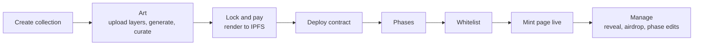

# Cobweb Launchpad (KingdomlyLite)

A no-code, permissionless NFT launchpad. A creator arrives, launches one collection, and manages it. This is a rebuild of Kingdomly as the lightest version we can run: about $60 to $80 a month fixed, with AWS cut down to Lambda, SQS and S3 for art rendering.

**Status:** Phase 0 done. The workspace is scaffolded with empty packages; no application code yet. Next are contracts (Phase 1) and the web shell (Phase 2).

## The product

One linear flow, no side doors:



The old app let creators build art projects and drop contracts separately and wire them together by hand. That flexibility is gone on purpose: a collection owns its art, its contract and its mint page.

**In v1:** create collection, generate art from layers, deploy, phases, whitelist, mint page, reveal, airdrops, phase edits.

**Not in v1:** marketplace, inventory, bridge launchpad, staking, Discord/X/email gates, merkle whitelists, partner codes, embeds, whitelist applications.

## Architecture

| Piece                             | Runs on                            | Job                                                                  |
| --------------------------------- | ---------------------------------- | -------------------------------------------------------------------- |
| Web app (dashboard and mint page) | Next.js on Vercel                  | Creator flow; mint page                                              |
| Database, auth, job queue         | Supabase                           | Postgres with row-level security, Sign in with Ethereum              |
| Contracts                         | Any EVM chain                      | Factory, collection (ERC721AC), payments                             |
| Freshness server                  | Node on Railway, behind Cloudflare | The only reader of chain state for mint pages                        |
| Render pipeline                   | AWS SQS and Lambda                 | Composites 100 tokens per batch with sharp, uploads CARs to Filebase |
| Layer storage                     | S3, CloudFront for thumbnails      | Source layers only                                                   |

Full detail, costs and the reasoning are in [docs/PLAN.md](docs/PLAN.md).

## Planned layout

```
apps/web           Next.js app: creator dashboard and mint page
apps/freshness     Railway service: chain polling, quota batching, HTTP with ETag
services/render    Render and metadata Lambdas, SQS wiring
contracts/         Foundry: factory, collection, payments
packages/dna       Trait assignment engine, shared by browser and server
packages/ui        Component library: shadcn components themed with the shared tokens
packages/shared    Types, ABIs, chain config
supabase/          Migrations and policies
docs/              Plan, master plan, legacy context
legacy/            Old Kingdomly repos, reference only, not in git
```

The packages are empty stubs; each is filled in phase by phase in the master plan.

## Commands

```
pnpm install
pnpm typecheck | lint | test | build     # all packages, through Turborepo
pnpm format                               # Prettier
cd contracts && forge test                # contracts
```

## Docs

| Doc                                            | What it is                                                    |
| ---------------------------------------------- | ------------------------------------------------------------- |
| [docs/PLAN.md](docs/PLAN.md)                   | The source plan: scope, locked decisions, costs, revenue      |
| [docs/MASTER_PLAN.md](docs/MASTER_PLAN.md)     | Build order, exit criteria per phase, decisions still needed  |
| [docs/legacy/README.md](docs/legacy/README.md) | Index of the legacy context docs: what to lift and from where |
| [docs/SKILLS.md](docs/SKILLS.md)               | Claude Code skills worth building for this repo               |

## Rules that hold everywhere

These come from the locked decisions and from bugs found in the legacy code.

1. **Liveness comes from the chain.** A phase is live when the contract's `mintGroupActive` view says so. The mint button never opens on the browser clock or on an event.
2. **Simulate, then send the simulated request.** The wallet opens only after `simulateContract` passes.
3. **Mint pages never call an RPC for shared state.** They poll the freshness server through Cloudflare.
4. **Every server action checks the session and ownership.** The legacy app checked neither.
5. **Fees are flat native amounts snapshotted at deploy.** No oracle. Admin can lower a snapshot, never raise it.
6. **Render jobs run only when `paid` or `waived`.**
7. **`legacy/` is read-only reference.** Lift from it using the context docs; never import from it, and never commit it (it contains secrets).
