# Cobweb Launchpad

Cobweb is a no-code, permissionless NFT launchpad. A creator arrives, launches one collection through one linear flow (Details, Art, Lock and upload, Deploy, Manage drop) and runs the mint from the same place. It is a rebuild of Kingdomly as the lightest version we can run: about $70 a month at rest, with no AWS. Art renders on Vercel Functions fed by Vercel Queues, and layers sit in Cloudflare R2 behind its S3 protocol.

**Status as of 27 October 2026:** built and verified locally from end to end. The contracts, the web app, the render pipeline, the freshness server and the indexer all exist, and sixteen `verify:*` scripts in `apps/web` exercise them against local Supabase, local storage, Anvil and the freshness server (the full list is in [CLAUDE.md](CLAUDE.md#commands)). The hosted stack is Vercel (app and render), Railway (freshness server), Supabase (Postgres and auth), Cloudflare (edge cache, R2 and Turnstile) and Filebase (IPFS); the owner-side hosted steps are listed in [docs/MASTER_PLAN.md](docs/MASTER_PLAN.md). Version 1 launches on Robinhood Chain first. Nothing is deployed to a mainnet yet and the contracts have had an internal review, not an external audit. See [Build status](#build-status).

## Contents

- [What it looks like](#what-it-looks-like)
- [The product](#the-product)
- [Architecture](#architecture)
- [Engineering worth reading](#engineering-worth-reading)
- [Security](#security)
- [Repository layout](#repository-layout)
- [Getting started](#getting-started)
- [Services we pay for](#services-we-pay-for)
- [Libraries and tools](#libraries-and-tools)
- [Contracts in brief](#contracts-in-brief)
- [How we make money](#how-we-make-money)
- [Rules that hold everywhere](#rules-that-hold-everywhere)
- [Working with the legacy code](#working-with-the-legacy-code)
- [Build status](#build-status)
- [Further reading](#further-reading)

## What it looks like

These are screenshots of the running app in flow order, taken against local Supabase in sample mode (`NEXT_PUBLIC_DEMO_DATA=1`), where screens past Details show sample data and no factory is needed. The app ships a dark theme only.

**1. Details.** Name, symbol and type of the collection; frozen once the art is locked.

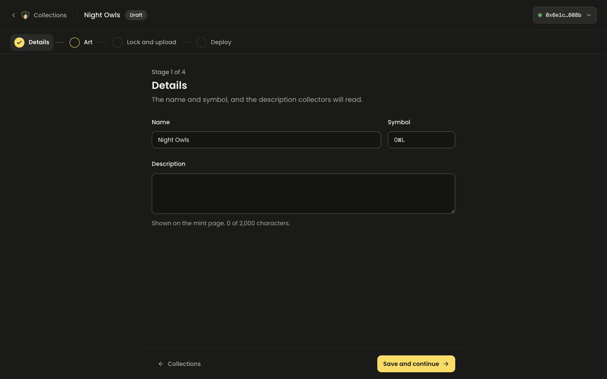

**2. Art, layers.** Upload trait layers, order them, set rarity weights and preview a token live.

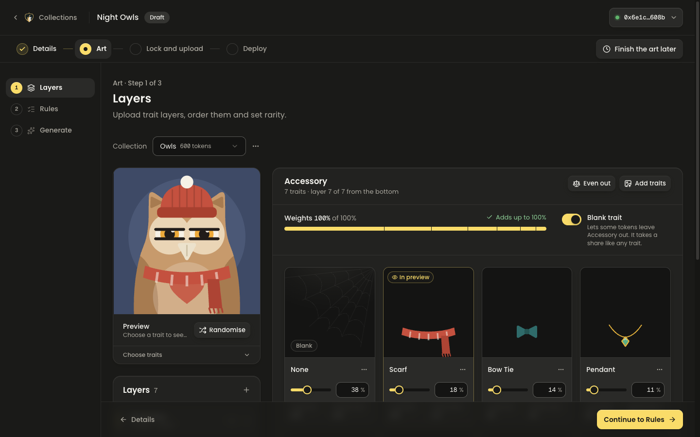

**3. Art, rules.** Pairing rules between traits, with a conflict reported when two rules cannot both apply.

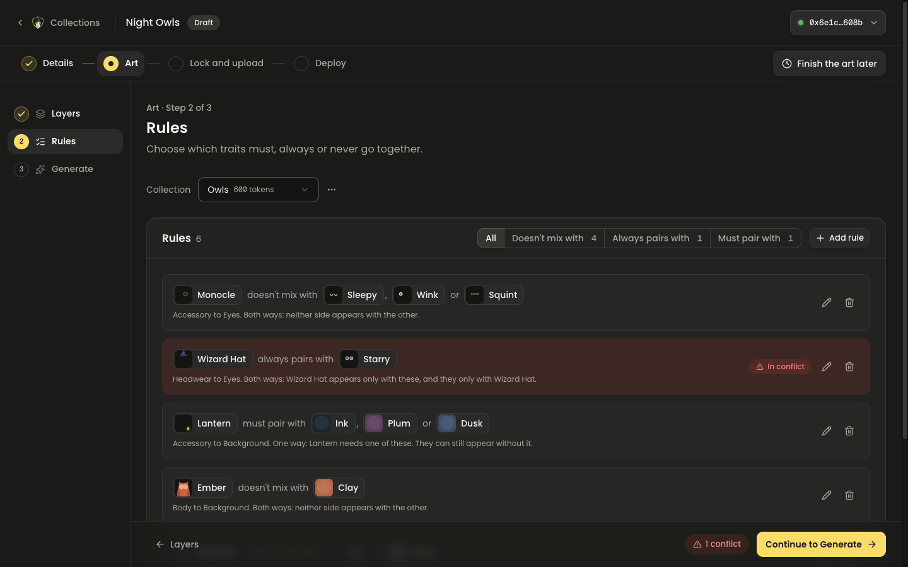

**4. Art, generate.** The trait engine generates the whole collection in the browser for free, with rarity tiers, curation and statistics.

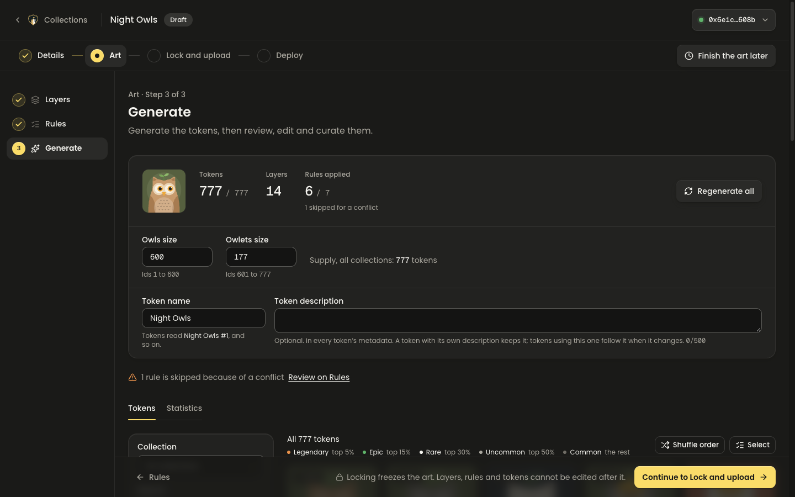

**5. Lock and upload.** Lock hashes the token list, then the creator pays the generation fee through the factory; the render starts once the payment is confirmed on chain.

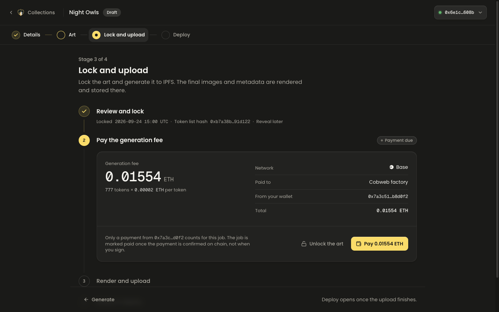

**6. Deploy.** Chain, contract settings and launch phases, deployed from the creator's wallet through the factory.

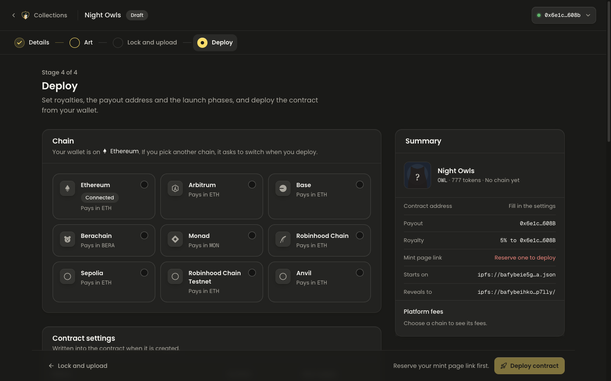

**7. Manage drop, overview.** The deployed collection's state read from the chain, with mint and holder activity from the indexer.

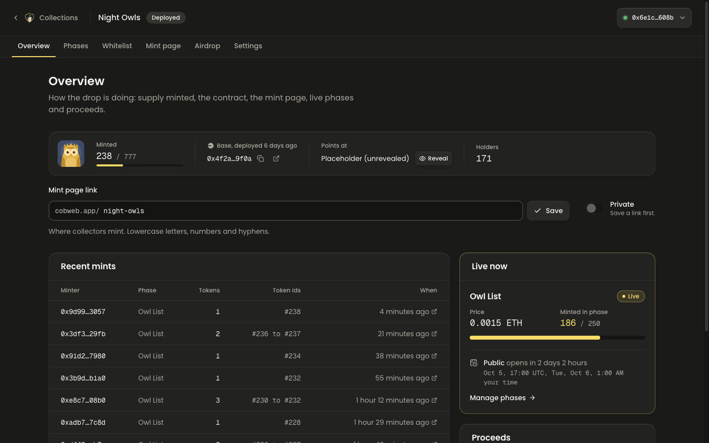

**8. Manage drop, phases.** Price, supply allocation and schedule per phase; liveness shown is the contract's `mintGroupActive`.

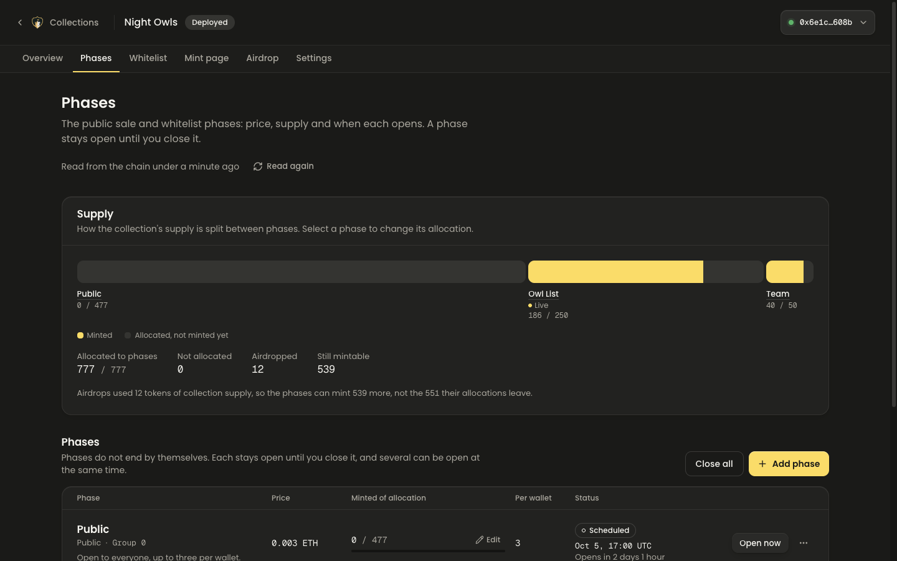

**9. Manage drop, whitelist.** The allowlist for a phase, written on chain in chunks.

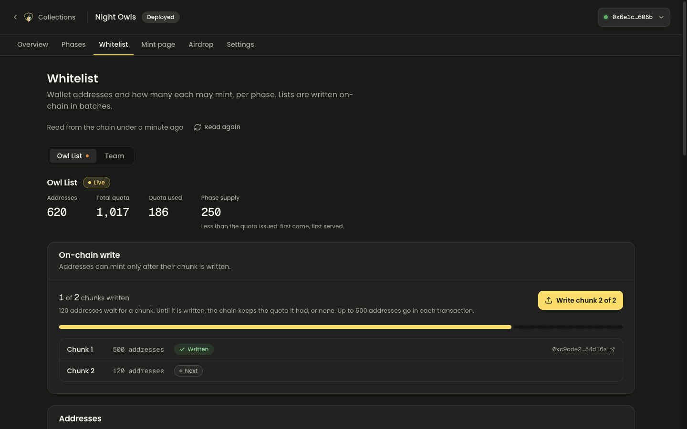

**10. Manage drop, airdrop.** Batches of airdrops and burns, each proven from its receipt.

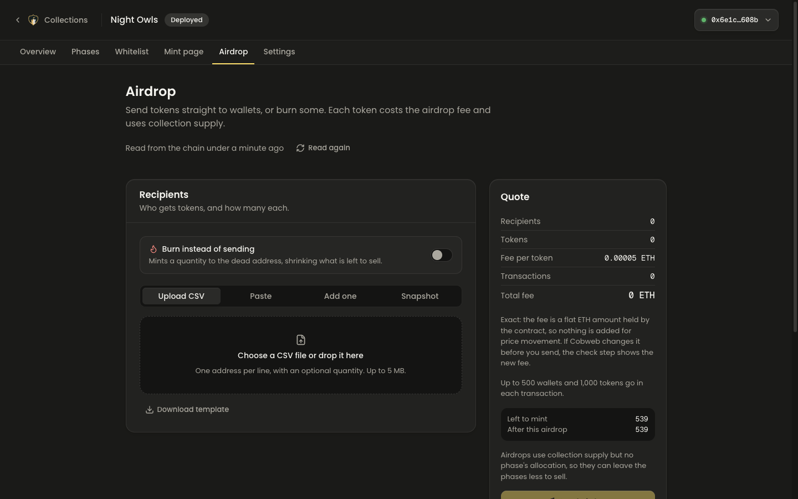

**11. Manage drop, settings.** Royalties, payout address, transfer security level and the other contract settings.

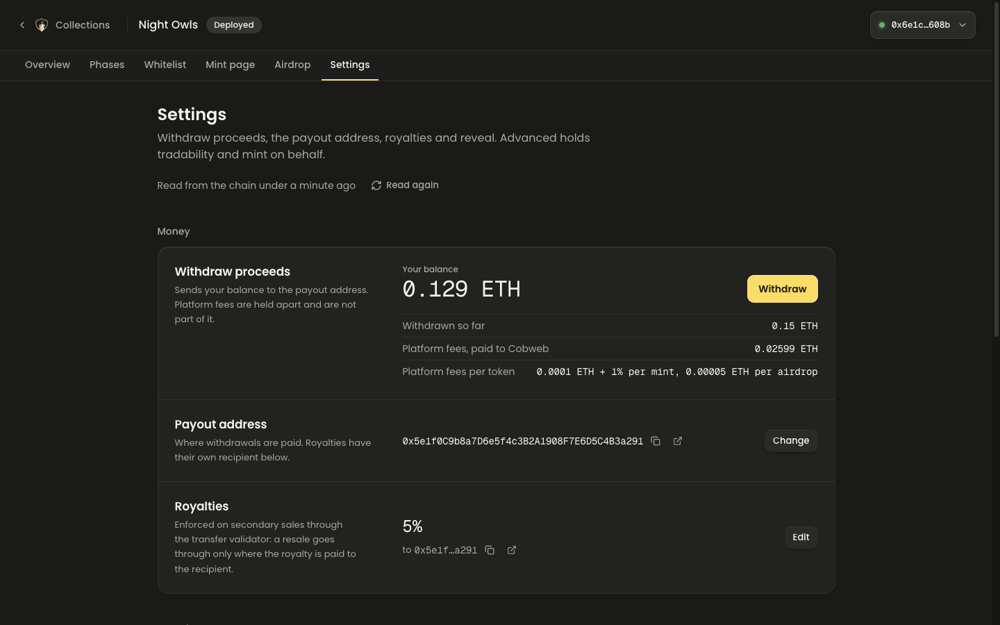

**12. Manage drop, mint page.** The editor for the public page, with a live preview beside it.

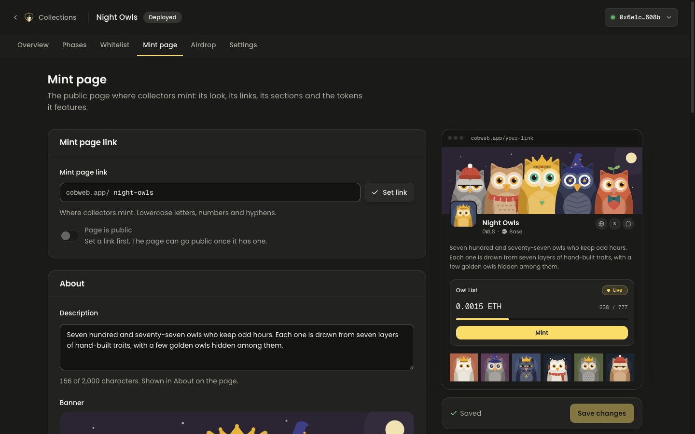

**13. The public mint page.** What a collector sees, polling the freshness server for shared state. The wallet is connected on the collection's chain, so the primary button is live.

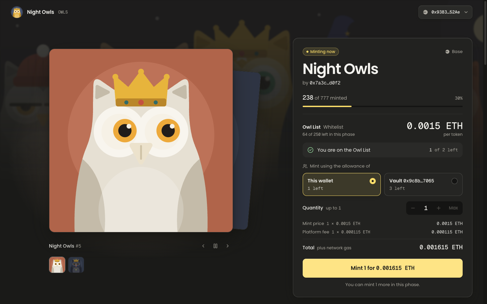

## The product

One linear flow, no side doors:

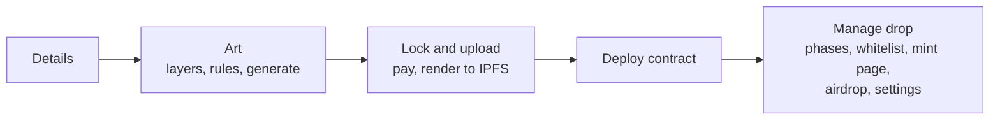

The first four stages happen once and in order. Manage drop is where the creator stays afterwards: everything about running the mint lives there as tabs, not as further steps.

Unlike the legacy app, art projects and drop contracts are not built separately and wired together by hand: a collection owns its art, its contract and its mint page.

**In v1:** create collection, generate art from layers, deploy, phases, whitelist, mint page, reveal, airdrops, phase edits.

**Not in v1:** marketplace, inventory, bridge launchpad, staking, Discord/X/email gates, merkle whitelists, partner codes, embeds, whitelist applications.

**Launch chains:** Ethereum, Arbitrum, Base, Berachain, Monad, Robinhood Chain.

## Architecture

There are two sides, and they share only the chain. The Create side costs money only while a job runs. The Mint side is cached at the edge, so the number of viewers never reaches our servers.

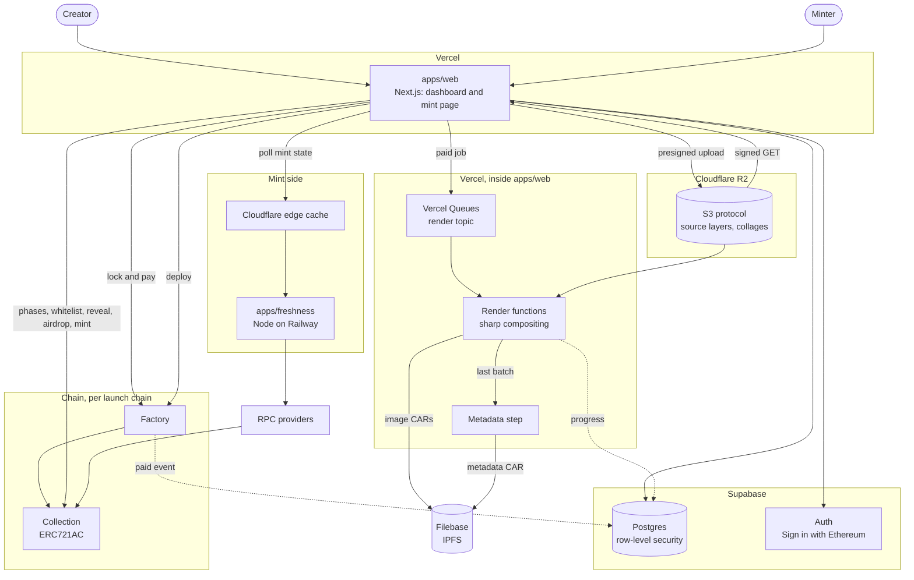

| Piece             | Code                                 | Runs on                                               | Job                                                               |
| ----------------- | ------------------------------------ | ----------------------------------------------------- | ----------------------------------------------------------------- |
| Web app           | `apps/web`                           | Vercel                                                | Creator dashboard and the public mint page                        |
| Database and auth | `supabase/`                          | Supabase                                              | Postgres with row-level security, Sign in with Ethereum, job rows |
| Contracts         | `contracts/`                         | Each launch chain                                     | Factory and collection                                            |
| Freshness server  | `apps/freshness`                     | Railway, behind Cloudflare                            | The only reader of chain state for mint pages, and the indexer    |
| Render pipeline   | `services/render`, `services/worker` | Vercel Functions and Vercel Queues, inside `apps/web` | Composites tokens, packs CARs, uploads to Filebase                |
| Layer storage     |                                      | Cloudflare R2, over the S3 protocol                   | Source layers, their thumbnails and preview collages              |
| Trait engine      | `packages/dna`                       | Browser and server                                    | Picks traits for each token; validates the final list at lock     |
| Component library | `packages/ui`                        |                                                       | shadcn components themed with our tokens                          |

### Art pipeline

Only source layers and preview collages touch storage (R2, over the S3 protocol). Rendered images go from a render function's memory straight to Filebase, one batch at a time.

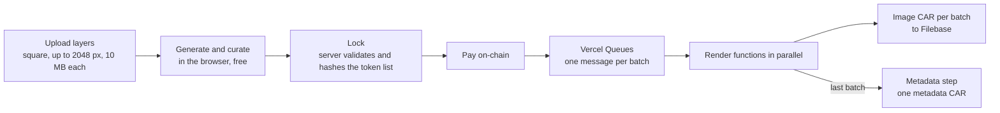

- The browser generates and edits the collection for free. Nothing is rendered until the creator pays.
- At lock the browser submits the final token list. The server checks it against the project's rules, stores it and hashes it. That stored list is what gets rendered.
- A job runs only when its row is `paid` (from the factory's payment event) or `waived` (admin only, logged).
- Failed batches retry through Vercel Queues; the third failed delivery fails the job with dead-letter. The last batch to finish flips the job to `finalizing` exactly once.
- A re-run of the same job must produce the same CIDs, so metadata carries no timestamps.

### Mint day traffic

Each layer shrinks what reaches the next one.

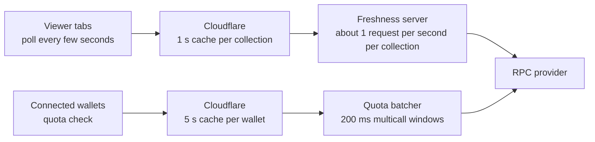

The freshness server polls each chain on a tiered schedule (slow when idle, fast around a phase start), keeps one logs subscription per chain, and serves cached JSON with ETags. The mint page never calls an RPC for shared state. The mint transaction itself goes from the minter's wallet to the chain and never touches our servers.

## Engineering worth reading

Seven decisions, each with the code that holds it. Line links point at the files as they stand on 27 October 2026.

### a. Identical collection bytecode, and a CREATE2 prediction pinned to the factory's own view

Every collection is a full contract, not a proxy, and its runtime bytecode is the same on every deploy: no per-collection immutables, no hard-coded per-chain addresses (rule 7 below). Per-collection values are constructor arguments written to storage, so a block explorer verifies the code once per chain and every later collection matches. The factory deploys only creation code whose hash an admin approved, and salts each deploy with the deployer's address, so nobody can take another creator's address ([`CobwebFactory.sol:104-120`](contracts/src/CobwebFactory.sol#L104-L120)). `test_deploy_runtimeBytecodeIsIdenticalAcrossCollections` holds the bytecode claim ([`CobwebFactory.t.sol:80`](contracts/test/CobwebFactory.t.sol#L80)).

The web app predicts the address before the creator signs anything. Its TypeScript prediction is checked in a unit test against a vector taken from the factory's own `predictCollectionAddress` view ([`deploy-address.test.ts:95-105`](packages/shared/src/deploy-address.test.ts#L95-L105)), and after the receipt the deploy flow confirms the `CollectionDeployed` event against the predicted address before it records anything.

```ts
export function predictCollectionAddress(input: {
  factory: Address; deployer: Address; salt: Hex; creationCode: Hex; args: Hex
}): Address {
  const finalSalt = keccak256(
    encodeAbiParameters([{ type: 'address' }, { type: 'bytes32' }], [input.deployer, input.salt]),
  )
  return getContractAddress({
    opcode: 'CREATE2',
    from: input.factory,
    salt: finalSalt,
    bytecodeHash: keccak256(concatHex([input.creationCode, input.args])),
  })
}
```

Source: [`packages/shared/src/deploy-address.ts:79-95`](packages/shared/src/deploy-address.ts#L79-L95), condensed to one-line parameters. The creation code the app ships is generated from the Foundry build and its hash is asserted against `contracts/out` in CI ([`contracts/README.md`](contracts/README.md#build-test-deploy)).

### b. Liveness comes from the chain, never the clock

Whether a phase is open is a single view, `mintGroupActive`, used by every mint path. A group is live if its flag is on, or if a start is scheduled and the block timestamp has reached it. There is no end time and no global switch; closing a group clears its schedule so an old timestamp cannot reopen it.

```solidity
function mintGroupActive(uint256 mintGroup) public view returns (bool) {
    if (s_mintGroupActive[mintGroup]) return true;
    uint256 start = s_mintGroupStartTimestamp[mintGroup];
    return start != 0 && block.timestamp >= start;
}
```

Source: [`contracts/src/CobwebCollection.sol:604-608`](contracts/src/CobwebCollection.sol#L604-L608). Off chain, the same value travels as the `active` field of `collectionState()` ([`collection-state.ts:19`](packages/shared/src/collection-state.ts#L19)); the freshness server and the dashboard copy it and never compute it. The tiers only decide when to read the chain ([`tiers.ts:4-6`](apps/freshness/src/tiers.ts#L4-L6)). Invariant 10 (`invariant_liveOnlyByFlagOrStart`) holds the rule over random schedules with time moving, and mutations that honour a start a second early or late both fail it (M11 and M17 in the [contract review](docs/reference/contract-review-2026-10.md#5-invariants)).

### c. Simulate, then send the simulated request

The wallet opens only after `simulateContract` passes, and the wallet receives the request the simulation returned, not a rebuilt one. The mint page and every Manage drop action share the shape:

```ts
simulate: async (call: MintCall) => {
  const simulated = await simulateContract(config, { ...call })
  // CLAUDE.md rule 2: the wallet gets exactly the request the simulation passed.
  return () => writeContract(config, simulated.request)
},
```

Source: [`apps/web/src/lib/mint/wagmi-chain.ts:83-87`](apps/web/src/lib/mint/wagmi-chain.ts#L83-L87); the Manage drop version is at [`manage-actions.ts:61-71`](apps/web/src/components/manage/manage-actions.ts#L61-L71). A transaction that would revert is refused with the contract's custom error before the wallet prompt, and the confirmed state is read back from the receipt and the chain, not from the browser. Each `verify:*` script that sends a transaction does so through the same path.

### d. The freshness server: tiered polling, ETags, and the edge in front

`apps/freshness` is one Node service that reads every chain whose `RPC_URL_<id>` and `FACTORY_ADDRESS_<id>` are set, over HTTP only. Per chain and tick it makes one `eth_getLogs` and one multicall at a single block over the collections requested in the last 10 minutes. The tick rate depends on the chain: every 1 s from 15 s before a scheduled start to 30 s after it, every 2 s while a phase is live, every 20 s otherwise ([`tiers.ts:9-14`](apps/freshness/src/tiers.ts#L9-L14), [`tiers.ts:27-41`](apps/freshness/src/tiers.ts#L27-L41)). It reads no database. Mint pages poll it with their stored `If-None-Match`, so an unchanged state is a 304 ([`fresh-client.ts`](apps/web/src/lib/mint/fresh-client.ts)), and no page calls an RPC for shared state.

Cloudflare sits in front of the freshness domain and caches by the origin's own headers: a state for 1 s, a wallet for 5 s, a refusal for 10 s. The edge reads `Cloudflare-CDN-Cache-Control` first, because given `s-maxage` Cloudflare turns `stale-while-revalidate` off and ignores `stale-if-error`.

```ts
export const STATE_CACHE = 'public, max-age=0, s-maxage=1, stale-while-revalidate=1, stale-if-error=60'
export const WALLET_CACHE = 'public, max-age=0, s-maxage=5'
export const REFUSAL_CACHE = 'public, max-age=0, s-maxage=10'
// in stateAnswer:
const headers = {
  ETag: etag,
  'Cache-Control': STATE_CACHE,
  'Cloudflare-CDN-Cache-Control': 'max-age=1, stale-while-revalidate=1, stale-if-error=60',
  ...CORS,
}
```

Source: [`apps/freshness/src/routes.ts:25-27`](apps/freshness/src/routes.ts#L25-L27) and [`routes.ts:107-112`](apps/freshness/src/routes.ts#L107-L112). The load profile (k6) and the edge check are scripts, not claims: `verify:load` runs the polling profile against the server in process on Anvil, and `check:edge` proves the Cloudflare zone from outside in 13 checks ([`docs/reference/cloudflare-setup.md`](docs/reference/cloudflare-setup.md)). The hosted 20,000-poller run is the owner's and has not been run yet.

### e. Repeatable CIDs: integer blending, so x64 and arm64 agree

A re-run of a render job must produce the same CIDs, because the worker asserts its locally computed CID against the pinning service's answer. libvips blends in floating point, which rounds differently on x64 and arm64, so `@cobweb/render` composites layers itself in integer arithmetic over raw RGBA and uses sharp only to decode and encode. Metadata carries no timestamps for the same reason.

```ts
const div255 = (x: number): number => Math.trunc((x + 127) / 255)

export function blendOver(dst: Uint8Array, src: Uint8Array, alpha: number): void {
  for (let i = 0; i < dst.length; i += 4) {
    const as = div255(src[i + 3]! * alpha)
    const wd = div255(dst[i + 3]! * (255 - as))
    const oa = as + wd
    for (let c = 0; c < 3; c++) {
      dst[i + c] = oa === 0 ? 0 : Math.trunc(((src[i + c]! * as + dst[i + c]! * wd) * 2 + oa) / (2 * oa))
    }
    dst[i + 3] = oa
  }
}
```

Source: [`services/render/src/blend.ts:7-23`](services/render/src/blend.ts#L7-L23). The golden batch CIDs are checked on darwin arm64 and on linux x64 under emulation ([`render.e2e.test.ts:6-8`](services/render/src/render.e2e.test.ts#L6-L8)); CI runs them on an x64 Ubuntu runner. The library is pure: no clock, environment, network or file-system access, with its dependencies pinned exactly.

### f. The token list is fixed at lock, and the art fee is paid on chain before any render runs

The browser generates the collection with `@cobweb/dna`, but nothing it produces is trusted. At lock the server re-validates the whole list against the project (ids 1 to N, sizes, well-formed DNA, rules, caps, uniqueness) with the same engine ([`validateTokenList`, `packages/dna/src/lock.ts:27`](packages/dna/src/lock.ts#L27)), hashes it, stores it and records the factory's art rate as a quote ([`lock-core.ts:256-292`](apps/web/src/lib/art/lock-core.ts#L256-L292)). That stored list is what gets rendered.

The creator then calls `payForArt(jobId)` on the factory. The server accepts the payment only by decoding the factory's `ArtPaid` log from the receipt and checking the emitter, the job id, the payer and the amount against the quote; payer and amount come from the log, never from the browser ([`art-paid.ts:19-45`](apps/web/src/lib/chain/art-paid.ts#L19-L45)). The render worker checks again before it claims a job, and fails closed:

```ts
// The payment is checked before the claim and fails closed. A waived job and a free one have
// nothing to check. A read error that outlasts the in-process retries throws out of here and the
// message is redelivered; a lagging node (PaymentUnproven) is such an error, never a verdict.
if (job.state === 'paid' && !job.waived && job.quoteTotalWei > 0n) {
  const paid = await retried(deps, 'payment', () => deps.chain.jobPayment(job))
  if (paid < job.quoteTotalWei) {
    await report(deps, message, null, PAYMENT_MISMATCH_CODE, PAYMENT_MISMATCH)
    return
  }
}
```

Source: [`services/worker/src/steps.ts:202-211`](services/worker/src/steps.ts#L202-L211). A third layer is in the database: a check constraint refuses any `render_jobs` row past `payment_due` that has no payment hash, no waiver and a non-zero quote ([`20261008010000_art_tables.sql:608-612`](supabase/migrations/20261008010000_art_tables.sql#L608-L612)).

### g. The indexer

The indexer runs inside the freshness server's process for every collection Cobweb deployed on a served chain, from its deploy block to the chain's confirmation depth, with a cursor per collection. It reads `Transfer`, the two mint events, `NFTsAirdropped` and `MintFundsWithdrawn` over at most 500 blocks a scan, and writes each log once through one service-role database function; replays, restarts and backfills are idempotent. It connects as `cobweb_indexer`, a login role that can execute its four functions and nothing else, over a pooled connection with verified TLS, so the Railway service holds no service-role key.

```ts
/** The most blocks one scan reads, the blocks it reads again included. */
export const MAX_RANGE = 500n

/**
 * The highest block buried under the chain's confirmations (the head counted): `head - confirmations + 1`,
 * never below 0.
 */
export function safeBlockOf(head: bigint, confirmations: number): bigint {
  const safe = head - BigInt(confirmations) + 1n
  return safe > 0n ? safe : 0n
}
```

Source: [`apps/freshness/src/indexer-plan.ts:9-10`](apps/freshness/src/indexer-plan.ts#L9-L10) and [`indexer-plan.ts:65-72`](apps/freshness/src/indexer-plan.ts#L65-L72). A scan also reads back a short window below its cursor, because the head and the logs can come from different nodes behind a load balancer and one can be a few blocks behind ([`indexer-plan.ts:11-18`](apps/freshness/src/indexer-plan.ts#L11-L18)). The state body carries holders and recent mints from the indexer's memory, so the request path still reads no database. `verify:indexer` checks mints, owners, airdrops and withdrawals once each, then a replay, a restart and a backfill.

## Security

What is enforced, and where. Every item below is in the code or in a document linked from it; nothing here depends on an operator remembering to do something, except where it says so.

**Database access.** Every one of the 22 tables created in [`supabase/migrations`](supabase/migrations) has row-level security enabled, and every server action checks the session and the owner (rule 4). Sessions are verified locally against the project's public signing keys ([`auth.ts:17-20`](apps/web/src/lib/auth.ts#L17-L20)); writes keep the auth server's own check, so a session signed out elsewhere is refused at once ([`auth.ts:44`](apps/web/src/lib/auth.ts#L44)). `verify:local` signs in with throwaway wallets and checks every access rule against the local database.

**Sign-in.** Sign in with Ethereum through Supabase Auth. The project signs sessions with asymmetric ES256 keys; the local stack uses a key of its own, generated by `supabase gen signing-key` and gitignored. Cloudflare Turnstile guards the sign-in button: its token travels with the signed message ([`sign-in-button.tsx:67-72`](apps/web/src/components/auth/sign-in-button.tsx#L67-L72)) and Supabase Auth verifies it before the signature. A wallet may hold at most 20 collections that are not deployed (`profiles.draft_cap`), enforced by a trigger under a lock per owner ([`20261017100000_production_hardening.sql`](supabase/migrations/20261017100000_production_hardening.sql)). The reasoning and the alternatives considered are in [the production hardening spec](docs/specs/2026-10-17-production-hardening.md).

**Content-Security-Policy.** The proxy ([`apps/web/src/proxy.ts`](apps/web/src/proxy.ts)) makes a fresh nonce for every request, discards any policy or nonce header a client sent, and sets a policy where scripts run only on that nonce and what `'strict-dynamic'` admits. The other directives list only the origins the app reads from its own settings ([`csp.ts`](apps/web/src/lib/security/csp.ts)). Violations post to a report endpoint ([`api/csp-report/route.ts`](apps/web/src/app/api/csp-report/route.ts)) and are logged one JSON line each through an allow-listed schema. `CSP_MODE` switches between enforce, report-only and off; unset, it is report-only on Vercel so the first hosted deploys report before they block, and moving to enforce is the owner's step. `verify:csp` checks a production build: a nonce on every page and script, the origins, report-only mode and the endpoint.

**Money.** Fees are flat native amounts snapshotted into the collection at deploy, read from the factory in the constructor; there is no oracle, and only a factory admin can change a deployed collection's fee. Render jobs run only when `paid` or `waived`: the payment is decoded from a receipt on chain, re-checked by the worker, and backed by a database constraint (see section f above).

**Contracts.** The October 2026 review is in [`docs/reference/contract-review-2026-10.md`](docs/reference/contract-review-2026-10.md): Slither 0.11.6 over both contracts with 22 findings from 15 of 102 detectors, none confirmed and every one triaged with a reason ([`slither.triage.md`](contracts/slither.triage.md)); a CI job that runs Slither on every push and pull request and fails on any medium or high finding the triage database does not hold ([`ci.yml:52-67`](.github/workflows/ci.yml#L52-L67)); 13 invariants driven by 31 handler actions, each shown to fail against a deliberate mutation of the contracts; the deep run of 1,000 runs at depth 1,000 (1,000,000 calls per invariant), all 100 tests passing; and about 96% line coverage on the collection and 97% on the factory. The review changed no contract. It is not an external audit: the external look is the owner's decision before mainnet, with the review as its brief, and the review's section 7 lists what is still owed.

**Secrets.** Nothing sensitive is in the repository. A gitleaks scan of all 469 commits on 27 October 2026 found no leaks. `.env` files (except `.env.example`), the local signing key and the `legacy/` folder of old repositories are gitignored ([`.gitignore`](.gitignore)). The indexer's database role holds no service-role key, and cron endpoints answer only a bearer secret.

**Storage hygiene.** Two cron sweeps keep storage honest, both dry-running until their delete switch is set: the upload sweep removes objects over a day old that no row records ([`upload-sweep`](apps/web/src/app/api/cron/upload-sweep/route.ts), `verify:sweep`), and the source sweep removes a collection's original art files 90 days after both its deploy and its last real render, keeping thumbnails, the IPFS art, the metadata and every row ([`source-sweep`](apps/web/src/app/api/cron/source-sweep/route.ts), `verify:sources`).

## Repository layout

```
apps/web           Next.js app: creator dashboard, mint page, and the render queue consumer and sweep crons (Vercel)
apps/freshness     Railway service: chain polling, quota batching, HTTP with ETag, and the indexer
services/render    Render library: layers to images, CARs and CIDs (pure; no network)
services/worker    Render worker: ports, steps, adapters, queue consumer, local runner. Runs inside apps/web on Vercel
contracts/         Foundry: factory and collection
packages/dna       Trait assignment engine, shared by browser and server
packages/ui        Component library: shadcn components themed with the shared tokens
packages/shared    Chain config, factory and collection ABIs, job ids, the render queue contract, pure chain readers, viem clients
supabase/          Migrations and policies
docs/              Plan, master plan, specs, plans, legacy context, reference contract and reviews
legacy/            Old repos. Reference only, not in git
```

## Getting started

You need:

- Node 22 or newer (the freshness server runs from source on Node 24)
- pnpm 10
- [Foundry](https://book.getfoundry.sh/getting-started/installation) for the contracts

```
git submodule update --init --recursive   # contract libraries
pnpm install

pnpm typecheck      # all packages, through Turborepo
pnpm lint
pnpm test
pnpm build
pnpm format         # Prettier, write
pnpm format:check   # Prettier, check only

cd contracts
forge build --sizes
forge test
```

CI runs the same commands on every pull request and on pushes to `main` (`.github/workflows/ci.yml`), plus the Slither job described under [Security](#security).

**Environment variables.** Each package that needs them has a `.env.example` beside it (`apps/web`, `apps/freshness`, `contracts`). Real `.env` files are never committed.

### Running the web app locally

You also need Docker and the [Supabase CLI](https://supabase.com/docs/guides/local-development).

```
(umask 077 && echo '[]' > supabase/signing_keys.json) && supabase gen signing-key --algorithm ES256 --yes   # once, before the first start
supabase start                      # local Postgres, auth and API, in Docker
supabase status                     # prints the API URL and publishable key
supabase seed buckets               # the local art, render and mint-page buckets
cp apps/web/.env.example apps/web/.env.local   # then paste those two values in
pnpm --filter @cobweb/web dev       # http://localhost:3000
```

- The local Supabase uses ports 55320 to 55329, so it can run beside another Supabase project on the default ports.
- `supabase db reset` re-applies the migrations to a clean local database.
- `NEXT_PUBLIC_DEMO_DATA=1` in `.env.local` turns on sample mode: every stage past Details opens on sample data without a factory, which is how the screenshots above were taken.
- `pnpm --filter @cobweb/web chain:local` starts Anvil with the factory deployed and prints the `.env.local` lines for real transactions.
- A browser-extension wallet is enough to sign in locally, and `apps/web/scripts/dev-wallet` signs in from a headless browser without one. WalletConnect needs a project id in `.env.local`.
- The full list of `verify:*` commands, what each checks and when to run it is in [CLAUDE.md](CLAUDE.md#commands). Run `verify:local` after any change to `supabase/migrations`.

**Branches.** Work on a branch and open a pull request into `main`.

**Working with Claude Code.** `CLAUDE.md` holds the repo rules an AI agent must follow. `docs/SKILLS.md` lists the project skills worth building.

## Services we pay for

Fixed cost at rest is about $68 to $78 a month. Figures come from [docs/PLAN.md](docs/PLAN.md), which has the reasoning and the busy-month scenarios.

| Service         | What we use it for                                    | Plan        | Monthly                                        |
| --------------- | ----------------------------------------------------- | ----------- | ---------------------------------------------- |
| Vercel          | Hosts `apps/web`                                      | Pro         | $20                                            |
| Supabase        | Postgres, auth, storage                               | Pro         | $25                                            |
| Railway         | Hosts `apps/freshness`                                | Usage-based | $15 to $25 once always-on                      |
| Filebase        | IPFS pinning for images and metadata                  | Paid plan   | $7                                             |
| Vercel (render) | Render functions and Vercel Queues, inside `apps/web` | Pro, usage  | About $1.50 of compute per 10,000-token render |
| Domain          |                                                       |             | $1 to $2                                       |

Free tiers we depend on:

| Service                 | What we use it for                                | When it starts to cost                                 |
| ----------------------- | ------------------------------------------------- | ------------------------------------------------------ |
| Cloudflare              | Edge cache in front of the freshness server       | Not expected                                           |
| RPC provider            | Chain reads from the freshness server             | About $50 a month once several chains are busy at once |
| Cloudflare R2           | Layers and preview collages, over the S3 protocol | Past the free storage allowance; no egress charge      |
| GitHub                  | Code and CI                                       | Not expected                                           |
| WalletConnect project   | Wallet connections through RainbowKit             | Not expected                                           |
| Block explorer API keys | Contract verification, once per chain             | Free                                                   |

One-time costs: gas to deploy and verify the factory on each chain.

What grows with success, in the order we would feel it: Filebase storage as collections accumulate, RPC once several chains are hot together, Supabase egress, Vercel bandwidth after a viral drop. Each is a plan upgrade, not a design change.

## Libraries and tools

| Area      | Library                                        | Used for                                                                          |
| --------- | ---------------------------------------------- | --------------------------------------------------------------------------------- |
| Tooling   | pnpm workspaces, Turborepo                     | Monorepo and task running                                                         |
| Tooling   | TypeScript 6                                   | Pinned to 6 until typescript-eslint supports 7                                    |
| Tooling   | ESLint, typescript-eslint, Prettier            | Lint and format                                                                   |
| Tooling   | Vitest                                         | Unit tests                                                                        |
| Tooling   | k6                                             | The freshness server's load profiles                                              |
| Contracts | Foundry, Solidity 0.8.30                       | Build, test (including invariants), deploy                                        |
| Contracts | Slither                                        | Static analysis with a triage database, in CI                                     |
| Contracts | Limit Break creator-token-standards (ERC721AC) | Collection base, transfer validator, locking                                      |
| Contracts | OpenZeppelin Contracts                         | Ownable, AccessControl, ERC2981 royalties, ReentrancyGuard                        |
| Contracts | delegate.xyz registry                          | Delegated minting                                                                 |
| Web       | Next.js, React                                 | `apps/web`                                                                        |
| Web       | Tailwind CSS, shadcn/ui                        | Styling and `packages/ui`                                                         |
| Web       | Motion, dnd-kit                                | Animation, layer reordering                                                       |
| Web       | RainbowKit, wagmi, viem                        | Wallet connection and contract calls                                              |
| Web       | Supabase JS and SSR client                     | Database access and sessions                                                      |
| Render    | sharp                                          | Decoding and encoding; compositing itself is integer arithmetic in `blend.ts`     |
| Render    | `@ipld/unixfs`, `@ipld/car`                    | CAR packing, with the CID computed locally and asserted against Filebase's answer |
| Render    | AWS SDK (S3 client)                            | Presigned uploads and storage reads over the S3 protocol (Supabase Storage, R2, Filebase) |
| Render    | Vercel Queues (`@vercel/queue`)                | Render job fan-out                                                                |
| Freshness | viem                                           | Multicall, logs, and the indexer's reads                                          |

## Contracts in brief

Full documentation, diagrams and a function-by-function reference are in [contracts/README.md](contracts/README.md).

Two contracts per chain:

- **Factory.** Deploys a full collection contract with CREATE2, with no proxies. The creation code arrives in calldata and is checked against an allowlisted hash. The factory holds the per-chain platform fees and takes the art-generation payment, emitting the event that marks a render job as paid.
- **Collection.** ERC721AC with mint groups, modelled on [docs/reference/TheSuits.sol](docs/reference/TheSuits.sol). Runtime bytecode is identical across deploys, so explorer verification happens once per chain.

How minting works:

- **Mint groups.** Group 0 is public; the others are allowlist groups. Each has a price, a supply allocation, an open/closed flag and an optional scheduled start.
- **Liveness.** A group is live if its flag is on, or if a start is scheduled and the block timestamp has reached it. There is no end time and no global switch. The creator closes a group by hand.
- **Limits.** Public has a per-wallet cap. Allowlist groups use a per-address quota, written on-chain from a CSV in chunks of 500 addresses.
- **Fees.** Flat native amounts set by the admin on the factory and snapshotted into each collection at deploy. No price oracle. Only the factory admin can change a deployed collection's fee, up or down.
- **Also supported.** Reveal, airdrops (a burn is an airdrop to the dead address), delegated minting that lands in the hot wallet, mint on behalf, royalties, and locking transfers through the ERC721AC transfer validator.

## How we make money

All three streams are collected on-chain in the chain's native token.

| Stream                    | Who pays | When                                   |
| ------------------------- | -------- | -------------------------------------- |
| Art generation, per token | Creator  | At lock, through the factory           |
| Airdrop, per token        | Creator  | At airdrop, through the collection     |
| Mint fee, per token       | Minter   | At mint, on top of the creator's price |

The rates are in [docs/PLAN.md](docs/PLAN.md). Open decisions are listed in [docs/MASTER_PLAN.md](docs/MASTER_PLAN.md#open-decisions).

## Rules that hold everywhere

These come from the plan's locked decisions and from bugs found in the legacy code.

1. **Liveness comes from the chain.** A phase is live when the contract's `mintGroupActive` view says so. The mint button never opens on the browser clock or on an event.
2. **Simulate, then send the simulated request.** The wallet opens only after `simulateContract` passes.
3. **Mint pages never call an RPC for shared state.** They poll the freshness server through Cloudflare.
4. **Every server action checks the session and ownership,** and every table has row-level security. The legacy app had neither.
5. **Fees are flat native amounts snapshotted at deploy.** No oracle. Only the factory admin can change a deployed collection's fee.
6. **Render jobs run only when `paid` or `waived`.**
7. **Contracts keep identical runtime bytecode across deploys.** No per-collection immutables, no hard-coded per-chain addresses.
8. **`legacy/` is read-only reference.** Never import from it and never commit it; it contains secrets.

Design conventions:

- The product name is Cobweb.
- Dark theme on a neutral warm gray with a yellow accent, in Poppins. Colours come from tokens, never hard-coded values.
- All UI is built from shadcn components in `packages/ui`. A screen ported from the old app keeps its layout and structure. Respect what the old screen could do, but take a better or simpler route where one exists, and note what changed.

## Working with the legacy code

Three old repos sit in `legacy/` on the machines of people who have them. They are not in this repository, and neither are the context docs below: the `.gitignore` rule for `legacy/` also matches `docs/legacy/`, so those docs stay on the machines that have them.

| Legacy repo                                | What we take from it                                    | Context doc                                                                                                                                                         |
| ------------------------------------------ | ------------------------------------------------------- | ------------------------------------------------------------------------------------------------------------------------------------------------------------------- |
| `KingdomlyMarket` (Next.js frontend)       | Layout, screens, the art generator and its trait engine | [design system](docs/legacy/market-design-system.md), [creator flow](docs/legacy/market-creator-flow.md), [mint page and data](docs/legacy/market-mint-and-data.md) |
| `KingdomlyMasterContractFactory` (Foundry) | The factory's deploy path, test structure               | [contracts](docs/legacy/contracts.md)                                                                                                                               |
| `ArtGenLambda` (serverless)                | sharp compositing, multi-collection handling            | [art pipeline](docs/legacy/artgen-lambda.md)                                                                                                                        |

Before porting anything, open the matching context doc: it says which files implement a feature, what to change and what to leave behind. Start at `docs/legacy/README.md`.

## Build status

Each phase's tasks, exit criteria and status line are in [docs/MASTER_PLAN.md](docs/MASTER_PLAN.md); this table is the summary.

| Phase | Area                                     | State                                                                                                                                  |
| ----- | ---------------------------------------- | -------------------------------------------------------------------------------------------------------------------------------------- |
| 0     | Scaffold: workspace, packages, CI        | Done                                                                                                                                   |
| 1     | Contracts: factory, collection           | Done, except the testnet deploy and verification, which need a funded deployer wallet, an RPC URL and an explorer key                  |
| 2     | Web shell, auth and schema               | Done locally                                                                                                                           |
| 3     | Art generator: trait engine, upload, lock and pay | Complete                                                                                                                      |
| 4     | Render pipeline: Vercel Queues, Vercel Functions, Filebase | Complete                                                                                                                     |
| 5     | Deploy and manage: phases, whitelist, airdrop, settings | In progress per the master plan; each sub-project is built and has its own `verify:*` script                                  |
| 6     | Freshness server, mint page on live data, indexer | In progress per the master plan; built and verified locally, hosted service and edge steps owed to the owner                  |
| 7     | Hardening and launch                     | In progress: production hardening, the load run profiles, the contract review and Cloudflare in front are done in code; the hosted deploys, the hosted load run, the external contract look and mainnet deploys are owed |

## Further reading

| Doc                                                                                    | What it is                                                                                                |
| -------------------------------------------------------------------------------------- | --------------------------------------------------------------------------------------------------------- |
| [docs/MASTER_PLAN.md](docs/MASTER_PLAN.md)                                             | Build order, exit criteria per phase, and every product decision. Where it differs from the plan, it wins |
| [docs/PLAN.md](docs/PLAN.md)                                                           | The source plan: scope, costs, revenue, load. Kept verbatim                                               |
| [docs/reference/contract-review-2026-10.md](docs/reference/contract-review-2026-10.md) | The contract review: Slither, the six-area reading, the invariants and their mutations                    |
| [docs/specs/2026-10-17-production-hardening.md](docs/specs/2026-10-17-production-hardening.md) | The CSP, the captcha, the session keys, the draft cap and the source lifecycle                    |
| [docs/reference/cloudflare-setup.md](docs/reference/cloudflare-setup.md)               | The Cloudflare zone, by hand, and what `check:edge` proves                                                |
| [docs/legacy/README.md](docs/legacy/README.md)                                         | Index of the legacy context docs                                                                          |
| [docs/reference/the-suits-mint-analysis.md](docs/reference/the-suits-mint-analysis.md) | How the reference contract mints, and what to fix when porting it                                         |
| [docs/SKILLS.md](docs/SKILLS.md)                                                       | Claude Code skills worth building for this repo                                                           |
| [CLAUDE.md](CLAUDE.md)                                                                 | Rules for AI agents working in this repo, and every command                                               |
