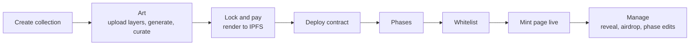
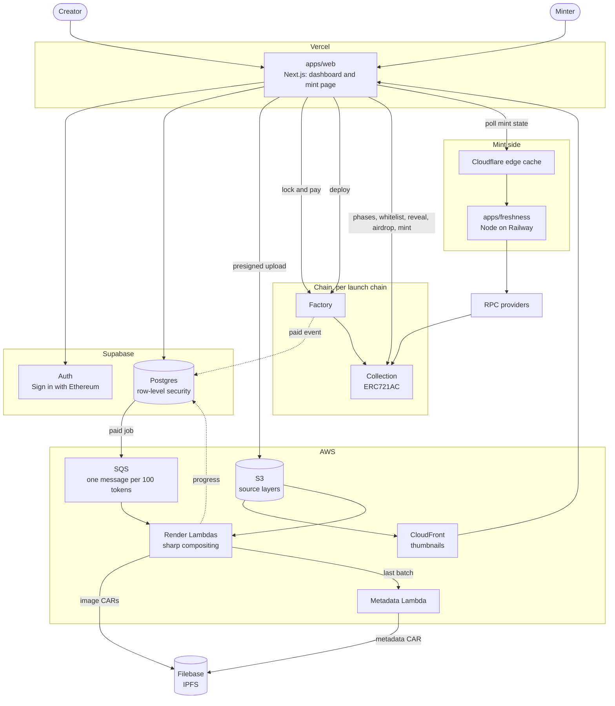
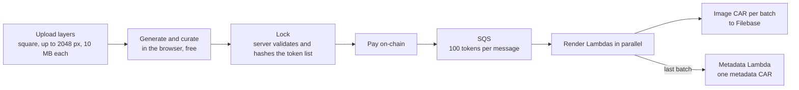
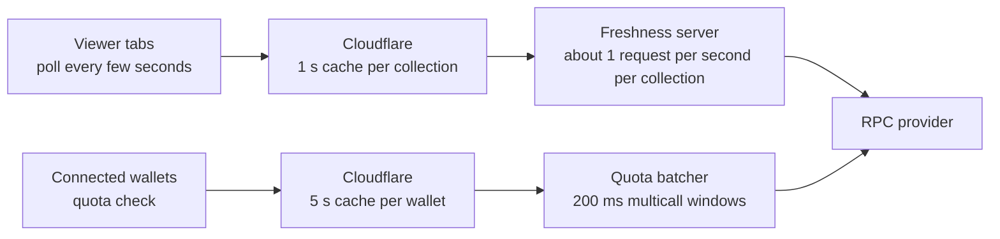

# Cobweb Launchpad

A no-code, permissionless NFT launchpad. A creator arrives, launches one collection, and manages it. Cobweb is a rebuild of Kingdomly as the lightest version we can run: about $70 a month at rest, with AWS cut down to Lambda, SQS and S3 for art rendering.

**Status:** Phase 1 (contracts) and Phase 2 (web shell, sign-in, database schema) are built and tested locally. Nothing is deployed yet. Next is the art generator (Phase 3). See [Build status](#build-status).

## Contents

- [The product](#the-product)
- [Architecture](#architecture)
- [Repository layout](#repository-layout)
- [Getting started](#getting-started)
- [Services we pay for](#services-we-pay-for)
- [Libraries and tools](#libraries-and-tools)
- [Contracts in brief](#contracts-in-brief)
- [How we make money](#how-we-make-money)
- [Rules that hold everywhere](#rules-that-hold-everywhere)
- [Working with the legacy code](#working-with-the-legacy-code)
- [Build status](#build-status)
- [Further reading](#further-reading)

## The product

One linear flow, no side doors:



The old Kingdomly app let creators build art projects and drop contracts separately and wire them together by hand. That flexibility is gone on purpose: a collection owns its art, its contract and its mint page.

**In v1:** create collection, generate art from layers, deploy, phases, whitelist, mint page, reveal, airdrops, phase edits.

**Not in v1:** marketplace, inventory, bridge launchpad, staking, Discord/X/email gates, merkle whitelists, partner codes, embeds, whitelist applications.

**Launch chains:** Ethereum, Arbitrum, Base, Berachain, Monad, Robinhood Chain.

## Architecture

There are two sides, and they share only the chain. The Create side costs money only while a job runs. The Mint side is cached at the edge, so the number of viewers never reaches our servers.



| Piece             | Code              | Runs on                    | Job                                                               |
| ----------------- | ----------------- | -------------------------- | ----------------------------------------------------------------- |
| Web app           | `apps/web`        | Vercel                     | Creator dashboard and the public mint page                        |
| Database and auth | `supabase/`       | Supabase                   | Postgres with row-level security, Sign in with Ethereum, job rows |
| Contracts         | `contracts/`      | Each launch chain          | Factory and collection                                            |
| Freshness server  | `apps/freshness`  | Railway, behind Cloudflare | The only reader of chain state for mint pages                     |
| Render pipeline   | `services/render` | AWS SQS and Lambda         | Composites tokens, packs CARs, uploads to Filebase                |
| Layer storage     |                   | S3, CloudFront             | Source layers and their thumbnails                                |
| Trait engine      | `packages/dna`    | Browser and server         | Picks traits for each token; validates the final list at lock     |
| Component library | `packages/ui`     |                            | shadcn components themed with our tokens                          |

### Art pipeline

Only source layers touch S3. Rendered images go from a Lambda's temporary disk straight to Filebase, one batch at a time.



- The browser generates and edits the collection for free. Nothing is rendered until the creator pays.
- At lock the browser submits the final token list. The server checks it against the project's rules, stores it and hashes it. That stored list is what gets rendered.
- A job runs only when its row is `paid` (from the factory's payment event) or `waived` (admin only, logged).
- Failed batches retry through SQS, with a dead-letter queue. The last batch to finish flips the job to `finalizing` exactly once.
- A re-run of the same job must produce the same CIDs, so metadata carries no timestamps.

### Mint day traffic

Each layer shrinks what reaches the next one.



The freshness server polls each chain on a tiered schedule (slow when idle, fast around a phase start), keeps one logs subscription per chain, and serves cached JSON with ETags. The mint page never calls an RPC for shared state. The mint transaction itself goes from the minter's wallet to the chain and never touches our servers.

## Repository layout

```
apps/web           Next.js app: creator dashboard and mint page
apps/freshness     Railway service: chain polling, quota batching, HTTP with ETag
services/render    Render and metadata Lambdas, SQS wiring
contracts/         Foundry: factory and collection
packages/dna       Trait assignment engine, shared by browser and server
packages/ui        Component library: shadcn components themed with the shared tokens
packages/shared    Types, ABIs, chain config
supabase/          Migrations and policies
docs/              Plan, master plan, legacy context, reference contract
legacy/            Old Kingdomly repos. Reference only, not in git
```

The packages are empty stubs today; each is filled in phase by phase.

## Getting started

You need:

- Node 22 or newer
- pnpm 10
- [Foundry](https://book.getfoundry.sh/getting-started/installation) for the contracts

```
git submodule update --init --recursive   # contract libraries
pnpm install

pnpm typecheck      # all packages, through Turborepo
pnpm lint
pnpm test
pnpm build
pnpm format         # Prettier, write
pnpm format:check   # Prettier, check only

cd contracts
forge build --sizes
forge test
```

CI runs the same commands on every pull request and on pushes to `main` (`.github/workflows/ci.yml`).

**Environment variables.** Each package that needs them has a `.env.example` beside it (`apps/web`, `contracts`). Real `.env` files are never committed.

### Running the web app locally

You also need Docker and the [Supabase CLI](https://supabase.com/docs/guides/local-development).

```
supabase start                      # local Postgres, auth and API, in Docker
supabase status                     # prints the API URL and publishable key
cp apps/web/.env.example apps/web/.env.local   # then paste those two values in
pnpm --filter @cobweb/web dev       # http://localhost:3000
```

- The local Supabase uses ports 55320 to 55329, so it can run beside another Supabase project on the default ports.
- `supabase db reset` re-applies the migrations to a clean local database.
- `pnpm --filter @cobweb/web verify:local` signs in with throwaway wallets against the local Supabase and checks sign-in and every access rule (64 checks). Run it after any change to `supabase/migrations`.
- A browser-extension wallet is enough to sign in locally. WalletConnect needs a project id in `.env.local`.

**Branches.** Work on a branch and open a pull request into `main`.

**Working with Claude Code.** `CLAUDE.md` holds the repo rules an AI agent must follow. `docs/SKILLS.md` lists the project skills worth building.

## Services we pay for

Fixed cost at rest is about $68 to $78 a month. Figures come from [docs/PLAN.md](docs/PLAN.md), which has the reasoning and the busy-month scenarios.

| Service  | What we use it for                       | Plan        | Monthly                                            |
| -------- | ---------------------------------------- | ----------- | -------------------------------------------------- |
| Vercel   | Hosts `apps/web`                         | Pro         | $20                                                |
| Supabase | Postgres, auth, storage                  | Pro         | $25                                                |
| Railway  | Hosts `apps/freshness`                   | Usage-based | $15 to $25 once always-on                          |
| Filebase | IPFS pinning for images and metadata     | Paid plan   | $7                                                 |
| AWS      | S3 for layers, SQS, Lambda for rendering | Pay per use | About $1 at rest, about $2 per 10,000-token render |
| Domain   |                                          |             | $1 to $2                                           |

Free tiers we depend on:

| Service                 | What we use it for                          | When it starts to cost                                 |
| ----------------------- | ------------------------------------------- | ------------------------------------------------------ |
| Cloudflare              | Edge cache in front of the freshness server | Not expected                                           |
| RPC provider            | Chain reads from the freshness server       | About $50 a month once several chains are busy at once |
| CloudFront              | Serves layer thumbnails                     | Not expected at our volume                             |
| GitHub                  | Code and CI                                 | Not expected                                           |
| WalletConnect project   | Wallet connections through RainbowKit       | Not expected                                           |
| Block explorer API keys | Contract verification, once per chain       | Free                                                   |

One-time costs: gas to deploy and verify the factory on each chain.

What grows with success, in the order we would feel it: Filebase storage as collections accumulate, RPC once several chains are hot together, Supabase egress, Vercel bandwidth after a viral drop. Each is a plan upgrade, not a design change.

## Libraries and tools

**Installed** means it is in the lockfile today. **Planned** means the phase that needs it will add it.

| Area      | Library                                        | Status                  | Used for                                       |
| --------- | ---------------------------------------------- | ----------------------- | ---------------------------------------------- |
| Tooling   | pnpm workspaces, Turborepo                     | Installed               | Monorepo and task running                      |
| Tooling   | TypeScript 6                                   | Installed               | Pinned to 6 until typescript-eslint supports 7 |
| Tooling   | ESLint, typescript-eslint, Prettier            | Installed               | Lint and format                                |
| Tooling   | Vitest                                         | Installed               | Unit tests                                     |
| Contracts | Foundry, Solidity 0.8.30                       | Installed               | Build, test, deploy                            |
| Contracts | Limit Break creator-token-standards (ERC721AC) | Planned, Phase 1        | Collection base, transfer validator, locking   |
| Contracts | OpenZeppelin Contracts                         | Planned, Phase 1        | Ownable, ERC2981 royalties, ReentrancyGuard    |
| Contracts | delegate.xyz registry                          | Planned, Phase 1        | Delegated minting                              |
| Web       | Next.js, React                                 | Planned, Phase 2        | `apps/web`                                     |
| Web       | Tailwind CSS, shadcn/ui                        | Planned, Phase 2        | Styling and `packages/ui`                      |
| Web       | RainbowKit, wagmi, viem                        | Planned, Phase 2        | Wallet connection and contract calls           |
| Web       | Supabase JS and SSR client                     | Planned, Phase 2        | Database access and sessions                   |
| Render    | sharp                                          | Planned, Phase 4        | Image compositing                              |
| Render    | AWS SDK (S3, SQS)                              | Planned, Phases 3 and 4 | Presigned uploads, job fan-out                 |
| Render    | A CAR packing library                          | Planned, Phase 4        | IPFS archives for Filebase. Not chosen yet     |
| Freshness | viem                                           | Planned, Phase 6        | Multicall and log subscriptions                |
| Load test | k6                                             | Planned, Phase 7        | Mint-day load test                             |

## Contracts in brief

Full documentation, diagrams and a function-by-function reference are in [contracts/README.md](contracts/README.md).

Two contracts per chain:

- **Factory.** Deploys a full collection contract with CREATE2, with no proxies. The creation code arrives in calldata and is checked against an allowlisted hash. The factory holds the per-chain platform fees and takes the art-generation payment, emitting the event that marks a render job as paid.
- **Collection.** ERC721AC with mint groups, modelled on [docs/reference/TheSuits.sol](docs/reference/TheSuits.sol). Runtime bytecode is identical across deploys, so explorer verification happens once per chain.

How minting works:

- **Mint groups.** Group 0 is public; the others are allowlist groups. Each has a price, a supply allocation, an open/closed flag and an optional scheduled start.
- **Liveness.** A group is live if its flag is on, or if a start is scheduled and the block timestamp has reached it. There is no end time and no global switch. The creator closes a group by hand.
- **Limits.** Public has a per-wallet cap. Allowlist groups use a per-address quota, written on-chain from a CSV in chunks of 300 to 500 addresses.
- **Fees.** Flat native amounts set by the admin on the factory and snapshotted into each collection at deploy. No price oracle. Only the factory admin can change a deployed collection's fee, up or down.
- **Also supported.** Reveal, airdrops (a burn is an airdrop to the dead address), delegated minting that lands in the hot wallet, mint on behalf, royalties, and locking transfers through the ERC721AC transfer validator.

## How we make money

All three streams are collected on-chain in the chain's native token.

| Stream                    | Who pays | When                                   |
| ------------------------- | -------- | -------------------------------------- |
| Art generation, per token | Creator  | At lock, through the factory           |
| Airdrop, per token        | Creator  | At airdrop, through the collection     |
| Mint fee, per token       | Minter   | At mint, on top of the creator's price |

The rates are in [docs/PLAN.md](docs/PLAN.md). The mint fee option and the art fee's free allowance are still open decisions.

## Rules that hold everywhere

These come from the plan's locked decisions and from bugs found in the legacy code.

1. **Liveness comes from the chain.** A phase is live when the contract's `mintGroupActive` view says so. The mint button never opens on the browser clock or on an event.
2. **Simulate, then send the simulated request.** The wallet opens only after `simulateContract` passes.
3. **Mint pages never call an RPC for shared state.** They poll the freshness server through Cloudflare.
4. **Every server action checks the session and ownership,** and every table has row-level security. The legacy app had neither.
5. **Fees are flat native amounts snapshotted at deploy.** No oracle. Only the factory admin can change a deployed collection's fee.
6. **Render jobs run only when `paid` or `waived`.**
7. **Contracts keep identical runtime bytecode across deploys.** No per-collection immutables, no hard-coded per-chain addresses.
8. **`legacy/` is read-only reference.** Never import from it and never commit it; it contains secrets.

Design conventions:

- The product name is Cobweb. The Kingdomly logo stays for now; "Kingdomly" and "realm" wording does not.
- Dark theme on a neutral warm gray with a yellow accent, in Poppins. Colours come from tokens, never hard-coded values.
- All UI is built from shadcn components in `packages/ui`. A screen ported from the old app keeps its layout and structure. Respect what the old screen could do, but take a better or simpler route where one exists, and note what changed.

## Working with the legacy code

Three old Kingdomly repos sit in `legacy/` on the machines of people who have them. They are not in this repository.

| Legacy repo                                | What we take from it                                    | Context doc                                                                                                                                                         |
| ------------------------------------------ | ------------------------------------------------------- | ------------------------------------------------------------------------------------------------------------------------------------------------------------------- |
| `KingdomlyMarket` (Next.js frontend)       | Layout, screens, the art generator and its trait engine | [design system](docs/legacy/market-design-system.md), [creator flow](docs/legacy/market-creator-flow.md), [mint page and data](docs/legacy/market-mint-and-data.md) |
| `KingdomlyMasterContractFactory` (Foundry) | The factory's deploy path, test structure               | [contracts](docs/legacy/contracts.md)                                                                                                                               |
| `ArtGenLambda` (serverless)                | sharp compositing, multi-collection handling            | [art pipeline](docs/legacy/artgen-lambda.md)                                                                                                                        |

Before porting anything, open the matching context doc: it says which files implement a feature, what to change and what to leave behind. Start at [docs/legacy/README.md](docs/legacy/README.md).

## Build status

| Phase | What                                                              | Status                                   |
| ----- | ----------------------------------------------------------------- | ---------------------------------------- |
| 0     | Scaffold: workspace, empty packages, CI                           | Done                                     |
| 1     | Contracts: factory, collection, testnet deploy                    | Built and tested; testnet deploy pending |
| 2     | Web shell: palette, `packages/ui`, sign-in, database schema       | Built and tested locally                 |
| 3     | Art generator: trait engine, layer upload, curation, lock and pay | Next                                     |
| 4     | Render pipeline: SQS, Lambdas, Filebase                           | Not started                              |
| 5     | Deploy and manage: phases, whitelist, reveal, airdrop             | Not started                              |
| 6     | Freshness server and mint page                                    | Not started                              |
| 7     | Hardening and launch: load test, mainnet deploys                  | Not started                              |

Each phase's tasks and exit criteria are in [docs/MASTER_PLAN.md](docs/MASTER_PLAN.md).

## Further reading

| Doc                                                                                    | What it is                                                                                                    |
| -------------------------------------------------------------------------------------- | ------------------------------------------------------------------------------------------------------------- |
| [docs/MASTER_PLAN.md](docs/MASTER_PLAN.md)                                             | Build order, exit criteria per phase, and every decision made so far. Where it differs from the plan, it wins |
| [docs/PLAN.md](docs/PLAN.md)                                                           | The source plan: scope, costs, revenue, load. Kept verbatim                                                   |
| [docs/legacy/README.md](docs/legacy/README.md)                                         | Index of the legacy context docs                                                                              |
| [docs/reference/the-suits-mint-analysis.md](docs/reference/the-suits-mint-analysis.md) | How the reference contract mints, and what to fix when porting it                                             |
| [docs/SKILLS.md](docs/SKILLS.md)                                                       | Claude Code skills worth building for this repo                                                               |
| [CLAUDE.md](CLAUDE.md)                                                                 | Rules for AI agents working in this repo                                                                      |
