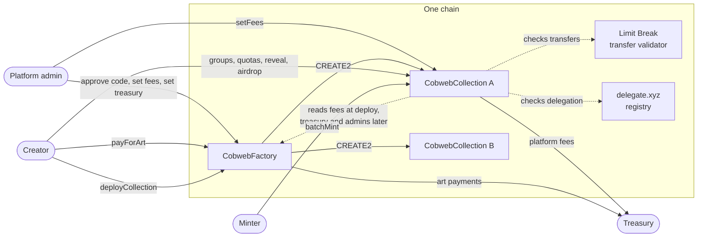
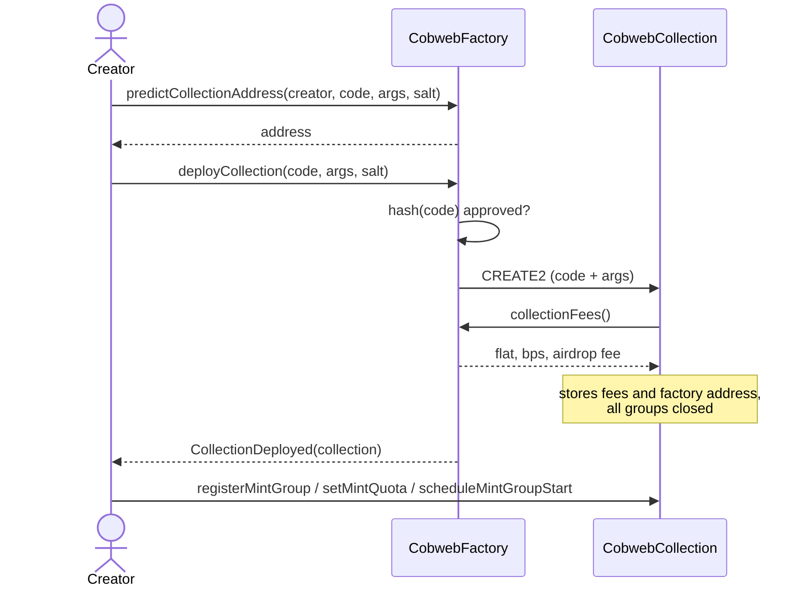
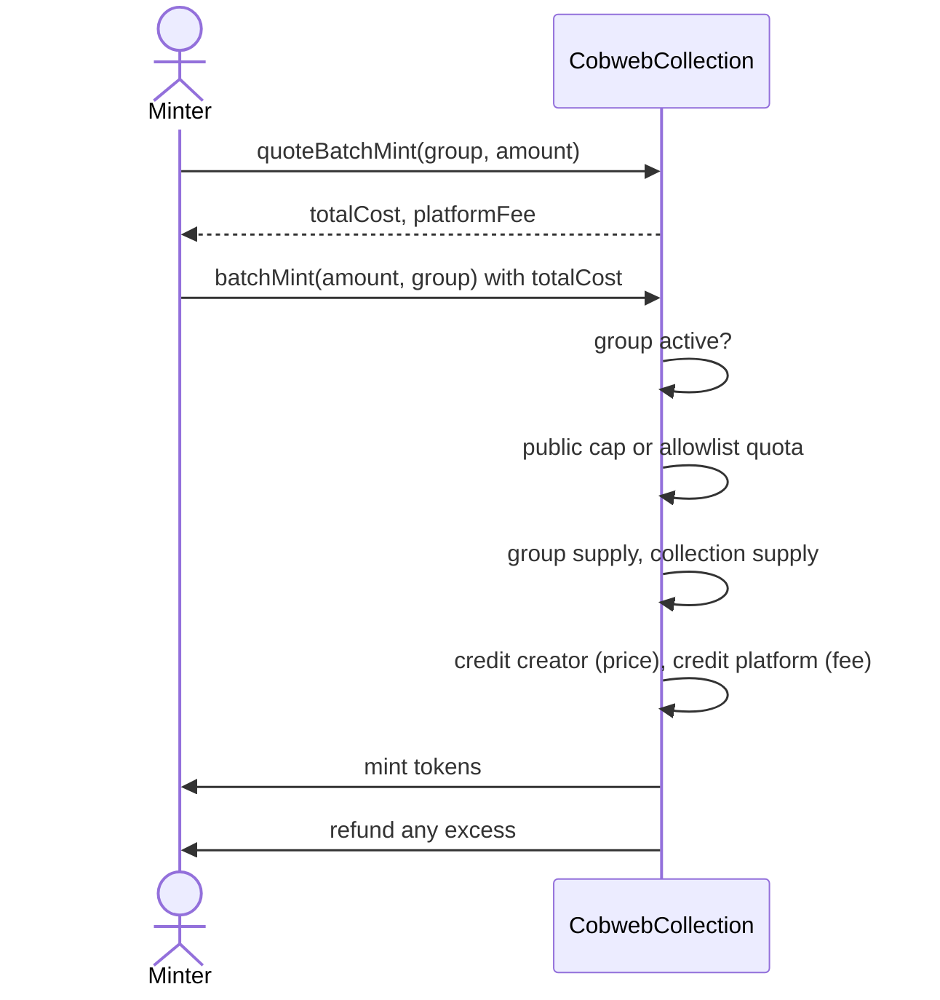
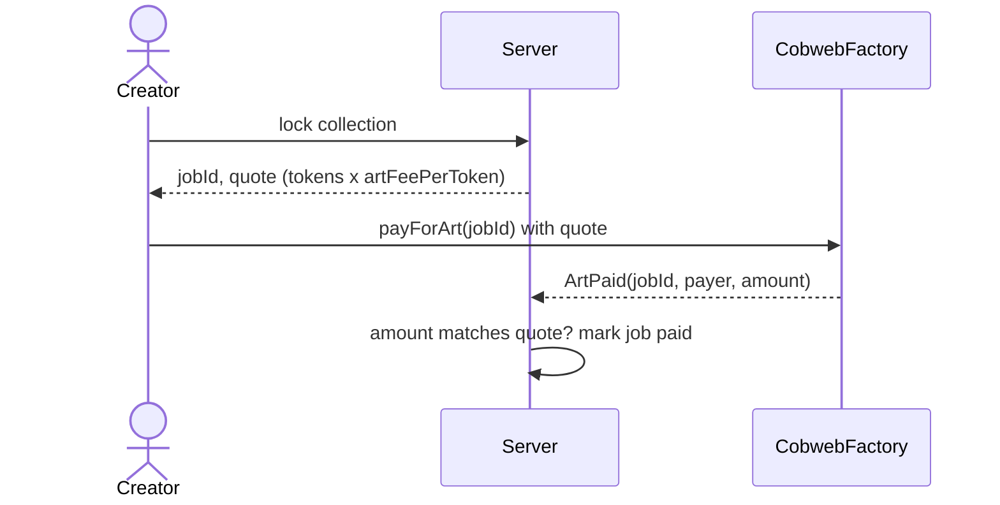
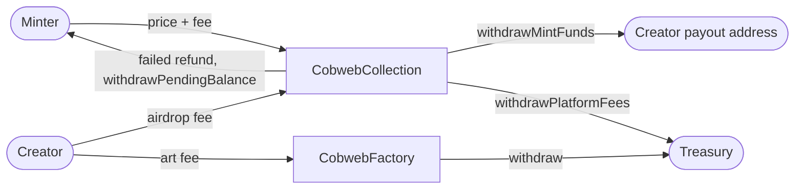
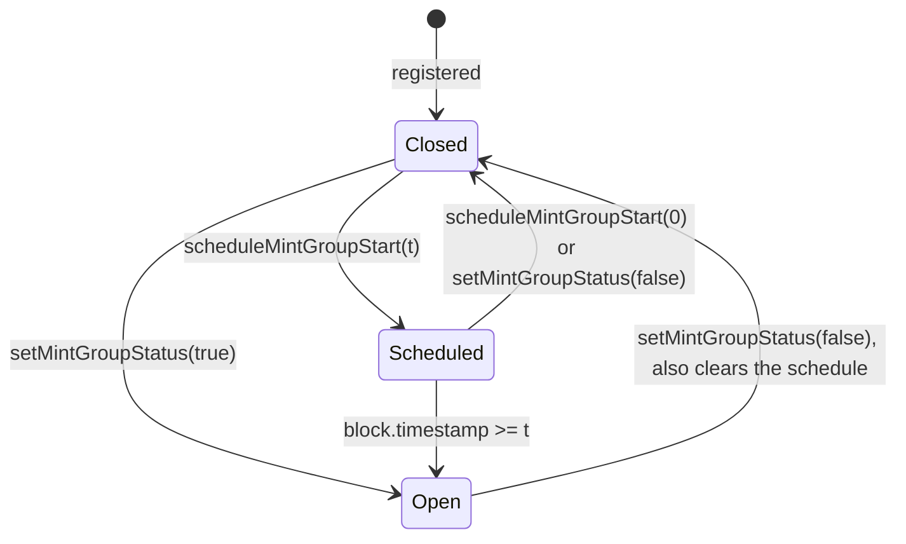

# Cobweb contracts

Two contracts per chain:

- **`CobwebFactory`** deploys collections, holds the platform's fee settings, and takes the art-generation payment.
- **`CobwebCollection`** is the NFT contract a creator launches: an ERC721AC collection with mint groups, allowlist quotas, airdrops, delegated minting, royalties and platform fees.

There are no proxies. Every collection is a full contract with identical runtime bytecode, so it is verified on a block explorer once per chain and every later collection is matched automatically.

**Status:** built and tested locally, with one internal review whose findings are fixed. Not yet deployed to any chain, and not externally audited.

## Contents

- [How the two contracts connect](#how-the-two-contracts-connect)
- [Who can do what](#who-can-do-what)
- [Flows](#flows)
- [Mint groups](#mint-groups)
- [Fees and money](#fees-and-money)
- [CobwebFactory reference](#cobwebfactory-reference)
- [CobwebCollection reference](#cobwebcollection-reference)
- [Events a server should watch](#events-a-server-should-watch)
- [Build, test, deploy](#build-test-deploy)
- [Design notes](#design-notes)

## How the two contracts connect



The link between the two is set up once per chain:

1. Deploy the factory with an admin and a treasury address.
2. The admin approves the hash of the collection's creation code (`approveCreationCode`).
3. The admin sets the fees (`setCollectionFees`, `setArtFeePerToken`).

After that, anyone can ask the factory to deploy a collection by sending the approved creation code plus constructor arguments. The new collection records the factory as its parent and reads three things from it:

| What             | When it is read                                 | Effect                                                         |
| ---------------- | ----------------------------------------------- | -------------------------------------------------------------- |
| Fee rates        | Once, in the constructor                        | Copied into the collection's own storage                       |
| Treasury address | Each time platform fees are withdrawn           | The admin can rotate the treasury for every collection at once |
| Admin list       | Each time `setFees` is called on the collection | Only factory admins can change a collection's fees             |

## Who can do what

| Actor                          | On the factory                                                                                      | On a collection                                                                                                                                    |
| ------------------------------ | --------------------------------------------------------------------------------------------------- | -------------------------------------------------------------------------------------------------------------------------------------------------- |
| **Platform admin**             | Approve or remove creation code, set default fees, set art fee, set treasury, withdraw art payments | Change that collection's fee rates, up or down                                                                                                     |
| **Creator** (collection owner) | Deploy a collection, pay for art                                                                    | Everything about the sale: groups, prices, supply, quotas, open and close, reveal, airdrop, royalties, payout address, transfer validator settings |
| **Minter**                     |                                                                                                     | Mint, mint on behalf, delegated mint, claim a failed refund                                                                                        |
| **Anyone**                     | Deploy a collection, pay for art                                                                    | Trigger the platform-fee withdrawal to the treasury                                                                                                |

## Flows

### Launching a collection



The address depends on the creator's address, the salt, the creation code and the constructor arguments. Nobody else can take it, and it is the same on every chain where the factory has the same address.

### Minting



### Paying for art



The factory does not check the amount. The server compares the event with the quote it issued, so a quote stays valid even if the admin changes the published rate in the meantime. Payments are recorded per payer, so nobody can block a job by paying a token amount for someone else's job id. The server must check that the payer is the wallet the quote was issued to.

### Where the money goes



## Mint groups

A mint group is a phase of the sale. Group `0` is the public sale. Every other group is an allowlist group.

|                   | Public (group 0)                           | Allowlist (groups 1 and up)        |
| ----------------- | ------------------------------------------ | ---------------------------------- |
| Who can mint      | Anyone                                     | Addresses with a quota             |
| Per-address limit | `publicMaxMintPerWallet`, one lifetime cap | The address's quota for that group |
| Price             | Per group                                  | Per group                          |
| Supply            | Per-group allocation                       | Per-group allocation               |

**When a group is live.** `mintGroupActive(group)` is the single test, used by every mint path:



- A group is live if its flag is on, or if a start is scheduled and the block timestamp has reached it. Live starts at exactly the scheduled second.
- There is no end time. A group stays live until the creator closes it. Groups can be live at the same time.
- Closing clears the schedule, so an old timestamp can never reopen a group.
- `stopOrStartAllMintGroups` flips every group in one transaction.

**Supply.** Each group has an allocation. The allocations together can never exceed the collection's max supply, and an allocation can never be set below what the group has already minted. Airdrops use collection supply but no group's allocation.

**Quotas.** A quota is the total issued to an address, stored separately from how much it has used. Sending the same allowlist twice changes nothing, so a chunked upload can be retried safely. Raising a quota adds room; lowering it below what was used simply leaves nothing remaining.

## Fees and money

All fees are amounts of the chain's native token. There is no price oracle.

| Fee         | Paid by                     | Formula                                               | Collected in |
| ----------- | --------------------------- | ----------------------------------------------------- | ------------ |
| Mint fee    | Minter, on top of the price | `(mintFeeFlat + price * mintFeeBps / 10000) * amount` | Collection   |
| Airdrop fee | Creator                     | `airdropFeePerToken * tokens`                         | Collection   |
| Art fee     | Creator                     | Quoted by the server from `artFeePerToken`            | Factory      |

- A free mint (price 0) still pays the flat fee.
- The factory's rates are the defaults for collections deployed from then on. Changing them does not touch existing collections.
- A platform admin can change any deployed collection's rates, up or down, with `setFees` on that collection. The basis-point part cannot exceed 10,000.

**Ledgers.** A collection keeps three separate balances: the creator's proceeds, the platform's fees, and refunds that could not be delivered. Each is paid out on request and none can block or be drained by another. If a refund to a minter fails (for example a contract that rejects payments), the amount is credited to that minter's pending balance instead of reverting the mint, and the minter can claim it to any address.

**Fee changes during a mint.** What a minter sends is the most they can be charged. If an admin raises a fee between the quote and the transaction, the mint reverts for insufficient payment; it never takes more than was sent.

## CobwebFactory reference

### Anyone

| Function                                                                  | What it does                                                                                                                                                                                      |
| ------------------------------------------------------------------------- | ------------------------------------------------------------------------------------------------------------------------------------------------------------------------------------------------- |
| `deployCollection(creationCode, constructorArgs, salt)`                   | Deploys a collection with CREATE2. Reverts unless the hash of `creationCode` is approved. The salt is combined with the caller's address. Returns the new address and emits `CollectionDeployed`. |
| `predictCollectionAddress(deployer, creationCode, constructorArgs, salt)` | Returns the address `deployCollection` would produce for that deployer and those inputs.                                                                                                          |
| `payForArt(jobId)`                                                        | Payable. Records the caller's payment for an art-generation job and emits `ArtPaid`. Reverts on zero value or if this caller already paid for that job.                                           |

### Admin only

| Function                                                           | What it does                                                                                           |
| ------------------------------------------------------------------ | ------------------------------------------------------------------------------------------------------ |
| `approveCreationCode(codeHash)`                                    | Allows creation code with this hash to be deployed.                                                    |
| `removeCreationCode(codeHash)`                                     | Stops further deployments of that code. Existing collections are unaffected.                           |
| `setCollectionFees(mintFeeFlat, mintFeeBps, airdropFeePerToken)`   | Sets the fee rates new collections start with.                                                         |
| `setArtFeePerToken(amount)`                                        | Sets the published art-generation rate the server quotes from.                                         |
| `setTreasury(address)`                                             | Sets where platform fees go, for the factory and every collection.                                     |
| `withdraw()`                                                       | Sends the factory's whole balance (art payments) to the treasury.                                      |
| `grantRole` / `revokeRole` / `renounceRole` (`DEFAULT_ADMIN_ROLE`) | Adds or removes admins. Inherited from OpenZeppelin `AccessControl`. The last admin cannot be removed. |

### Views

| Function                           | Returns                                                        |
| ---------------------------------- | -------------------------------------------------------------- |
| `collectionFees()`                 | The default `mintFeeFlat`, `mintFeeBps`, `airdropFeePerToken`. |
| `artFeePerToken()`                 | The published art rate.                                        |
| `treasury()`                       | The treasury address.                                          |
| `isAdmin(account)`                 | Whether the account is a platform admin.                       |
| `isCreationCodeApproved(codeHash)` | Whether that code may be deployed.                             |
| `isCollection(address)`            | Whether this factory deployed that address.                    |
| `jobPayment(jobId, payer)`         | Amount that payer has paid for a job; zero if unpaid.          |

## CobwebCollection reference

### Constructor

| Argument                  | Meaning                                                               |
| ------------------------- | --------------------------------------------------------------------- |
| `baseVariables`           | `name`, `symbol`, `ownerPayoutAddress`, `initialBaseURI`, `maxSupply` |
| `mintGroupMaxSupplies_`   | Supply allocation per initial group; index 0 is the public group      |
| `mintPrice_`              | Price per initial group, same order                                   |
| `publicMaxMintPerWallet_` | Lifetime per-wallet cap for the public group                          |
| `royaltyPercentage`       | Default royalty in basis points                                       |
| `owner_`                  | The creator                                                           |
| `royaltyPayoutAddress`    | Default royalty receiver                                              |

At least one group is required. All groups start closed. The collection must be deployed by the factory, because fee rates are read from the deployer.

### Minting (anyone, payable)

| Function                                    | What it does                                                                                                                                                |
| ------------------------------------------- | ----------------------------------------------------------------------------------------------------------------------------------------------------------- |
| `batchMint(amount, mintGroup)`              | Mints to the caller, using the caller's cap or quota.                                                                                                       |
| `mintOnBehalf(amount, mintGroup, receiver)` | The caller pays; the receiver's cap or quota is used and the receiver gets the tokens. Only while the creator has switched it on.                           |
| `delegateMint(amount, mintGroup, vault)`    | Mints to the caller using the vault's cap or quota. The vault must have delegated to the caller on delegate.xyz, for the whole wallet or for this contract. |

Each returns the total charged and refunds anything sent above it.

### Withdrawals

| Function                       | Who                         | What it does                                                                                 |
| ------------------------------ | --------------------------- | -------------------------------------------------------------------------------------------- |
| `withdrawMintFunds()`          | Owner or the payout address | Sends the creator's proceeds to the payout address.                                          |
| `withdrawPlatformFees()`       | Anyone                      | Sends the collected platform fees to the factory's current treasury.                         |
| `withdrawPendingBalance()`     | Anyone                      | Claims the caller's own balance, credited when a refund could not be pushed.                 |
| `withdrawPendingBalanceTo(to)` | Anyone                      | The same, paid to another address. For a caller that cannot receive the native token itself. |

### Creator (owner only)

| Function                                                         | What it does                                                                                                                                       |
| ---------------------------------------------------------------- | -------------------------------------------------------------------------------------------------------------------------------------------------- |
| `registerMintGroup(mintGroup, price, maxSupply, startTimestamp)` | Creates a new group and sets its price, allocation and optional schedule in one call. Reverts if the id exists. The group starts closed.           |
| `setMintQuota(addresses, mintGroup, quotas)`                     | Sets the quota for each address in an allowlist group. Reverts for the public group.                                                               |
| `setPublicMaxMintPerWallet(cap)`                                 | Sets the public group's lifetime per-wallet cap.                                                                                                   |
| `changeSalePrice(price, mintGroup)`                              | Changes a group's price.                                                                                                                           |
| `setMintGroupMaxSupply(mintGroup, maxSupply)`                    | Changes a group's allocation. Reverts below the group's minted count or if allocations would exceed max supply.                                    |
| `setMintGroupStatus(mintGroup, status)`                          | Opens or closes a group. Closing clears its schedule.                                                                                              |
| `stopOrStartAllMintGroups(status)`                               | Opens or closes every group.                                                                                                                       |
| `scheduleMintGroupStart(mintGroup, startTimestamp)`              | Schedules a group to open by itself; 0 clears the schedule.                                                                                        |
| `setMintOnBehalfStatus(status)`                                  | Switches `mintOnBehalf` on or off.                                                                                                                 |
| `setBaseURI(uri)`                                                | Sets the metadata base URI and emits `BatchMetadataUpdate`. This is the reveal.                                                                    |
| `airdropNFTs(recipients, amounts)`                               | Payable. Mints to each recipient for the airdrop fee. An airdrop to the dead address is the burn.                                                  |
| `setOwnerPayoutAddress(address)`                                 | Changes where the creator's proceeds are paid out.                                                                                                 |
| `setDefaultRoyalty(receiver, bps)`                               | Sets the default royalty.                                                                                                                          |
| `setTokenRoyalty(tokenId, receiver, bps)`                        | Sets the royalty for one token.                                                                                                                    |
| `setTransferValidator(validator)`                                | Inherited from ERC721AC. Changes or removes the transfer validator.                                                                                |
| `setAutomaticApprovalOfTransfersFromValidator(bool)`             | Inherited from ERC721AC. Lets Limit Break's default validator move tokens without a per-holder approval. It has no effect for any other validator. |
| `transferOwnership` / `renounceOwnership`                        | Inherited from OpenZeppelin `Ownable`.                                                                                                             |

### Platform admin only

| Function                                               | What it does                                                                     |
| ------------------------------------------------------ | -------------------------------------------------------------------------------- |
| `setFees(mintFeeFlat, mintFeeBps, airdropFeePerToken)` | Changes this collection's fee rates. The caller must be an admin on the factory. |

### Views

| Function                                                                                                                                 | Returns                                                                                                                                                                                                       |
| ---------------------------------------------------------------------------------------------------------------------------------------- | ------------------------------------------------------------------------------------------------------------------------------------------------------------------------------------------------------------- |
| `collectionState()`                                                                                                                      | One call for a mint page: max supply, total minted, public cap, fee rates, mint-on-behalf switch, the block timestamp, and every group's id, price, allocation, minted count, schedule, flag and live status. |
| `walletState(wallet)`                                                                                                                    | One call for a connected wallet: tokens minted from public, and per group the quota issued and used.                                                                                                          |
| `mintGroupActive(mintGroup)`                                                                                                             | Whether the group is live right now.                                                                                                                                                                          |
| `quoteBatchMint(mintGroup, amount)`                                                                                                      | `totalCost` to send and the `platformFee` inside it.                                                                                                                                                          |
| `canMintCheck(amount, mintGroup, minter)`                                                                                                | Whether a mint would pass, and the name of the failing check if not. Does not consider payment.                                                                                                               |
| `quotaRemaining(mintGroup, minter)`                                                                                                      | Quota still usable.                                                                                                                                                                                           |
| `mintQuotas`, `quotaClaimed`, `publicMints`                                                                                              | The raw per-address figures.                                                                                                                                                                                  |
| `mintGroups()`, `mintGroupExists`, `mintPrice`, `mintGroupMaxSupply`, `mintGroupMints`, `mintGroupStartTimestamp`, `mintGroupActiveFlag` | Per-group figures. `mintGroupActiveFlag` is the raw flag and ignores the schedule.                                                                                                                            |
| `fees()`, `creatorBalance()`, `platformBalance()`, `pendingBalance(user)`                                                                | Fee rates and the three ledgers.                                                                                                                                                                              |
| `maxSupply()`, `totalMinted()`, `publicMaxMintPerWallet()`, `mintOnBehalfActive()`, `baseURI()`, `ownerPayoutAddress()`, `factory()`     | Collection settings.                                                                                                                                                                                          |
| `tokenURI(tokenId)`                                                                                                                      | If the base URI ends in `/`, the base plus the token id. Otherwise the base as-is for every token, which is how unrevealed and Single Asset collections work.                                                 |
| `royaltyInfo`, `supportsInterface`, `getTransferValidator`, and the ERC721 views                                                         | Standard.                                                                                                                                                                                                     |

### Locking transfers

There is no lock code in the collection. Transfers are checked by Limit Break's transfer validator, and the creator locks or unlocks trading by changing the collection's security level on that validator. Mints and airdrops are unaffected.

On a chain where no validator contract exists at the configured address, the collection skips the check, so the same bytecode works everywhere and tokens transfer freely there.

The creator may point the collection at a different validator contract. ERC721AC's automatic approval is honoured only for Limit Break's default validator, so a creator cannot install their own contract and use it to move holders' tokens.

## Events a server should watch

Liveness must always be read from `mintGroupActive` or `collectionState`. These events are signals to re-read, never a source of state.

| Event                                                                                                   | Emitted by | Meaning                                 |
| ------------------------------------------------------------------------------------------------------- | ---------- | --------------------------------------- |
| `CollectionDeployed(collection, codeHash, deployer, salt)`                                              | Factory    | A new collection exists                 |
| `ArtPaid(jobId, payer, amount)`                                                                         | Factory    | An art job was paid                     |
| `TokensMinted(recipient, amount, mintGroup)`                                                            | Collection | A mint or mint on behalf                |
| `TokensDelegateMinted(vault, recipient, amount, mintGroup)`                                             | Collection | A delegated mint                        |
| `NFTsAirdropped(recipients, amount, feePaid)`                                                           | Collection | An airdrop                              |
| `MintGroupStatusChanged(mintGroup, status)`                                                             | Collection | A group was opened or closed by hand    |
| `MintGroupStartTimestampChanged(mintGroup, timestamp)`                                                  | Collection | A schedule was set or cleared           |
| `MintGroupRegistered`, `SalePriceChanged`, `MintGroupMaxSupplyUpdated`, `PublicMaxMintPerWalletChanged` | Collection | Group settings changed                  |
| `FeesUpdated(mintFeeFlat, mintFeeBps, airdropFeePerToken)`                                              | Collection | An admin changed this collection's fees |
| `BatchMetadataUpdate(from, to)`                                                                         | Collection | Metadata changed (reveal)               |

## Build, test, deploy

Libraries are git submodules. After cloning:

```
git submodule update --init --recursive
cd contracts
forge build --sizes
forge test
forge coverage
```

| Suite                         | What it covers                                                                                                                                         |
| ----------------------------- | ------------------------------------------------------------------------------------------------------------------------------------------------------ |
| `test/CobwebFactory.t.sol`    | Deployment, address prediction, identical bytecode, admin controls, art payment                                                                        |
| `test/CobwebCollection.t.sol` | Liveness, public and allowlist minting, supply, groups, mint on behalf, delegated mint, airdrops, withdrawals, fees, metadata, views, transfer locking |
| `test/Invariants.t.sol`       | Random sequences of mints, airdrops, withdrawals and setting changes; checks that the balance always equals what is owed and supply limits always hold |

Current figures: 92 tests passing, about 95% line coverage on the collection and 97% on the factory. `CobwebCollection` is 17.8 KB of runtime code against the 24 KB limit. Deploying a collection through the factory costs about 4.5M gas.

**Deploying to a chain.** Copy `.env.example` to `.env`, fill it in, then:

```
forge script script/Deploy.s.sol --rpc-url $RPC_URL --broadcast --verify
```

The script deploys the factory through the deterministic deployment proxy with a fixed salt, so the same admin and treasury give the same factory address on every chain. If the deployer is the admin it also approves the collection's creation code. Afterwards the admin sets the fees for that chain.

**The artifact the web app ships.** `pnpm --filter @cobweb/shared abi` (after `forge build`) copies the factory ABI entries the app uses into `packages/shared/src/factory-abi.ts` and the whole collection artifact into `packages/shared/src/collection.ts`: the creation code, its keccak256 hash and the ABI. The deploy screen sends that creation code to `deployCollection`, so the hash the admin approves with `approveCreationCode` must be the hash of the shipped bytes. `foundry.toml` pins `evm_version` for that reason, `packages/shared/src/collection.test.ts` asserts the shipped hash against `contracts/out` whenever the build is present, and CI runs that test after `forge build`, so a compiler drift fails the build. After any change to the contracts: `forge build`, run the copy script, commit both generated files, and have the admin approve the new hash (the script prints it).

## Design notes

**Compared with the reference contract** ([TheSuits](../docs/reference/TheSuits.sol), [analysis](../docs/reference/the-suits-mint-analysis.md)), mint-group handling is kept and these things changed:

- Platform fees, the airdrop fee, delegated minting and the two single-call views were added.
- `maxSupply` moved from an immutable to storage, to keep bytecode identical.
- `setMintGroupMaxSupply` rejects a value below the group's minted count, and the supply error no longer underflows.
- `setMintQuota` rejects the public group.
- The public cap counter is only written for public mints.
- `registerMintGroup` configures the group in the same call.
- Revert strings became custom errors, and group existence is a mapping lookup.
- Mint entry points are non-reentrant.
- Creator proceeds are held in their own balance instead of the refund ledger. In the reference contract, changing the payout address to a minter's address and back moved that minter's failed refund to the creator.
- Mints are split into ERC721A batches of 20, so a large airdrop to one wallet does not make its tokens costly to transfer.
- Automatic validator approval is limited to the default validator.

**Compared with the legacy factory**, approval is by creation-code hash alone (no template address), the salt no longer includes the block timestamp, fee settings and the art payment were added, and the last admin cannot be removed.

**Things to know:**

- **Check both directions before trusting a collection.** Deployment is open to anyone, so a server or mint page must confirm `factory.isCollection(address)` on the real factory, not only that the collection names a factory.
- **A live group is not always mintable.** `active` says the group is open. It can still be sold out, or airdrops may have used the collection's remaining supply. Mintable supply is the smaller of the group's remaining allocation and the collection's remaining supply.
- **`mintOnBehalf` uses the receiver's allowance.** While it is switched on, anyone can pay to mint for an address and use up that address's cap or quota. The receiver gets the tokens.
- There is no upper limit on the flat mint fee or the airdrop fee an admin can set.
- Ownership transfer is single-step.

- The factory admin can raise a deployed collection's fees. This is deliberate.
- If the creator renounces ownership, sale settings freeze, and proceeds can still be withdrawn by the payout address.
- Delegated minting reverts on a chain without the delegate.xyz registry.
- Loops over recipients and quota lists are unbounded; the dashboard sends allowlists in chunks of 300 to 500 addresses.
