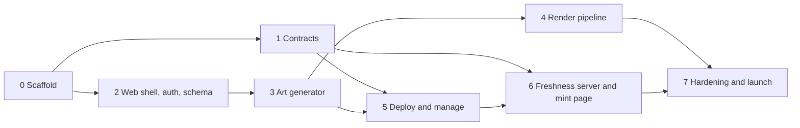

# Master plan

Build order for Cobweb / KingdomlyLite. The what and why are in [PLAN.md](PLAN.md); the legacy material each phase lifts from is indexed in [legacy/README.md](legacy/README.md).

## Where the plan and the legacy code disagree

Reading the old repos turned up places where the plan assumes something the code does not support. Each needs a ruling before the phase that depends on it.

| # | Plan says | Legacy reality | Recommendation | Blocks |
| --- | --- | --- | --- | --- |
| C1 | Server re-runs the DNA engine at lock and stores the assignment hash (decision 7) | `DNAGenerator` uses unseeded `Math.random()`, and creators hand-edit tokens after generating, so a re-run cannot reproduce the result | Server validates the submitted assignment (supply, rules, duplicates, constants) and hashes that. Add a seeded PRNG anyway so generation is testable | Phase 3 |
| C2 | Layers upload to S3 at up to 10 MB, renders are high-res (decisions 10, 17) | Old browser code shrank every layer to 1200x1200 and about 1 MB; originals were never kept | Upload originals; make the thumbnail a separate small file | Phase 3 |
| C3 | Whitelist "ported as-is" at 1,000 addresses per tx, and also "a few hundred" | 1,000 addresses is about 22M gas | 300 to 500 per tx. Store allowance and minted count separately so a re-upload does not reset quotas | Phase 1 |
| C4 | Fee snapshot taken at deploy (decision 6) | The factory is permissionless; anyone can call it with any constructor args | Collection constructor reads the fee from the factory itself; never accept it as an argument | Phase 1 |
| C5 | Identical runtime bytecode, verify once per chain (decision 1) | V3 hard-codes per-chain addresses and uses `immutable maxSupply` | Move both to storage set in the constructor | Phase 1 |
| C6 | ERC721AC where a validator exists, plain ERC721 elsewhere | That is two artifacts and two codehashes | One artifact that leaves the validator unset where none exists | Phase 1 |
| C7 | "Same output layout as before" with per-batch CARs | The old layout already had one image CID per batch and one metadata CID; there was never a single image folder | Keep per-batch image CIDs unless a single image folder is wanted | Phase 4 |
| C8 | Deploy, then phases (the linear flow) | Old phases were constructor arguments | As in TheSuits: the constructor takes the initial groups, all closed, and more are registered after deploy | Phase 1 |
| C9 | Sharp "swapped in if the benchmark shows it matters" | Sharp is already the only compositor | Nothing to swap; the benchmark only sets memory and batch size | Phase 4 |
| C10 | Dynamic and Firebase dropped | Firebase is already gone apart from two download links. Dynamic is in every shell component | Auth swap is the first thing done to any lifted shell component | Phase 2 |

## Decisions needed from you

Plan open questions plus what the legacy review raised.

| # | Decision | Needed by |
| --- | --- | --- |
| D1 | Mint fee: A, B or C | Phase 1 (default values only; the mechanism is the same) |
| D2 | Art fee: $0.11 from token one, or 4,000 free | Phase 3 |
| D3 | Rulings on C1 to C8 above | Phase 1 and 3 |

## Decided (Oct 2, 2026)

| # | Decision | Ruling |
| --- | --- | --- |
| D4 | Phase start boundary | Live exactly at start: `block.timestamp >= start`. Legacy used strict `>`; every contract check, view and the freshness server use `>=` |
| D5 | Burn | An airdrop to the dead address. No burn function in the contract; total supply is not reduced |
| D7 | Delegated mint | Token lands in the hot wallet (the caller), with quota taken from the vault |
| D8 | Single Asset `tokenURI` | Returns the base URI as-is, no token id appended |
| D9 | Launch chains | Ethereum, Arbitrum, Base, Berachain, Monad, Robinhood Chain. Sophon, Mitosis and HyperEVM are dropped |
| D4b | Phase end time | None. A phase has a start time only. This amends locked decision 1 in PLAN.md, which lists an end |
| D12 | Mint group model | As in TheSuits: one open/closed flag per group plus an optional scheduled start, no global gate. The creator closes a phase by hand. This amends locked decisions 1 and 11 in PLAN.md, which say no toggles |
| C1 | Art check at lock | The browser submits the final token list; the server validates it against the project's rules, stores it and hashes it. The engine is not re-run at lock |
| C2 | Layer images | Originals are uploaded and kept, and must be square (1:1). The browser makes a separate small thumbnail for preview screens. Maximum 2048 x 2048, every image in a project the same size, 10 MB per file. Proposed and not yet confirmed: 5 GB of layer files per project, 500 traits per layer |
| D13 | Robinhood Chain | Deployable. Mainnet live since July 2026, chain id 4663 (testnet 46630), ETH for gas, Arbitrum Nitro (standard EVM), Blockscout explorer. The CREATE2 deployer, delegate.xyz registry and Limit Break's default validator all have code there. A testnet dry run should confirm that deploys are not restricted and that verification works |
| D21 | Art payment | No separate payments contract. The factory takes the art-generation fee through a `pay(jobId)` function and emits the paid event. Two contracts per chain: `CobwebFactory` and `CobwebCollection` |
| D22 | Fee currency | Every fee is an amount of the chain's native token, set by the admin. No USD peg and no price oracle |
| D10 | Brand | The product is named Cobweb. The Kingdomly logo stays for now. All "realm" and medieval copy is dropped for a professional tone |
| D10b | Look | Layout and Poppins are kept; no full redesign. The green palette is replaced by a neutral warm gray, dark only. UI and UX improvements are welcome where a review finds them |
| D16 | Accent colour | The Kingdomly yellow (`#fadc69`) stays for now, to be revisited in the design review |
| D11 | Components | Full port to shadcn. Every screen, lifted or new, is built from shadcn components in `packages/ui`; the old hand-rolled components are not carried over. Layout and structure are kept. Legacy functionality is respected, not frozen: a better or more efficient way to do the same job is preferred, and any deliberate change is noted |
| D17 | Factory | Reuse the legacy factory's code, with a fresh deployment per chain. One factory and one approved collection contract per chain, connected by approving the collection's creation-code hash |
| D18 | Fee settings | Held on the factory and changeable by the admin only. The collection reads them from the factory in its constructor, which is safe because the factory is the caller. Fully flexible: the factory admin can raise or lower the fee on an already deployed collection. This amends locked decision 6 in PLAN.md, which says a snapshot can only be lowered. The platform payout address is read from the factory at withdrawal time |
| D19 | Collection addresses | Predictable and the same on every chain: the salt drops `block.timestamp`, and the factory itself is deployed to the same address on each chain |
| D20 | Naming | No Kingdomly branding in contract names, events or errors. Use Cobweb: `CobwebFactory`, `CobwebCollection`, `CobwebPayments` |
| D14 | `mintOnBehalf` | Kept, alongside the delegate.xyz mint: caller pays, the receiver's quota is used, the receiver gets the tokens, behind the owner switch |
| D15 | Lowering a group's supply | `setMintGroupMaxSupply` rejects a value below what the group has already minted |
| D6 | Locked tokens | No new contract code. The lock is the ERC721AC transfer validator's security level, set by the creator to the non-transferable level and back |

### Launch chains

| Chain | Id | Note |
| --- | --- | --- |
| Ethereum | 1 | Legacy factory present |
| Arbitrum | 42161 | Legacy factory present |
| Base | 8453 | Legacy factory present |
| Berachain | 80094 | Legacy factory present |
| Monad | 143 | Legacy factory present |
| Robinhood Chain | to confirm | New for this build; see D13 |

All six are standard EVM chains, so one factory build and one collection artifact cover them.

### Lock (D6)

Locking uses what ERC721AC already provides. The collection's transfers are checked by the Limit Break transfer validator, and the creator changes the collection's security level on that validator: the non-transferable level to lock, back to the default to unlock. Marketplaces are blocked automatically while it is set.

- **Contract:** nothing added beyond inheriting ERC721AC and pointing at the validator.
- **Dashboard:** a Lock and Unlock action on the Manage step that sends the validator call from the creator's wallet.
- **Mint page:** the freshness server reads the collection's current security level and the page shows when transfers are locked.
- **To verify in Phase 1:** the exact level for non-transferable in the validator version deployed on each launch chain, and that mints and airdrops still go through while it is set.
- **Limit:** on a chain with no validator deployed, there is no lock.

### Mint groups (D4b, D12)

The model is the TheSuits contract: [reference/TheSuits.sol](reference/TheSuits.sol), analysed in [reference/the-suits-mint-analysis.md](reference/the-suits-mint-analysis.md).

- A group is live if its flag is on, or if a start is scheduled and `block.timestamp >= start`. There is no end time and no global toggle.
- The creator opens, closes or schedules each group. Closing clears the schedule.
- Groups overlap: an allowlist group stays open after public starts unless the creator closes it.
- Liveness on the mint page still comes only from the contract's `mintGroupActive` view. Status and schedule logs make the freshness server re-read that view at once; they never set liveness themselves.

## Phases

Each phase ends with something that can be shown working. Phases 1 and 2 can run side by side, and Phase 4 can start as soon as Phase 3 has fixed the job data shape.

### Phase 0: Scaffold

- pnpm workspace with Turborepo, TypeScript, lint and format config.
- Directories from the README layout, empty packages wired into the workspace.
- `CLAUDE.md` with the repo rules, and the skills from [SKILLS.md](SKILLS.md).
- CI: typecheck, lint, test, `forge test`.
- Accounts: Supabase project, Railway project, AWS account with a scoped deploy role, Cloudflare zone, Filebase bucket.

**Done when:** a fresh clone installs, builds and passes CI with empty packages.

### Phase 1: Contracts

**Status:** contracts, tests, deploy script and documentation are done ([contracts/README.md](../contracts/README.md)). Remaining: the testnet deploy and verification, which needs a funded deployer wallet, an RPC URL and an explorer key.

Source: [legacy/contracts.md](legacy/contracts.md), sections 2, 3, 8 and 9.

- Foundry project with pinned dependencies (the legacy submodules are empty; install fresh).
- **Factory:** lift the legacy deploy path. Add the per-chain fee config, admin-only codehash allowlist and a predictable salt.
- **Collection:** new contract on ERC721AC.
  - Mint groups ported from TheSuits: per-group flag and scheduled start, price, supply allocation, public per-wallet cap, issued and claimed quotas. Apply the fixes in the analysis doc.
  - Quota writes chunked by the dashboard at 300 to 500 addresses per tx.
  - Fee snapshot read from the factory in the constructor, held in storage, changeable in either direction by the factory admin only.
  - Reveal, airdrop with per-token fee (burn is an airdrop to the dead address), delegated mint to the hot wallet, royalties, withdraw. Locking is the validator's security level, not contract code.
  - View functions built for one multicall: phase state, supply, per-wallet quota.
- **Payments contract:** takes the art fee, emits an event keyed by job id.
- Tests: port the legacy unit and invariant structure; add invariants for fee changes being admin-only, liveness matching the `mintGroupActive` view, supply, quota accounting and that all collected value is withdrawable.
- Checks in CI: runtime bytecode identical across two deploys with different arguments; creation code under 24 KB.
- Deploy and verify on one testnet.

**Done when:** a collection deployed through the factory on testnet can be minted through a public phase and an allowlist phase, revealed and airdropped, and a second deploy verifies automatically.

**Do not carry over:** the 3% fee that is credited to nobody, the Pyth dependency, the global mint toggle (the per-group flag stays), `immutable maxSupply`, `block.timestamp` in the salt.

### Phase 2: Web shell, auth and schema

Source: [legacy/market-design-system.md](legacy/market-design-system.md), [legacy/market-mint-and-data.md](legacy/market-mint-and-data.md) sections 3 and 4.

- Next.js app keeping the legacy layout, root font scaling, 1440px `xl` and Poppins.
- New palette as tokens: neutral warm gray in place of the Kingdomly green. Proposed starting values, to tune on screen: background `#262624`, surface `#30302e`, raised `#3a3a37`, text `#f5f4ef`, muted text `#a6a39a`, borders as white at low opacity. Every hard-coded legacy colour (the old surface `#1b2425` appears 255 times) is replaced by a token during the lift.
- `packages/ui`: shadcn components themed with the tokens above. Each legacy component gets a shadcn replacement with the same behaviour: `BaseModal` (about 66 importers) becomes Dialog, the alert, error and pending modals become AlertDialog variants, the side nav becomes Sidebar, toasts become Sonner, and the step indicator and spinner are small custom components built on shadcn primitives. Headless UI is not carried over.
- A feature inventory per lifted screen: what the legacy screen lets a user do is listed from the legacy code first. The port respects that list but is not bound by it: where a simpler or better way to do the same job exists, take it, and note what changed and why. Nothing is dropped by accident.
- Shell: navbar and side nav built from `packages/ui`, Kingdomly logo, Cobweb name, professional copy.
- Design review of the shell and the step flow with the frontend-design, design-taste and impeccable skills before Phase 3 builds on them.
- RainbowKit with Supabase Sign in with Ethereum; session available in server components and actions.
- Fresh Supabase schema: collections, phases, whitelist entries, art projects, layers, traits, rules, tokens, render jobs, batches. Row-level security on every table, ownership by wallet.
- One helper that every server action uses to check session and ownership.
- Routes: landing, `/create`, `/collections/[id]` with the step layout. Each step is a stub.

**Done when:** a wallet can sign in, create a collection row, see only its own collections, and walk the empty step layout.

### Phase 3: Art generator

Source: [legacy/market-creator-flow.md](legacy/market-creator-flow.md), sections 2, 3, 4, 7 and 8.

- `packages/dna`: lift `DNAGenerator`, make it pure (no input mutation), add a seeded PRNG, fix the rarity formula bug, add tests.
- Layer upload by presigned URL to S3, originals kept, browser-made thumbnails, content-hash keys so duplicates share files.
- Lift the art gallery UI into the collection's Art step: layers and ordering, rarity, constants, blank traits, rules and conflict analyzer, preview, token edit, swap, delete, curated regeneration, shuffle, 1/1s, metadata view, rarity tiers.
- All four project types; Single Asset capped at 4,000.
- Fix known legacy behaviour: adding a trait must not reset weights; auto-populate must not delete 1/1s; layer edits must not wipe the token list without warning.
- Competitor features marked "Add", "Switch" or "Replace" in the plan.
- Lock: server validates and hashes the assignment, creates the job row with quote and TTL.
- Pay: payments contract call; job becomes `paid` only from the verified event.

**Done when:** a creator can upload layers, generate and curate 10,000 tokens, lock, and pay on testnet, leaving a `paid` job row with a stored assignment.

### Phase 4: Render pipeline

Source: [legacy/artgen-lambda.md](legacy/artgen-lambda.md), sections 3, 4, 7 and 9.

- SQS queue with a dead-letter queue; one message per 100 tokens carrying only job id and range.
- Render Lambda: lift the sharp compositing and multi-collection code; read layers from S3 to `/tmp`; pack the batch as a CAR; upload to Filebase.
- Batch completion recorded as a set of finished batch numbers; the last one flips the job to `finalizing` with one conditional update.
- Metadata Lambda: writes all JSON, packs one CAR, stores the CIDs on the job.
- No timestamps in metadata; pinned sharp and CAR settings so a re-run gives the same CIDs.
- Per-layer opacity, extra metadata fields, preview collage.
- Dashboard progress by polling the job row.
- Benchmark on real layers to set memory, `/tmp` size and batch size.

**Done when:** a paid 10,000-token job renders end to end, survives a forced batch failure and retry, and a re-run produces identical CIDs.

### Phase 5: Deploy and manage

Source: [legacy/market-creator-flow.md](legacy/market-creator-flow.md) section 6.

- Deploy step: factory call from the creator's wallet, address recorded from the event.
- Phases step: create and edit; Open now, Close and Schedule per phase, with times entered in the creator's timezone and converted to Unix.
- Whitelist step: CSV upload, validation, chunked on-chain writes with resume after a failed chunk.
- Manage: reveal, airdrop with fee, burn, phase edits, withdraw, lock.
- Gates and partner codes stripped from the lifted whitelist and deploy code.

**Done when:** a creator can go from a rendered collection to a deployed contract with two phases and a 2,000-address whitelist on testnet, without leaving the flow.

### Phase 6: Freshness server and mint page

Source: [legacy/market-mint-and-data.md](legacy/market-mint-and-data.md), sections 1, 7 and 8.

- Freshness server: per-chain multicall with tiered polling, one topic-filtered logs subscription per chain, in-memory state per collection, HTTP with ETag and cache headers, `degraded` flag.
- Quota endpoint batching wallet reads into 200 ms multicall windows.
- Cloudflare in front: 1 s cache per collection, 5 s per wallet.
- Mint page at `/[slug]`: lift the layout and phase display; replace the status logic so liveness comes only from the server-reported chain state.
- Mint action: `simulateContract`, then write with the simulated request. No fee padding.
- Delegated minting.

**Done when:** a mint page opens its button within one poll of the phase start on-chain, never before, and a mint attempted one second early is blocked in the UI.

### Phase 7: Hardening and launch

- Port the k6 test; run 20,000 pollers and 5,000 quota reads in a minute against the Cloudflare endpoint.
- Contract review: Slither, invariant run, and an external look if budget allows.
- Mainnet factory deploys and verification on the launch chains; fee values set.
- Lifecycle rule deleting layer sources after 90 days.
- Alerts on the dead-letter queue, freshness server health and RPC errors.
- Rotate every legacy secret listed in [legacy/README.md](legacy/README.md).

**Done when:** one real collection has been launched end to end on mainnet.

## Order of risk

What is most likely to cost time, most serious first.

1. **Collection contract size and correctness.** Legacy creation code is already 20.6 KB of the 24 KB limit, and phases and views are additions.
2. **Art generator lift.** It is the largest body of legacy UI, with page files over a thousand lines and state spread across providers.
3. **Assignment integrity at lock (C1).** It decides what the creator pays for and what gets rendered.
4. **Repeatable CIDs.** A retried batch that produces a different CID breaks metadata that already points at the first one.
5. **Auth and ownership.** Nothing in the legacy app can be trusted as a pattern here.
