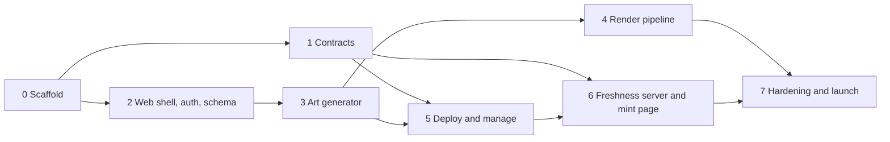

# Master plan

Build order and product decisions for Cobweb. [PLAN.md](PLAN.md) is the original brief (scope, costs, revenue); this document is authoritative wherever the two differ. The legacy material each phase lifts from is indexed in [legacy/README.md](legacy/README.md).

## Decisions

### Contracts

- **Two contracts per chain:** `CobwebFactory` and `CobwebCollection`. The factory reuses the legacy factory's deploy path and is deployed fresh on each chain. One factory and one approved collection per chain, connected by approving the collection's creation-code hash.
- **Naming.** Contract names, events and errors use Cobweb, never Kingdomly.
- **Identical runtime bytecode.** No per-collection immutables and no hard-coded per-chain addresses: max supply and per-chain addresses live in storage set by the constructor. One collection artifact serves every chain; where no transfer validator exists, the validator is left unset.
- **Predictable addresses.** The CREATE2 salt has no `block.timestamp`, and the factory is deployed to the same address on every chain, so a collection's address is the same on every chain.
- **Fees.** Every fee is a flat amount of the chain's native token, set by the admin. No USD peg and no price oracle. Fee settings live on the factory; the collection reads them from the factory in its constructor (safe because the factory is the caller) and never accepts them as arguments. Only the factory admin can change a deployed collection's fee, up or down. The platform payout address is read from the factory at withdrawal time.
- **Art payment.** The factory takes the art-generation fee through `payForArt(jobId)` and emits the paid event. There is no separate payments contract.
- **Mint groups,** modelled on TheSuits (see [Mint groups](#mint-groups) below). The constructor takes the initial groups, all closed; more are registered after deploy. Each group has an open/closed flag and an optional scheduled start. There is no end time and no global gate.
- **Phase start.** A phase is live exactly at its start: `block.timestamp >= start`. Every contract check, view and the freshness server use `>=`.
- **Close all** is an emergency stop that turns every group's flag off (`stopOrStartAllMintGroups(false)`); it is not a separate gate.
- **Group supply.** `setMintGroupMaxSupply` rejects a value below what the group has already minted.
- **Whitelist quotas.** Written on-chain at 500 addresses per `setMintQuota` transaction. Allowance and minted count are stored separately, so a re-upload never resets what an address has already used.
- **Burn** is an airdrop to the dead address. There is no burn function and total supply is not reduced. A burn pays the airdrop fee per token.
- **Delegated mint.** The token lands in the hot wallet (the caller), and the quota is taken from the vault.
- **`mintOnBehalf`** sits alongside the delegate.xyz mint, behind an owner switch: the caller pays, the receiver's quota is used, and the receiver gets the tokens.
- **Single asset `tokenURI`** returns the base URI as-is, with no token id appended.
- **Locked tokens** need no contract code (see [Lock](#lock) below). The transfer validator's address can be changed from Settings.
- **Royalty** is per collection. There is no per-token royalty.

### Art

- **Assignment integrity at lock.** The browser submits the final token list; the server validates it against the project's rules (supply, rules, maximum counts, and duplicates unless the creator chose "Allow identical tokens" at lock), stores it and hashes it. That stored list is what gets rendered. The engine is not re-run at lock, because creators edit tokens by hand after generating. Generation uses a seeded PRNG so it is testable.
- **Layer images.** Originals are uploaded and kept. Every image is square (1:1), at most 2048 x 2048, the same size across a project, and at most 10 MB per file. The browser makes a separate small thumbnail for preview screens.
- **Maximum counts.** A trait's fixed quantity is a cap, as in the legacy app: the trait appears at most N times, since rules and other traits can prevent reaching it. The copy says "up to N".
- **Changing a token's trait** is checked against the rules, uniqueness and maximum counts.
- **Media.** 1/1s and metadata projects take images only. MP4 and GIF belong to the Single asset type, and the render pipeline passes them through without compositing.
- **Rarity tiers.** Five tiers (top 5%, 15%, 30%, 50%, the rest), with five tier colour tokens shared by Generate and the mint page.
- **Render output.** One image CID per batch and one metadata CID.
- **Compositor.** sharp is the only compositor. The render benchmark sets Lambda memory and batch size.
- **Art fee** (decided 7 October 2026). $0.11 per token from token one, converted to the chain's native token at lock. No free allowance. Single asset projects pay nothing, as in the legacy app.
- **Placeholder fee** (decided 7 October 2026). A deferred-art lock renders only the placeholder and costs nothing. The real set is quoted and paid when the art is finished and locked.
- **Storage limits** (decided 7 October 2026). 5 GB of layer files per project and 500 traits per layer.

### Flow

- **Five stages:** Details, Art (Layers, Rules, Generate; Upload assets for the other types), Lock and upload, Deploy, Manage drop. Phases, whitelist, mint page details, airdrop and settings are tabs inside Manage drop, not steps.
- **Mint page address.** No mint page exists without a contract. The creator reserves the address in the Deploy form; a reservation lasts 3 days and lapses if the contract is not deployed by then, freeing the address for anyone. Deploying makes it permanent and immutable, so shared links never break. A deployed collection without an address sets one in Manage drop, Mint page tab, where the page is also published. Schema: `collections.slug` is nullable, `slug_reserved_at` records the reservation, and every write goes through `private.reserve_slug(collection_id, slug)`.
- **Pre-reveal** is part of the one collection, not a second project. Lock and upload has a "Reveal later" placeholder (image, MP4 or GIF), Deploy starts on the placeholder CID, and Settings reveals to the real CID. A creator may deploy before the real art is finished; Art then stays open after deploy until the real set is locked. The details are in the [creator flow spec](specs/2026-10-03-creator-flow-ui.md#7-pre-reveal).
- **Deploy defaults.** The payout address defaults to the connected wallet. The public per-wallet limit is a constructor argument set at Deploy and editable in Phases.
- **Holder snapshot import** for Whitelist and Airdrop is a serverless function that reads `totalSupply` and loops `ownerOf` in batches over a private RPC endpoint. No indexer.
- **Auth.** RainbowKit with Supabase Sign in with Ethereum. Unlike the legacy app, there is no Dynamic and no Firebase; swapping auth is the first change to any lifted shell component.
- **Dropped:** gate submissions, partner codes, iframe customisation, email reminders, and the dashboard search and sort (a creator has a handful of collections).

### Mint page

- Liveness comes only from the contract's `mintGroupActive` view, read by the freshness server. Status and schedule logs make the freshness server re-read that view at once; they never set liveness themselves.
- Team, Roadmap, FAQ, a music player and an image carousel are mint page sections, edited in the Mint page tab (Phase 6).
- "Remind me" opens the visitor's calendar with the phase start, as on TheSuits. No email.
- Collectors see the rarity tier of what they minted on generative collections. Single asset and other same-metadata collections show something else in that spot, designed in Phase 6.
- Sold out shows no mint button, only links onward.
- Under 640 px the page's root font is 14 px.

### Brand and UI

- The product is named Cobweb, in a professional tone with no "realm" or medieval copy. The Kingdomly logo is in use until the logo decision below.
- Layout and Poppins come from the legacy app; there is no full redesign. The palette is a neutral warm gray, dark only, with the yellow accent `#fadc69` for the primary action, live state and progress. Tokens and rules are in [DESIGN.md](DESIGN.md).
- Every screen, lifted or new, is built from shadcn components in `packages/ui`; hand-rolled legacy components are not carried over. Layout and structure are kept. Legacy functionality is respected, not frozen: a better or more efficient way to do the same job is preferred, and any deliberate change is noted.

### Launch chains

| Chain           | Id    | Note                                                                                                                                                    |
| --------------- | ----- | ------------------------------------------------------------------------------------------------------------------------------------------------------- |
| Ethereum        | 1     |                                                                                                                                                         |
| Arbitrum        | 42161 |                                                                                                                                                         |
| Base            | 8453  |                                                                                                                                                         |
| Berachain       | 80094 |                                                                                                                                                         |
| Monad           | 143   |                                                                                                                                                         |
| Robinhood Chain | 4663  | Testnet 46630. ETH for gas, Arbitrum Nitro, Blockscout explorer. A testnet dry run confirms that deploys are not restricted and that verification works |

All six are standard EVM chains, so one factory build and one collection artifact cover them. The CREATE2 deployer, the delegate.xyz registry and Limit Break's default validator all have code on each of them.

### Lock

Locking uses what ERC721AC already provides. The collection's transfers are checked by the Limit Break transfer validator, and the creator changes the collection's security level on that validator: the non-transferable level to lock, back to the default to unlock. Marketplaces are blocked automatically while it is set.

- **Contract:** nothing added beyond inheriting ERC721AC and pointing at the validator.
- **Dashboard:** Lock and Unlock in Manage drop, Settings, sent from the creator's wallet.
- **Mint page:** the freshness server reads the collection's current security level and the page shows when transfers are locked.
- **To verify on testnet:** the exact non-transferable level in the validator version deployed on each launch chain, and that mints and airdrops still go through while it is set.
- **Limit:** on a chain with no validator deployed, there is no lock.

### Mint groups

The model is the TheSuits contract: [reference/TheSuits.sol](reference/TheSuits.sol), analysed in [reference/the-suits-mint-analysis.md](reference/the-suits-mint-analysis.md).

- A group is live if its flag is on, or if a start is scheduled and `block.timestamp >= start`. There is no end time and no global toggle.
- The creator opens, closes or schedules each group. Closing clears the schedule.
- Groups overlap: a whitelist group stays open after public starts unless the creator closes it.
- Liveness on the mint page comes only from the contract's `mintGroupActive` view.

## Open decisions

| Decision                                                                                   | Needed by                                                    |
| ------------------------------------------------------------------------------------------ | ------------------------------------------------------------ |
| Mint fee: option A, B or C from [PLAN.md](PLAN.md)                                         | Phase 7, when fee values are set (the mechanism is the same) |
| The logo: keep the Kingdomly crown or replace it                                           | Phase 7                                                      |

## Phases

Each phase ends with something that can be shown working. Phases 1 and 2 can run side by side, and Phase 4 can start as soon as Phase 3 has fixed the job data shape.

### Phase 0: Scaffold

**Status:** done.

- pnpm workspace with Turborepo, TypeScript, lint and format config.
- Directories from the README layout, empty packages wired into the workspace.
- `CLAUDE.md` with the repo rules, and the skills from [SKILLS.md](SKILLS.md).
- CI: typecheck, lint, test, `forge test`.
- Accounts: Supabase project, Railway project, AWS account with a scoped deploy role, Cloudflare zone, Filebase bucket.

**Done when:** a fresh clone installs, builds and passes CI with empty packages.

### Phase 1: Contracts

**Status:** done except the testnet deploy and verification, which need a funded deployer wallet, an RPC URL and an explorer key. Contracts, tests, deploy script and documentation are in [contracts/README.md](../contracts/README.md).

Source: [legacy/contracts.md](legacy/contracts.md), sections 2, 3, 8 and 9.

- Foundry project with pinned dependencies, installed fresh (the legacy submodules are empty).
- **Factory:** the legacy deploy path, plus the per-chain fee config, an admin-only codehash allowlist, a predictable salt, and `payForArt(jobId)` for the art fee, emitting an event keyed by job id.
- **Collection:** new contract on ERC721AC.
  - Mint groups ported from TheSuits: per-group flag and scheduled start, price, supply allocation, public per-wallet cap, issued and claimed quotas. Apply the fixes in the analysis doc.
  - Quota writes chunked by the dashboard at 500 addresses per transaction.
  - Fee settings read from the factory in the constructor, held in storage, changeable in either direction by the factory admin only.
  - Reveal, airdrop with per-token fee (burn is an airdrop to the dead address), delegated mint to the hot wallet, mint on behalf, royalties, withdraw. Locking is the validator's security level, not contract code.
  - View functions built for one multicall: phase state, supply, per-wallet quota.
- Tests: the legacy unit and invariant structure, plus invariants for fee changes being admin-only, liveness matching the `mintGroupActive` view, supply, quota accounting, and all collected value being withdrawable.
- Checks in CI: runtime bytecode identical across two deploys with different arguments; creation code under 24 KB.
- Deploy and verify on one testnet.

**Done when:** a collection deployed through the factory on testnet can be minted through a public phase and a whitelist phase, revealed and airdropped, and a second deploy verifies automatically.

**Do not carry over:** the 3% fee that is credited to nobody, the Pyth dependency, the global mint toggle (the per-group flag stays), `immutable maxSupply`, `block.timestamp` in the salt.

### Phase 2: Web shell, auth and schema

**Status:** done locally. Not yet connected to a hosted Supabase project or tried with a real wallet extension. The browser checks and unit tests from the [creator flow plan](plans/2026-10-03-creator-flow-ui.md) were completed on 7 October 2026.

Source: [legacy/market-design-system.md](legacy/market-design-system.md), [legacy/market-mint-and-data.md](legacy/market-mint-and-data.md) sections 3 and 4.

What exists:

- Next.js app keeping the legacy layout, root font scaling, 1440px `xl` and Poppins, on the token palette in [DESIGN.md](DESIGN.md). No hard-coded colours in components.
- `packages/ui`: every shadcn component restyled with the tokens, plus PageHeader, Panel, Stat, StatusBadge, Artwork and motion helpers. Dialog, AlertDialog, Sidebar and Sonner replace the legacy modals, side nav and toasts; Headless UI is not carried over.
- RainbowKit with Supabase Sign in with Ethereum; the session is available in server components and actions. A local dev wallet signs in for browser checks.
- Supabase schema: `profiles`, `collections`, `mint_groups` and `whitelist_entries`, with row-level security on every table and ownership by wallet, plus the mint page address reservation (`slug_reserved_at`, `private.reserve_slug`). The art tables (layers, traits, rules, tokens, render jobs, batches) arrive in Phase 3.
- One helper that every server action uses to check session and ownership. `pnpm --filter @cobweb/web verify:local` checks sign-in and every access rule against a local Supabase.
- Routes: sign-in, dashboard, `/create`, the five-stage flow under `/collections/[id]` (spec in [specs/2026-10-03-creator-flow-ui.md](specs/2026-10-03-creator-flow-ui.md)), and the public mint page at `/[slug]`.
- Details is wired to the database, including the frozen-field rules and the mint page address. Art, Lock and upload, Deploy, the six Manage drop tabs and the mint page run on typed sample data in `apps/web/src/lib/demo` with simulated transactions, switched on by `NEXT_PUBLIC_DEMO_DATA=1`. Each place a real backend plugs in is marked `Seam:` in the code; Phases 3 to 6 replace the sample data screen by screen.
- Pre-reveal ("Reveal later" and "Finish the art later") is modelled in the sample data and the stage rules.

**Done when:** a wallet can sign in, create a collection row, see only its own collections, and walk every stage of the flow and the mint page on sample data.

### Phase 3: Art generator

**Status:** in progress. The DNA engine (first sub-project) landed on 7 October 2026; see its spec. Next: the art tables. The art tables (second sub-project) landed on 8 October 2026; see [specs/2026-10-08-art-tables.md](specs/2026-10-08-art-tables.md). Next: layer and asset upload.

Source: [legacy/market-creator-flow.md](legacy/market-creator-flow.md), sections 2, 3, 4, 7 and 8.

Built as five sub-projects, each with its own spec and plan: the DNA engine ([specs/2026-10-07-dna-engine.md](specs/2026-10-07-dna-engine.md)), the art tables, layer and asset upload, wiring the Art screens, then lock and pay.

Data contract: [specs/2026-10-03-creator-flow-ui.md](specs/2026-10-03-creator-flow-ui.md) section 5 is the shape the Art, Lock and upload, Deploy, Manage and mint page screens already consume. Phase 3 implements it for the art tables and replaces the sample data behind each `Seam:` marker.

- `packages/dna`: lift `DNAGenerator`, make it pure (no input mutation), add a seeded PRNG, fix the rarity formula bug, add tests. A fixed quantity is a cap.
- Art tables: layers, traits, rules, tokens, render jobs, batches, and a deferred-art flag on the collection. The render job carries an optional placeholder (`{ cid, mediaType }`).
- Layer upload by presigned URL to S3, originals kept, browser-made thumbnails, content-hash keys so duplicates share files.
- Wire the Art screens to the real data: layers and ordering, rarity, maximum counts, blank traits, rules and conflict analyser, preview, token edit, swap, delete, curated regeneration, shuffle, 1/1s, metadata view, rarity tiers (five tier tokens in `packages/ui`).
- All four project types; Single asset capped at 4,000 and accepting MP4 and GIF (`UploadedAsset` gains a media type).
- Legacy behaviour fixed: adding a trait does not reset weights; auto-populate does not delete 1/1s; layer edits do not wipe the token list without warning.
- Competitor features marked "Add", "Switch" or "Replace" in the plan.
- Lock: the server validates and hashes the submitted token list and creates the job row with quote and TTL.
- Pay: the factory's `payForArt(jobId)`; the job becomes `paid` only from the verified event.

**Done when:** a creator can upload layers, generate and curate 10,000 tokens, lock, and pay on testnet, leaving a `paid` job row with a stored assignment.

### Phase 4: Render pipeline

**Status:** not started.

Source: [legacy/artgen-lambda.md](legacy/artgen-lambda.md), sections 3, 4, 7 and 9.

- SQS queue with a dead-letter queue; one message per 100 tokens carrying only job id and range.
- Render Lambda: lift the sharp compositing and multi-collection code; read layers from S3 to `/tmp`; pack the batch as a CAR; upload to Filebase.
- Single asset video or GIF, and the pre-reveal placeholder, pass through without compositing, each with matching metadata; the placeholder gets its own small CID.
- Batch completion recorded as a set of finished batch numbers; the last one flips the job to `finalizing` with one conditional update.
- Metadata Lambda: writes all JSON, packs one CAR, stores the CIDs on the job.
- No timestamps in metadata; pinned sharp and CAR settings so a re-run gives the same CIDs.
- Per-layer opacity, extra metadata fields, preview collage.
- Dashboard progress by polling the job row.
- Benchmark on real layers to set memory, `/tmp` size and batch size.

**Done when:** a paid 10,000-token job renders end to end, survives a forced batch failure and retry, and a re-run produces identical CIDs.

### Phase 5: Deploy and manage

**Status:** not started.

Source: [legacy/market-creator-flow.md](legacy/market-creator-flow.md) section 6.

- Deploy: factory call from the creator's wallet, address recorded from the event, mint page address made permanent.
- Phases: create and edit; Open now, Close and Schedule per phase, with times entered in the creator's time zone and converted to Unix.
- Whitelist: CSV upload, validation, chunked on-chain writes with resume after a failed chunk.
- Holder snapshot import for Whitelist and Airdrop, as a serverless function.
- Manage: reveal, airdrop with fee, burn, phase edits, withdraw, lock, and changing the transfer validator address in Settings.
- Gates and partner codes stripped from the lifted whitelist and deploy code.

**Done when:** a creator can go from a rendered collection to a deployed contract with two phases and a 2,000-address whitelist on testnet, without leaving the flow.

### Phase 6: Freshness server and mint page

**Status:** not started.

Source: [legacy/market-mint-and-data.md](legacy/market-mint-and-data.md), sections 1, 7 and 8.

- Freshness server: per-chain multicall with tiered polling, one topic-filtered logs subscription per chain, in-memory state per collection, HTTP with ETag and cache headers, `degraded` flag.
- Quota endpoint batching wallet reads into 200 ms multicall windows.
- Cloudflare in front: 1 s cache per collection, 5 s per wallet.
- Mint page at `/[slug]` on live data, with liveness only from the server-reported chain state. The collection endpoint carries the creator address, royalty and `degraded` flag the page needs.
- Mint action: `simulateContract`, then write with the simulated request. No fee padding.
- Delegated minting.
- Team, Roadmap, FAQ, music player and image carousel as Mint page tab fields and page sections; "Remind me" for a scheduled phase; rarity tier on minted tokens, with an alternative for same-metadata collections.

**Done when:** a mint page opens its button within one poll of the phase start on-chain, never before, and a mint attempted one second early is blocked in the UI.

### Phase 7: Hardening and launch

**Status:** not started.

- Port the k6 test; run 20,000 pollers and 5,000 quota reads in a minute against the Cloudflare endpoint.
- Contract review: Slither, invariant run, and an external look if budget allows.
- Mainnet factory deploys and verification on the launch chains; fee values set.
- Lifecycle rule deleting layer sources after 90 days.
- Alerts on the dead-letter queue, freshness server health and RPC errors.
- Rotate every legacy secret listed in [legacy/README.md](legacy/README.md).
- Hosted Supabase settings:
  - Email provider off. Wallet sign-ups stay on.
  - `site_url` and redirect URLs set to exact production origins. No wildcard preview domains: this list decides which sites' sign-in signatures are accepted.
  - Session limits and a short access-token lifetime, as in `supabase/config.toml`.
  - Captcha on wallet sign-in, and a per-wallet cap on collections so mint page addresses cannot be squatted.
  - Asymmetric JWT signing keys, so sessions are verified without a network call.
- A full Content-Security-Policy for scripts, beyond the framing block in place today.

**Done when:** one real collection has been launched end to end on mainnet.

## Order of risk

What is most likely to cost time, most serious first.

1. **Collection contract size and correctness.** Legacy creation code is already 20.6 KB of the 24 KB limit, and phases and views are additions.
2. **Art generator lift.** It is the largest body of legacy UI, with page files over a thousand lines and state spread across providers.
3. **Assignment integrity at lock.** It decides what the creator pays for and what gets rendered.
4. **Repeatable CIDs.** A retried batch that produces a different CID breaks metadata that already points at the first one.
5. **Auth and ownership.** Nothing in the legacy app can be trusted as a pattern here.
