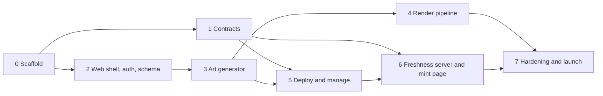

# Master plan

Build order and product decisions for Cobweb. [PLAN.md](PLAN.md) is the original brief (scope, costs, revenue); this document is authoritative wherever the two differ. The legacy material each phase lifts from is indexed in [legacy/README.md](legacy/README.md).

## Decisions

### Contracts

- **Two contracts per chain:** `CobwebFactory` and `CobwebCollection`. The factory reuses the legacy factory's deploy path and is deployed fresh on each chain. One factory and one approved collection per chain, connected by approving the collection's creation-code hash.
- **Naming.** Contract names, events and errors use Cobweb, never Kingdomly.
- **Identical runtime bytecode.** No per-collection immutables and no hard-coded per-chain addresses: max supply and per-chain addresses live in storage set by the constructor. One collection artifact serves every chain; where no transfer validator exists, the validator is left unset.
- **Predictable addresses.** The CREATE2 salt has no `block.timestamp`, and the factory is deployed to the same address on every chain, so a collection's address is the same on every chain.
- **Fees.** Every fee is a flat amount of the chain's native token, set by the admin. No USD peg and no price oracle. Fee settings live on the factory; the collection reads them from the factory in its constructor (safe because the factory is the caller) and never accepts them as arguments. Only the factory admin can change a deployed collection's fee, up or down. The platform payout address is read from the factory at withdrawal time.
- **Art payment.** The factory takes the art-generation fee through `payForArt(jobId)` and emits the paid event. There is no separate payments contract.
- **Mint groups,** modelled on TheSuits (see [Mint groups](#mint-groups) below). The constructor takes the initial groups, all closed; more are registered after deploy. Each group has an open/closed flag and an optional scheduled start. There is no end time and no global gate.
- **Phase start.** A phase is live exactly at its start: `block.timestamp >= start`. Every contract check, view and the freshness server use `>=`.
- **Close all** is an emergency stop that turns every group's flag off (`stopOrStartAllMintGroups(false)`); it is not a separate gate.
- **Group supply.** `setMintGroupMaxSupply` rejects a value below what the group has already minted.
- **Whitelist quotas.** Written on-chain at 500 addresses per `setMintQuota` transaction. Allowance and minted count are stored separately, so a re-upload never resets what an address has already used.
- **Burn** is an airdrop to the dead address. There is no burn function and total supply is not reduced. A burn pays the airdrop fee per token.
- **Delegated mint.** The token lands in the hot wallet (the caller), and the quota is taken from the vault.
- **`mintOnBehalf`** sits alongside the delegate.xyz mint, behind an owner switch: the caller pays, the receiver's quota is used, and the receiver gets the tokens.
- **Single asset `tokenURI`** returns the base URI as-is, with no token id appended.
- **Locked tokens** need no contract code (see [Lock](#lock) below). The transfer validator's address can be changed from Settings.
- **Royalty** is per collection. There is no per-token royalty.
- **The shipped collection artifact** (decided 14 October 2026; [specs/2026-10-14-deploy.md](specs/2026-10-14-deploy.md)). The web app deploys the creation code it ships from `@cobweb/shared/collection`, generated from the Foundry build by the copy script with its keccak256 hash and the ABI, never fetched at request time. `foundry.toml` pins `evm_version`, the shared package's test asserts the shipped hash against `contracts/out`, and CI runs that test after `forge build`, so the hash the admin approves on the factory is the hash the web app sends.

### Art

- **Assignment integrity at lock.** The browser submits the final token list; the server validates it against the project's rules (supply, rules, maximum counts, and duplicates unless the creator chose "Allow identical tokens" at lock), stores it and hashes it. That stored list is what gets rendered. The engine is not re-run at lock, because creators edit tokens by hand after generating. Generation uses a seeded PRNG so it is testable.
- **Layer images.** Originals are uploaded and kept. Every image is square (1:1), at most 2048 x 2048, the same size across a project, and at most 10 MB per file. The browser makes a separate small thumbnail for preview screens.
- **Maximum counts.** A trait's fixed quantity is a cap, as in the legacy app: the trait appears at most N times, since rules and other traits can prevent reaching it. The copy says "up to N".
- **Changing a token's trait** is checked against the rules, uniqueness and maximum counts.
- **Media.** 1/1s and metadata projects take images only. MP4 and GIF belong to the Single asset type, and the render pipeline passes them through without compositing.
- **Rarity tiers.** Five tiers (top 5%, 15%, 30%, 50%, the rest), with five tier colour tokens shared by Generate and the mint page.
- **Render output.** One image CID per batch and one metadata CID.
- **Compositor.** sharp is the only compositor. The render benchmark sets Lambda memory and batch size.
- **Art fee** (decided 7 October 2026). $0.11 per token from token one, converted to the chain's native token at lock. No free allowance. Single asset projects pay nothing, as in the legacy app.
- **Placeholder fee** (decided 7 October 2026). A deferred-art lock renders only the placeholder and costs nothing. The real set is quoted and paid when the art is finished and locked.
- **Storage limits** (decided 7 October 2026). 5 GB of layer files per project and 500 traits per layer.
- **Render credit** (decided 14 October 2026; [specs/2026-10-14-render-screen-wiring.md](specs/2026-10-14-render-screen-wiring.md)). A paid render that fails for good (an art problem, or five failed retries on a worker fault) can be unlocked, and the payment already made covers the next lock of the same collection with the same or fewer tokens: that lock is recorded `waived` with `credit_job_id` naming the job whose payment it rests on, through the waiver columns `render_jobs` already had. The rule lives in one SQL function, `private.render_credit`, which `art_lock` and the review's `art_render_credit` both ask; the web app never mirrors it. A larger lock pays in full and leaves the credit for a later, smaller lock; a credit is never partial. A job failed with `payment-mismatch` cannot be unlocked and leaves no credit: the payment itself is in doubt, so it stays with support.

### Flow

- **Five stages:** Details, Art (Layers, Rules, Generate; Upload assets for the other types), Lock and upload, Deploy, Manage drop. Phases, whitelist, mint page details, airdrop and settings are tabs inside Manage drop, not steps.
- **Mint page address.** No mint page exists without a contract. The creator reserves the address in the Deploy form; a reservation lasts 3 days and lapses if the contract is not deployed by then, freeing the address for anyone. Deploying makes it permanent and immutable, so shared links never break. A deployed collection without an address sets one in Manage drop, Mint page tab, where the page is also published. Schema: `collections.slug` is nullable, `slug_reserved_at` records the reservation, and every write goes through `private.reserve_slug(collection_id, slug)`.
- **Pre-reveal** is part of the one collection, not a second project. Lock and upload has a "Reveal later" placeholder (image, MP4 or GIF), Deploy starts on the placeholder CID, and Settings reveals to the real CID. A creator may deploy before the real art is finished; Art then stays open after deploy until the real set is locked. The details are in the [creator flow spec](specs/2026-10-03-creator-flow-ui.md#7-pre-reveal).
- **Deploy defaults.** The payout address defaults to the connected wallet. The public per-wallet limit is a constructor argument set at Deploy and editable in Phases.
- **The deploy chain** (decided 14 October 2026; [specs/2026-10-14-deploy.md](specs/2026-10-14-deploy.md)). The contract lives on the chain the art fee was paid on: when the collection has a done real job, the deploy chain is that job's `quote_chain_id` and the wallet switches to it; a deferred collection, which has paid nothing, picks its chain at deploy, and the real art's fee is quoted on it later because the lock reads `collections.chain_id` once set. `collections.chain_id` is written at deploy and never changes.
- **Prepare and prove** (decided 14 October 2026; [specs/2026-10-14-deploy.md](specs/2026-10-14-deploy.md)). A read-only action builds the constructor from the collection row, the finished render and the form, encodes it, picks the salt (the collection id's 16 bytes, left-aligned in 32) and predicts the CREATE2 address; the browser simulates and sends the factory call with those bytes; the confirming action rebuilds the same arguments, decodes the factory's `CollectionDeployed` log from the receipt and records the contract only when the event's address equals the prediction. Nothing is stored before the receipt. One `deployments` row per collection holds what was sent and what landed; the launch phases become `mint_groups` rows; `collection_record_deploy` writes all three. The name, symbol and description freeze at lock, since the metadata the worker writes and the contract's name must agree.
- **Holder snapshot import** for Whitelist and Airdrop is a serverless function that reads `totalSupply` and loops `ownerOf` in batches over a private RPC endpoint. No indexer.
- **Auth.** RainbowKit with Supabase Sign in with Ethereum. Unlike the legacy app, there is no Dynamic and no Firebase; swapping auth is the first change to any lifted shell component.
- **Dropped:** gate submissions, partner codes, iframe customisation, email reminders, and the dashboard search and sort (a creator has a handful of collections).

### Mint page

- Liveness comes only from the contract's `mintGroupActive` view, read by the freshness server. Status and schedule logs make the freshness server re-read that view at once; they never set liveness themselves.
- Team, Roadmap, FAQ, a music player and an image carousel are mint page sections, edited in the Mint page tab (Phase 6).
- "Remind me" opens the visitor's calendar with the phase start, as on TheSuits. No email.
- Collectors see the rarity tier of what they minted on generative collections. Single asset and other same-metadata collections show something else in that spot, designed in Phase 6.
- Sold out shows no mint button, only links onward.
- Under 640 px the page's root font is 14 px.
- **The public page's data** (decided 16 October 2026; [specs/2026-10-16-mint-page-live-data.md](specs/2026-10-16-mint-page-live-data.md)). One definer read of a published page, cached by its tag; chain state only from the browser's polls of the freshness server; token art from metadata at the chain's base URI; rarity only for the revealed base URI.

### Brand and UI

- The product is named Cobweb, in a professional tone with no "realm" or medieval copy. The Kingdomly logo is in use until the logo decision below.
- Layout and Poppins come from the legacy app; there is no full redesign. The palette is a neutral warm gray, dark only, with the yellow accent `#fadc69` for the primary action, live state and progress. Tokens and rules are in [DESIGN.md](DESIGN.md).
- Every screen, lifted or new, is built from shadcn components in `packages/ui`; hand-rolled legacy components are not carried over. Layout and structure are kept. Legacy functionality is respected, not frozen: a better or more efficient way to do the same job is preferred, and any deliberate change is noted.

### Launch chains

| Chain           | Id    | Note                                                                                                                                                    |
| --------------- | ----- | ------------------------------------------------------------------------------------------------------------------------------------------------------- |
| Ethereum        | 1     |                                                                                                                                                         |
| Arbitrum        | 42161 |                                                                                                                                                         |
| Base            | 8453  |                                                                                                                                                         |
| Berachain       | 80094 |                                                                                                                                                         |
| Monad           | 143   |                                                                                                                                                         |
| Robinhood Chain | 4663  | Testnet 46630. ETH for gas, Arbitrum Nitro, Blockscout explorer. A testnet dry run confirms that deploys are not restricted and that verification works |

All six are standard EVM chains, so one factory build and one collection artifact cover them. The CREATE2 deployer, the delegate.xyz registry and Limit Break's default validator all have code on each of them.

### Lock

Locking uses what ERC721AC already provides. The collection's transfers are checked by the Limit Break transfer validator, and the creator changes the collection's security level on that validator: the non-transferable level to lock, back to the default to unlock. Marketplaces are blocked automatically while it is set.

- **Contract:** nothing added beyond inheriting ERC721AC and pointing at the validator.
- **Dashboard:** Lock and Unlock in Manage drop, Settings, sent from the creator's wallet.
- **Mint page:** the freshness server reads the collection's current security level and the page shows when transfers are locked.
- **To verify on testnet:** the exact non-transferable level in the validator version deployed on each launch chain, and that mints and airdrops still go through while it is set.
- **Limit:** on a chain with no validator deployed, there is no lock.

### Mint groups

The model is the TheSuits contract: [reference/TheSuits.sol](reference/TheSuits.sol), analysed in [reference/the-suits-mint-analysis.md](reference/the-suits-mint-analysis.md).

- A group is live if its flag is on, or if a start is scheduled and `block.timestamp >= start`. There is no end time and no global toggle.
- The creator opens, closes or schedules each group. Closing clears the schedule.
- Groups overlap: a whitelist group stays open after public starts unless the creator closes it.
- Liveness on the mint page comes only from the contract's `mintGroupActive` view.
- **The dashboard reads the chain** (decided 15 October 2026; [specs/2026-10-15-phases.md](specs/2026-10-15-phases.md)). Manage drop reads `collectionState()` on the server on each page load and after each confirmed change; status is its `active` field. `mint_groups` keeps what never goes on chain (name, description, visibility, order) and a copy of price, allocation and start refreshed from those reads, never from the browser. The freshness server may replace the read in Phase 6.

### Hosting

- **Render pipeline on Vercel, Cloudflare R2 and Vercel Queues; no AWS** (decided 13 October 2026; [specs/2026-10-13-render-worker-vercel.md](specs/2026-10-13-render-worker-vercel.md)). The render worker runs inside the web app as Vercel Functions on fluid compute, which scale to zero: the consumer of the `render` topic and a sweep cron every 15 minutes. Pro allows 800 seconds an invocation and a 4 GB Performance instance; a proof run rendered 100 tokens at 2048 by 2048 with 7 layers in 187 seconds at a 779 MB peak and produced the laptop's CID. Layers and collages live in Cloudflare R2 (no egress charge) through its S3 endpoint; locally both buckets stay on Supabase Storage. Duplicates are stopped by idempotency keys; dead-lettering is in the consumer, on the third delivery; the start message is sent when the payment is recorded, or at lock for a waived job; 1/1 and single asset batches target 500 MB at lock and the worker's ceiling is 600 MB; 25 batches run at once to start, in `iad1`. The `infra` CDK package, the Lambda entry points, the SQS adapter and the Secrets Manager loader are deleted. Railway stays for the freshness server.
- **The freshness server** (decided 16 October 2026; [specs/2026-10-16-freshness-server.md](specs/2026-10-16-freshness-server.md)). One Node service on Railway, run from its TypeScript source by Node 24, reads every chain whose `RPC_URL_<id>` and `FACTORY_ADDRESS_<id>` are set, over HTTP only: per chain and tick, one `eth_getLogs` and one multicall at one block over the collections requested in the last 10 minutes, every 1 s around a scheduled start, 2 s while a phase is live and 20 s otherwise. It serves the state and wallet endpoints with ETag and cache headers and a `degraded` flag, reads no database and never computes liveness. Its Railway settings live on the service, since Railway deprecated config as code. Manage keeps its own reads.

## Open decisions

| Decision                                           | Needed by                                                    |
| -------------------------------------------------- | ------------------------------------------------------------ |
| Mint fee: option A, B or C from [PLAN.md](PLAN.md) | Phase 7, when fee values are set (the mechanism is the same) |
| The logo: keep the Kingdomly crown or replace it   | Phase 7                                                      |

## Phases

Each phase ends with something that can be shown working. Phases 1 and 2 can run side by side, and Phase 4 can start as soon as Phase 3 has fixed the job data shape.

### Phase 0: Scaffold

**Status:** done.

- pnpm workspace with Turborepo, TypeScript, lint and format config.
- Directories from the README layout, empty packages wired into the workspace.
- `CLAUDE.md` with the repo rules, and the skills from [SKILLS.md](SKILLS.md).
- CI: typecheck, lint, test, `forge test`.
- Accounts: Supabase project, Railway project, AWS account with a scoped deploy role, Cloudflare zone, Filebase bucket.
- Accounts, as of 13 October 2026: Supabase project, Railway project, Vercel project, Cloudflare zone and R2, Filebase bucket. The AWS account with a scoped deploy role was dropped; see the Hosting decision.
- Accounts, as of 15 October 2026: the hosted Supabase project `cobweb` (SuitVentures organisation, us-east-1, ref `umwkpwtkwmdizgndxnjc`) is linked and configured through `[remotes.cobweb]` in `supabase/config.toml` (Sign in with Ethereum on, the production domain as the only sign-in origin), with its `art` and `render` buckets created; the Vercel project `cobweb` (team cobweb3, root `apps/web`) holds the non-secret production values and a cron secret. Left to the owner: `supabase db push`, the Supabase keys and the storage key pair into Vercel, and the production deploy.

**Done when:** a fresh clone installs, builds and passes CI with empty packages.

### Phase 1: Contracts

**Status:** done except the testnet deploy and verification, which need a funded deployer wallet, an RPC URL and an explorer key. Contracts, tests, deploy script and documentation are in [contracts/README.md](../contracts/README.md).

Source: [legacy/contracts.md](legacy/contracts.md), sections 2, 3, 8 and 9.

- Foundry project with pinned dependencies, installed fresh (the legacy submodules are empty).
- **Factory:** the legacy deploy path, plus the per-chain fee config, an admin-only codehash allowlist, a predictable salt, and `payForArt(jobId)` for the art fee, emitting an event keyed by job id.
- **Collection:** new contract on ERC721AC.
  - Mint groups ported from TheSuits: per-group flag and scheduled start, price, supply allocation, public per-wallet cap, issued and claimed quotas. Apply the fixes in the analysis doc.
  - Quota writes chunked by the dashboard at 500 addresses per transaction.
  - Fee settings read from the factory in the constructor, held in storage, changeable in either direction by the factory admin only.
  - Reveal, airdrop with per-token fee (burn is an airdrop to the dead address), delegated mint to the hot wallet, mint on behalf, royalties, withdraw. Locking is the validator's security level, not contract code.
  - View functions built for one multicall: phase state, supply, per-wallet quota.
- Tests: the legacy unit and invariant structure, plus invariants for fee changes being admin-only, liveness matching the `mintGroupActive` view, supply, quota accounting, and all collected value being withdrawable.
- Checks in CI: runtime bytecode identical across two deploys with different arguments; creation code under 24 KB.
- Deploy and verify on one testnet.

**Done when:** a collection deployed through the factory on testnet can be minted through a public phase and a whitelist phase, revealed and airdropped, and a second deploy verifies automatically.

**Do not carry over:** the 3% fee that is credited to nobody, the Pyth dependency, the global mint toggle (the per-group flag stays), `immutable maxSupply`, `block.timestamp` in the salt.

### Phase 2: Web shell, auth and schema

**Status:** done locally. Not yet connected to a hosted Supabase project or tried with a real wallet extension. The browser checks and unit tests from the [creator flow plan](plans/2026-10-03-creator-flow-ui.md) were completed on 7 October 2026.

Source: [legacy/market-design-system.md](legacy/market-design-system.md), [legacy/market-mint-and-data.md](legacy/market-mint-and-data.md) sections 3 and 4.

What exists:

- Next.js app keeping the legacy layout, root font scaling, 1440px `xl` and Poppins, on the token palette in [DESIGN.md](DESIGN.md). No hard-coded colours in components.
- `packages/ui`: every shadcn component restyled with the tokens, plus PageHeader, Panel, Stat, StatusBadge, Artwork and motion helpers. Dialog, AlertDialog, Sidebar and Sonner replace the legacy modals, side nav and toasts; Headless UI is not carried over.
- RainbowKit with Supabase Sign in with Ethereum; the session is available in server components and actions. A local dev wallet signs in for browser checks.
- Supabase schema: `profiles`, `collections`, `mint_groups` and `whitelist_entries`, with row-level security on every table and ownership by wallet, plus the mint page address reservation (`slug_reserved_at`, `private.reserve_slug`). The art tables (layers, traits, rules, tokens, render jobs, batches) arrive in Phase 3.
- One helper that every server action uses to check session and ownership. `pnpm --filter @cobweb/web verify:local` checks sign-in and every access rule against a local Supabase.
- Routes: sign-in, dashboard, `/create`, the five-stage flow under `/collections/[id]` (spec in [specs/2026-10-03-creator-flow-ui.md](specs/2026-10-03-creator-flow-ui.md)), and the public mint page at `/[slug]`.
- Details is wired to the database, including the frozen-field rules and the mint page address. Art, Lock and upload, Deploy, the six Manage drop tabs and the mint page run on typed sample data in `apps/web/src/lib/demo` with simulated transactions, switched on by `NEXT_PUBLIC_DEMO_DATA=1`. Each place a real backend plugs in is marked `Seam:` in the code; Phases 3 to 6 replace the sample data screen by screen.
- Pre-reveal ("Reveal later" and "Finish the art later") is modelled in the sample data and the stage rules.

**Done when:** a wallet can sign in, create a collection row, see only its own collections, and walk every stage of the flow and the mint page on sample data.

### Phase 3: Art generator

**Status:** complete. The DNA engine (first sub-project) landed on 7 October 2026; see its spec. The art tables (second sub-project) landed on 8 October 2026; see [specs/2026-10-08-art-tables.md](specs/2026-10-08-art-tables.md). Layer and asset upload (third sub-project) landed on 8 October 2026; see [specs/2026-10-08-art-upload.md](specs/2026-10-08-art-upload.md). Wiring the Art screens to the art tables (fourth sub-project) landed on 8 October 2026; see [specs/2026-10-08-art-wiring.md](specs/2026-10-08-art-wiring.md). Owed to the lock and pay sub-project: a sweep of objects that were uploaded but never recorded (older than a day), since the project cap counts recorded rows only. Next: lock and pay. Lock and pay (fifth sub-project) landed on 10 October 2026; see [specs/2026-10-09-lock-and-pay.md](specs/2026-10-09-lock-and-pay.md). Phase 3 is complete. Owed to Phase 4: the worker re-checks jobPayment(onchain_job_id, quote_payer) against the quote on chain before rendering; locking the real set of a deferred-art collection after its placeholder lock is wired with the reveal flow; render output must not be written into the `art` bucket under upload-shaped keys, or the sweep must learn the pattern first; a support path to reconcile a payment that mined after its job was unlocked (the job row is kept with state failed and error unlocked, keyed by its on-chain job id). Owed to Phase 5: deploy on the job's `quote_chain_id` or refuse a mismatch, since the chain is not frozen on the collection (done 14 October 2026 by the Deploy sub-project: `prepareCore` deploys on the done real job's `quote_chain_id`, refuses another chain, and `collection_record_deploy` writes `collections.chain_id`; [specs/2026-10-14-deploy.md](specs/2026-10-14-deploy.md)). Next: Phase 4, rendering.

Source: [legacy/market-creator-flow.md](legacy/market-creator-flow.md), sections 2, 3, 4, 7 and 8.

Built as five sub-projects, each with its own spec and plan: the DNA engine ([specs/2026-10-07-dna-engine.md](specs/2026-10-07-dna-engine.md)), the art tables, layer and asset upload, wiring the Art screens, then lock and pay.

Data contract: [specs/2026-10-03-creator-flow-ui.md](specs/2026-10-03-creator-flow-ui.md) section 5 is the shape the Art, Lock and upload, Deploy, Manage and mint page screens already consume. Phase 3 implements it for the art tables and replaces the sample data behind each `Seam:` marker.

- `packages/dna`: lift `DNAGenerator`, make it pure (no input mutation), add a seeded PRNG, fix the rarity formula bug, add tests. A fixed quantity is a cap.
- Art tables: layers, traits, rules, tokens, render jobs, batches, and a deferred-art flag on the collection. The render job carries an optional placeholder (`{ cid, mediaType }`).
- Layer upload by presigned URL to S3, originals kept, browser-made thumbnails, content-hash keys so duplicates share files.
- Wire the Art screens to the real data: layers and ordering, rarity, maximum counts, blank traits, rules and conflict analyser, preview, token edit, swap, delete, curated regeneration, shuffle, 1/1s, metadata view, rarity tiers (five tier tokens in `packages/ui`).
- All four project types; Single asset capped at 4,000 and accepting MP4 and GIF (`UploadedAsset` gains a media type).
- Legacy behaviour fixed: adding a trait does not reset weights; auto-populate does not delete 1/1s; layer edits do not wipe the token list without warning.
- Competitor features marked "Add", "Switch" or "Replace" in the plan.
- Lock: the server validates and hashes the submitted token list and creates the job row with quote and TTL.
- Pay: the factory's `payForArt(jobId)`; the job becomes `paid` only from the verified event.

**Done when:** a creator can upload layers, generate and curate 10,000 tokens, lock, and pay on testnet, leaving a `paid` job row with a stored assignment. Proven on a local Anvil chain (`verify:chain` and the browser walk); a public testnet needs only `RPC_URL_<id>` and `FACTORY_ADDRESS_<id>` once the factory is deployed there.

### Phase 4: Render pipeline

**Status:** complete. Items owed to this phase are listed at the end of the Phase 3 status line. It starts from a `paid` (or `waived`) render job: `render_jobs.token_list_hash`, `batch_size` and `batches_total` are set at lock, the generative list is the `tokens` rows and the 1/1 and single asset list is `render_jobs.token_list`. The screen's render and done steps run on `components/upload/render-sim.ts`, the seam this phase replaces. Render core (first sub-project of four: render core, job state, worker and local runner, screen wiring) landed on 11 October 2026; see [specs/2026-10-11-render-core.md](specs/2026-10-11-render-core.md). `@cobweb/render` in `services/render` is a pure library (no clock, environment, network or file-system access) with sharp, `@ipld/unixfs` and `@ipld/car` pinned exactly. The second and third sub-projects consume `LoadImage` (the worker's loader: bytes for an `ImageRef`, throwing when the object is missing), `renderBatch`, `renderMetadataSet`, `renderPlaceholder`, `previewCollage` and `PackedDirectory.cid`, the CID computed locally that the worker asserts against the pinning service's answer. Per-layer opacity and extra metadata fields are supported by the library; their columns and controls are owed to a follow-up. For the third sub-project's benchmark: raw RGBA decoding costs about 16.7 MB per 2048 by 2048 layer per token in flight, `packDirectory` holds the input, the blocks and the joined CAR at once (about three times the input at peak), and a token's layer images load one after another; the worker needs a support path to reconcile a payment that mined after its job was unlocked (the job row is kept as state failed, error unlocked). Compositing blends in integer arithmetic so CIDs agree across architectures; the third sub-project confirms the goldens on a native x64 runner and checks ICC-tagged and 16-bit layers across architectures. Job state (second sub-project) landed on 12 October 2026; see [specs/2026-10-12-render-job-state.md](specs/2026-10-12-render-job-state.md). `render_state` gained `finalizing`; `render_jobs.images_cid` is gone (each batch row carries its directory's CID), and the job gained `base_uri`, `placeholder_image_cid`, `collage_key`, `error_code` and `retries`. Six functions move a job. The worker calls five with the service role: `art_claim_render(p_job_id)`, `art_batch_start(p_job_id, p_index)`, `art_batch_done(p_job_id, p_index, p_images_cid, p_images_size)` (it returns `batches_done` and `last`; `last` is true exactly once, for the call that flips the job to `finalizing`), `art_batch_failed(p_job_id, p_index, p_code, p_message, p_final)` and `art_render_finish(p_job_id, p_metadata_cid, p_base_uri, p_placeholder_image_cid, p_collage_key)`. The creator's session calls the sixth, `art_render_retry(p_collection_id)`, which re-queues batches in state failed or running, refuses a job failed with `payment-mismatch` and a job at five retries, and returns a job with every batch done to `finalizing`. The screen reads the `RenderJob` union (`rendering` with `failedBatch`; `finalizing`; `failed` with `errorCode`, `failedBatch`, `retries` and `retryable`; `done` with `metadataCid`, `baseUri`, `batchCids`, `placeholderImageCid` and `collageKey`) by polling `getRenderJob`; `MAX_RENDER_RETRIES` is 5. Every function that writes the collection locks it before the job, and no status write moves a `deployed` collection. Owed to the third sub-project (worker and local runner): `enqueueRender(jobId)` for the retry action; enqueue and sweep every batch not done (a retry re-queues failed and running batches); when `art_batch_done` answers `last` false with `batches_done` equal to the total, enqueue the metadata step anyway (finish is idempotent); a sweep that re-enqueues the metadata step for a job left `finalizing`; a job-level failure is `art_batch_failed` with a null index and `p_final` true, which needs a cast in TypeScript because the generated type has no null; the worker fails a job with code `payment-mismatch` when the on-chain payment check fails and with `cid-mismatch` when the pinning service returns a different CID; a refusal from `art_batch_start` on a job that is not rendering is acknowledged, not retried; and the collage key convention outside upload-shaped keys. Owed to the fourth sub-project (screen wiring): `retryRender`, which calls `art_render_retry` and then `enqueueRender(jobId)`; the polling loop (3 seconds, 15 after two minutes); replacing the render simulation so a failed job shows its error, failed batch, retries left and Try again; and listing every batch CID on the done step. Owed to Phase 5: the reveal flow owns a deployed collection's rendering status, and retry's job selection on a deferred collection that later holds a real job. After the whole-branch review of job state, the worker's messages carry the job's `retries` value and pass it to `art_batch_failed` as `p_retries`, so a report older than the creator's latest retry is ignored; the worker may check payment before claiming and record a mismatch as a job-level failure on the paid job; a claim redelivered after the flip is answered with the unchanged row; a batch finishing after a sibling's final failure is recorded; placeholder locks are capped at ten per collection. The render worker (third sub-project) landed on 12 October 2026; see [specs/2026-10-12-render-worker.md](specs/2026-10-12-render-worker.md). What exists: `@cobweb/worker` in `services/worker` (five ports, each with a production adapter and a local or test double; the start, batch and metadata steps; the dead-letter handler and the sweep; the three Lambda entry points), the local runner (`@cobweb/worker/local`), `pnpm --filter @cobweb/web verify:render` (19 PASS lines against local Supabase, local storage and Anvil, with a folder standing in for Filebase and a queue in memory), and the CDK stack `CobwebRender` in `infra`, in us-east-1, defined and tested offline with template assertions and never deployed. The local benchmark (`pnpm --filter @cobweb/worker bench`: 100 tokens at 2048 by 2048 with 7 layers) took about 52 to 60 seconds and about 695 MB on a 12 core arm64 laptop and made a 146 MB archive. Owed to the owner before production: the deploy itself, the two Filebase behaviours (a CAR imported by object metadata, and the CID in the head response) confirmed against a live account, a benchmark on Lambda to set memory, timeout and ephemeral storage, and a notification target for the alarm on the dead-letter function's invocations (the alarm exists and has no target). Still owed technically: native x64 goldens (CI runs `pnpm test` on an x64 Ubuntu runner, so the render library's golden CIDs are checked there on the next push to main or pull request, but no x64 run has been seen yet), ICC tagged and 16 bit layers across architectures, the payment depth branch exercised on a chain with more than one confirmation (Anvil has one, so only unit tests cover it), and revisiting the cap of 10 concurrent render functions after the Lambda benchmark and once Filebase's limits are known. The stack also holds two secrets (the dead-letter and sweep functions read the Supabase key only), installs sharp from a committed lockfile, and shortens a failed message's wait to 120 seconds; asset batches are sized by bytes at lock (about 1 GB) and the worker enforces a real ceiling. Owed: freezing the collection's name and description while the art is locked (Phase 5, where deploy uses the name; the metadata step reads them fresh meanwhile) (done 14 October 2026 by the Deploy sub-project: `collections_guard_frozen_fields` refuses a change to the name, symbol or description once `art_locked_at` is set, and the Details screen shows them read-only; [specs/2026-10-14-deploy.md](specs/2026-10-14-deploy.md)); streaming the CAR so batches need not be sized by memory; a dead duplicate message costs a creator one retry; many unstartable paid jobs starve the sweep's 100 row read; `record_upload` accepts a caller-supplied size when called directly, so sizes should be verified against storage inside the database path or the function moved behind the service role (owed to hardening); and per-tenant fairness in the shared queue (one creator's large job delaying others, bounded today only by the concurrency cap). The fourth sub-project consumes `enqueueRender` from `@cobweb/shared`, the SQS queue adapter `sqsRenderQueue` from `@cobweb/worker/queue`, and `art_render_retry` followed by `enqueueRender` in a `retryRender` action. It also reads the collage key, `<collectionId>/collage/<jobId>.png` in the render bucket, and the web app needs a way to sign it, which needs a read grant on the render bucket. The web app must also list `@cobweb/worker/queue` as a real dependency and transpile it. One known gap: a job failed for an art problem such as a wrong size layer is reported retryable, though a retry fails the same way; for every code in `ART_PROBLEM_CODES` (exported from `@cobweb/shared/render-queue`: `layer-size`, `bad-dna`, `missing-image`, `batch-range`, `missing-batch`, `reserved-key`, `duplicate-name`, `decode` and the worker's `batch-too-large`) the screen should send the creator to unlock and fix the art. Next: screen wiring (fourth sub-project). On 13 October 2026 the render worker moved to Vercel; see [specs/2026-10-13-render-worker-vercel.md](specs/2026-10-13-render-worker-vercel.md). The worker runs inside `apps/web` as the `render` topic's consumer (`/api/queues/render`, 800 seconds, at most 25 at once, region `iad1`) and the sweep cron (`/api/cron/render-sweep`, every 15 minutes); the pay flow sends the start message when the payment is recorded, and the lock sends it for a waived job; layers and collages are in Cloudflare R2; asset batches target 500 MB at lock and the worker's ceiling is 600 MB; a waived job is started at lock. The `infra` package, the Lambda entry points, the SQS adapter and the Secrets Manager loader are gone, and the fourth sub-project's retry action uses `vercelRenderQueue` from `@cobweb/worker/queue` in place of `sqsRenderQueue`. A preview deployment to the Vercel project `cobweb` built with sharp and registered the consumer's trigger and the cron. The AWS to-dos above (the deploy, the benchmark on Lambda, the alarm's notification target, the cap of 10 concurrent render functions) are withdrawn. Owed to the owner before production: the production env values and settings on the Vercel project (Function CPU Performance, the Supabase project in us-east-1, the two R2 buckets with their token and CORS rule, `CRON_SECRET`, the Filebase key) and the two Filebase behaviours confirmed against a live account (services/worker/README.md). Alerting on queue retries moves to Phase 7. Screen wiring (fourth sub-project) landed on 14 October 2026; see [specs/2026-10-14-render-screen-wiring.md](specs/2026-10-14-render-screen-wiring.md). The Lock and upload screen polls `getRenderJob` through React Query (3 seconds, then 15 after two minutes), shows the batches as the worker finishes them, shows a failed job with the worker's sentence and one of four faces (fix the art, try again, unlock on the credit, tell support), retries through `retryRender` (which sends the start message with the row's new retry count), and shows the collage, the metadata CID, the base URI and every batch CID on the done step; the collage is served by `GET /api/collections/[id]/collage`; a paid render that fails and is unlocked leaves a credit (the Render credit decision); sample mode runs on the same code and `render-sim.ts` is gone; `pnpm --filter @cobweb/web render:local <collectionId>` renders a collection's paid jobs on a laptop. Phase 4 is complete. Owed to Phase 5: the reveal flow owns a deployed collection's rendering status, and the retry's job selection on a deferred collection that later holds a real job. Minor and known: the poll runs the existing action, whose session check is the verified one (a read-only owner check is an optimisation for when the poll count shows it); the time estimate is rough (an observed rate over batches done, 95 seconds a batch before that); polling pauses in a background tab and the first poll after a return waits one interval; a credit is never partial.

Source: [legacy/artgen-lambda.md](legacy/artgen-lambda.md), sections 3, 4, 7 and 9.

- Before rendering a `paid` job, the worker re-checks the payment on chain as defense in depth: `jobPayment(onchain_job_id, quote_payer) >= quote_total_wei` on the factory. The lock, requote and payment record are already service-role only (Phase 3), so this guards against a server bug, not a creator.
- SQS queue with a dead-letter queue; one message per 100 tokens carrying only job id and range.
- Render Lambda: lift the sharp compositing and multi-collection code; read layers from S3 to `/tmp`; pack the batch as a CAR; upload to Filebase.
- Single asset video or GIF, and the pre-reveal placeholder, pass through without compositing, each with matching metadata; the placeholder gets its own small CID.
- Batch completion recorded as a set of finished batch numbers; the last one flips the job to `finalizing` with one conditional update.
- Metadata Lambda: writes all JSON, packs one CAR, stores the CIDs on the job.
- No timestamps in metadata; pinned sharp and CAR settings so a re-run gives the same CIDs.
- Per-layer opacity, extra metadata fields, preview collage.
- Dashboard progress by polling the job row.
- Benchmark on real layers to set memory, `/tmp` size and batch size.

**Done when:** a paid 10,000-token job renders end to end, survives a forced batch failure and retry, and a re-run produces identical CIDs.

### Phase 5: Deploy and manage

**Status:** in progress. The item owed to this phase is listed at the end of the Phase 3 status line. Deploy (first sub-project of four: deploy; phases; whitelist and the holder snapshot; airdrop and settings, each with its own spec, plan and branch) landed on 14 October 2026; see [specs/2026-10-14-deploy.md](specs/2026-10-14-deploy.md). What exists: `@cobweb/shared/collection` (the creation code, its hash and the ABI, asserted against the Foundry build in CI) and `deploy-address.ts` (the salt, the constructor encoding, the CREATE2 prediction pinned to the factory's own view); the `deployments` table and `collection_record_deploy` (the row, the collection's status, chain and contract, the link made permanent, the launch phases in `mint_groups`), the guard's lock freeze and `collection_placeholder_ready`; `prepareDeploy` and `confirmDeploy` (the prediction on the server, the record from the factory's `CollectionDeployed` event only when its address equals the prediction, the chain's confirmation depth as the payment's); the deploy machine (prepare, switch, simulate, wallet, confirm, verify; the sent hash and the form kept in localStorage; "I have a transaction hash"); the Deploy screen on real data with the one-chain card, the server's prediction and the deployed view, sample mode on the same code; Deploy open for a deferred collection whose placeholder is rendered; `pnpm --filter @cobweb/web verify:deploy` (15 checks against local Supabase and Anvil). The items owed by Phases 3 and 4 that this sub-project closes are marked at their lines. Known: the deployer pays the full creation code in calldata (about 4.5M gas), the identical-bytecode decision rules out a clone; a creator who deploys the prepared bytes from outside the flow with other arguments ends with a contract the app never records (support); the fee snapshot in `deployments` is informational, the contract's `fees()` is the truth; "Open mint page" waits for Phase 6 and explorer verification for Phase 7. Next: phases (the second sub-project). Phases (second sub-project of four) landed on 15 October 2026; see [specs/2026-10-15-phases.md](specs/2026-10-15-phases.md). What exists: `@cobweb/shared/collection-abi` (the collection's ABI alone, which Manage drop's browser code imports); the phases migration (`mint_groups.description`, `visible` and `position`, names of 1 to 40 characters unique in the collection ignoring case, the public sale always shown, the owner's grant narrowed to those four columns, `mint_group_record`, `mint_groups_refresh` with the read's block so a slower read never overwrites a newer one, `mint_group_move`, and `deployments.public_max_per_wallet` as the copy of the contract's limit with `state_block` and `state_read_at`); the server's read of `collectionState()` on each Manage page load and after each confirmed change, joined with the rows (`getPhases`), and the last copy with an alert when the chain does not answer; `confirmPhaseTx` and `recordPhase`, which check the receipt (to the collection, from the sign-in wallet, carrying the expected event) and read the chain again, the added phase's row written only then; `renamePhase`, `setPhaseVisibility` and `movePhase`; the manage machine (switch, check, wallet, confirming, reading the contract) that every on-chain change in Manage drop runs through, with the collection's custom errors in the creator's words; Phases and the Overview's minted total and live phases on real data, Add phase with its pending store and "Check again", sample mode on the same code; the deployed view's launch phases from `deployments.args`; `pnpm --filter @cobweb/web verify:phases` (20 checks against local Supabase and Anvil) on a deploy fixture shared with `verify:deploy`. Next: the whitelist and the holder snapshot (the third sub-project), then airdrop and settings (the fourth). Known: until the freshness server (Phase 6) the screens change only on a read, so a start that passes while the page is open reads Scheduled until the next read; a replaced or cancelled transaction is never matched (a replaced add is discarded before naming its "Group N"); an id or a limit set outside Cobweb above 2,147,483,647 is not copied; the Whitelist, Airdrop and Settings dialogs run on the sample actions until their sub-projects. Whitelist (third sub-project of four) landed on 15 October 2026; see [specs/2026-10-15-whitelist.md](specs/2026-10-15-whitelist.md). What exists: the whitelist migration (`whitelist_entries.quota` of 0 for a removal staged on a written address, the copies `written_quota`, `written_tx` and `written_at` of what the chain was last proven to hold, the owner's grants narrowed to the list's columns, `whitelist_entries_add` for the owner's adds under a cap of 10,000 per group, and `whitelist_chunk_record`, which only the service role calls); `setMintQuota` in the manage calls, with arrays in `SentCall` and counts in the review; chunks of 500 built by the server from the entries not written (`nextChunk`), sent from the sign-in wallet by the manage machine and proven by `confirmWhitelistChunk` from the receipt and the transaction's calldata; a chunk sent but not confirmed kept in the browser with "Check again" and "Discard"; quota used from `collectionState()` and Minted for the 25 addresses on screen from `quotaClaimed`; the holder snapshot as a server action (`fetchHolders`: ERC-721 checked through ERC-165, one block, at most 20,000 tokens, the chains with an RPC) behind the recipients input of Whitelist and Airdrop; sample mode on the same code; `pnpm --filter @cobweb/web verify:whitelist` (18 checks against local Supabase and Anvil). Next: airdrop and settings (the fourth sub-project). Known: the mint page (Phase 6) reads eligibility from `walletState` through the freshness server, and a quota set outside Cobweb is known only once a chunk carrying it is confirmed through Cobweb; per-chain chunk sizes stay out (500 fresh entries cost about 11.6M gas), and Monad and Berachain are measured on testnet before launch; records are not ordered by block, so "Check again" on an older chunk can write an older copy back until the next chunk; the 10,000 cap is the actions' and `whitelist_entries_add`'s, not the owner's direct insert grant; the snapshot misses holders of ids above `totalSupply()` after burns, reads no ERC-1155 and has no rate limit; the page ships every entry of each group; the Airdrop and Settings dialogs run on the sample actions until the fourth sub-project. Airdrop and Settings (fourth sub-project of four) landed on 16 October 2026; see [specs/2026-10-15-airdrop-settings.md](specs/2026-10-15-airdrop-settings.md). What exists: the migration (`airdrops` and `withdrawals`, read by the owner and written only by `airdrop_record` and `withdrawal_record` after a proof, and `deployments`' payout, royalty, base URI, `transfer_validator` and `mint_on_behalf` as copies refreshed by `settings_refresh`); `validatorAbi` and `DEFAULT_TRANSFER_VALIDATOR` in the shared package; payable and validator calls in the manage machine; airdrop batches of at most 500 wallets and 1,000 tokens built in the browser, sent with the contract's fee as the value, proven from the receipt and calldata at the chain's depth and listed with their token ids; the job kept in the browser with "Check again" and "Discard"; burn as a batch to the dead address; Settings read at one block, balances never copied, each change confirmed from its receipt, the reveal also from its calldata and the level from the validator's log; the withdrawals recorded; Reveal to the rendered metadata, the placeholder or another IPFS link; the owner check; the Overview's pointer, Reveal and proceeds; sample mode on the same code; `pnpm --filter @cobweb/web verify:airdrop` (15 checks) and `verify:settings` (17), and a batch of 500 fresh wallets with 2 tokens each measured at 26,880,045 gas on Anvil. Phase 5 is complete locally; the done-when run on a testnet is owed. Known: Phase 6 brings holders, recent mints, "Paid by minters", per-recipient history and the mint page's reveal state and transfer level through the freshness server, and airdrops and withdrawals made outside Cobweb are neither listed nor counted until its indexer reads them; the batch caps are provisional, and the 500-wallet batch's 26,880,045 gas is above the 16,777,216 per-transaction cap where one applies, so the wallet cap drops before launch, and Monad and Berachain are measured on testnet before launch; a discarded batch that landed is sent again by "Retry batch <n>" and mints twice (the waiting panel says so), a replaced transaction is never matched, a job too large for the browser's storage is kept for the visit only, and History's When is the time Cobweb recorded the batch; the default validator is the one legacy drove as V5 with `setRulesetOfCollection` while `validatorAbi` holds the pinned library's call, so the testnet check before launch covers the function and the levels 0, 1 and 9, levels 2 to 8 set outside Cobweb read "Level <n>, set outside Cobweb", and the validator's errors read generically; verify covers the validator address only, since Anvil has no validator code, so the level control, its confirm and the way back to the default are checked on a testnet; `royaltyInfo(1, 10000)` reads token 1's royalty, the payout address may withdraw on chain when it is not the owner, and refunds held for this wallet are shown, not claimed; a custom link is checked for its form, never fetched, and Reveal stays off until Cobweb has rendered the real set; `state_read_at` is the time of the last read of either kind; Phase 4 still owes the reveal flow owning a deployed collection's rendering status and the retry's job selection on a deferred collection that later holds a real job; a tab's server actions run one at a time, so an airdrop confirm's polls wait behind a running holder snapshot.

Source: [legacy/market-creator-flow.md](legacy/market-creator-flow.md) section 6.

- Deploy: factory call from the creator's wallet, address recorded from the event, mint page address made permanent.
- Phases: create and edit; Open now, Close and Schedule per phase, with times entered in the creator's time zone and converted to Unix.
- Whitelist: CSV upload, validation, chunked on-chain writes with resume after a failed chunk.
- Holder snapshot import for Whitelist and Airdrop, as a serverless function.
- Manage: reveal, airdrop with fee, burn, phase edits, withdraw, lock, and changing the transfer validator address in Settings.
- Gates and partner codes stripped from the lifted whitelist and deploy code.

**Done when:** a creator can go from a rendered collection to a deployed contract with two phases and a 2,000-address whitelist on testnet, without leaving the flow.

### Phase 6: Freshness server and mint page

**Status:** in progress. Freshness server (first sub-project of three: the freshness server; the mint page on live data; the indexer and the Overview, each with its own spec, plan and run) landed on 16 October 2026; see [specs/2026-10-16-freshness-server.md](specs/2026-10-16-freshness-server.md). What exists: `apps/freshness` run from its TypeScript source with no build step (`pnpm --filter @cobweb/freshness start`, on `PORT`, reading each chain whose `RPC_URL_<id>` and `FACTORY_ADDRESS_<id>` are set, and refusing to start on a malformed factory address); the hot set (a collection joins on its first request once its chain's factory confirms it with `isCollection`, and leaves after 10 minutes without one; at most 50 factory reads in flight per chain, `busy` beyond them); per chain and tick one `eth_getLogs` and one multicall at one block, at 1 s around a scheduled start, 2 s while a phase is live and 20 s otherwise, never sooner than one fast interval after a tick starts; the extras (owner, royalty, base URI, transfer validator and level) on their logs and every 60 s; the state endpoint with a weak ETag that unchanged ticks keep, the cache headers, `Access-Control-Expose-Headers` and `degraded` (its tier counted over the chain's entries that have a read); the wallet endpoint in 200 ms windows with up to 10 delegated vaults; `/health` (a failed factory read counts on its chain); the readers in `@cobweb/shared` with the `clients` entry and the delegate registry's ABI; `COBWEB_TEST_CHAINS` with Robinhood Chain Testnet (the web app fixes the switch at build time, and Turborepo passes it to the build); `pnpm --filter @cobweb/web verify:freshness` with 16 checks. Known: the Railway service, its settings and variables are the owner's to set (the spec's section 12), as is the one-line lint rule that keeps the web app on the shared server entry (a plugin hook refused that edit during the run), and until the mainnet factories (Phase 7) it can serve only the test chains, while Phase 1 still owes the testnet factory deploy; Cloudflare in front (a 1 s edge TTL, `stale-while-revalidate`, `stale-if-error`, the weak ETags and 304s, a rate limit, `CDN-Cache-Control` for the edge-only directives), the k6 run, alerts on `/health`, the second replica and the freshness origin in the CSP's `connect-src` are Phase 7's; on a testnet before launch: a wallet with whole-wallet and contract delegations reading its vaults, the registry's code on Berachain and Monad mainnet, `getCollectionSecurityPolicy` on the default validator, each provider's `eth_getLogs` range limit, its `eth_call` gas cap against up to 500 `collectionState()` calls in one multicall, and its head behind a load balancer, and Railway's edge idle timeout against the server's 65 s keep-alive; Anvil has no `multicall3`, validator code or registry, so the verify reads in parallel, reads every level `none` and every wallet without vaults, and it moves Anvil's clock about 600 s ahead each run; one replica, so a restart empties the hot set and each collection's first poll waits for its first read (up to 2 s, then 503), and a second replica would give up the per-process rule that `block` never goes back; a start scheduled less than one idle interval (20 s) ahead can be read up to that late; a node that keeps answering an old head reads as fresh, and `/health`'s lag shows it; a frozen read (a view that keeps answering null) keeps an idle chain at its own interval, and an entry marked while a node answers a head above the real chain is read in full on every tick that moves until a head reaches the scanned block again, since the scanned block never moves down; the verify's one-tick bounds in checks 10 and 14 leave about half a second of margin; reads are at the head, so a reorg can show a state and take it back; viem's HTTP transport waits up to 10 s and retries three times, so one slow RPC can stretch a tick, which `degraded` shows, and `close()` can take that long per call; there is no origin rate limit, and an address spray shares the ticks' provider quota; the extras can be older than `block`; `royaltyInfo(1, 10000)` reads token 1's royalty, and levels 2 to 8 are answered as numbers; with a cache in front a poll can be served one answer late, so the mint page fetches with `cache: 'no-cache'`, reads `Age`, keeps the highest `block` it has seen and treats a 404 `not-a-collection` as final for that page load only. Next: the mint page on live data. Mint page on live data (second sub-project of three) landed on 16 October 2026; see [specs/2026-10-16-mint-page-live-data.md](specs/2026-10-16-mint-page-live-data.md). What exists: `mint_pages` (one row per collection, written by its owner within column checks and a guard trigger) and `token_ranks` (a done real job's ranks, recorded by the server through `token_ranks_record` when a published page is saved or a reveal is confirmed in Settings), read publicly only through `mint_page`, `mint_page_preview` and `mint_page_tiers`; the public `mint-page` bucket; the Mint page tab saving its description, banner, avatar, About banner, links, featured tokens and five sections as one draft with its files, its public switch and Preview at `/<slug>/preview`, the Overview and Deploy reading the row; `/<slug>` rendered from one read cached under its link's tag for 60 s and expired by the tab's saves; the browser's polls of the freshness server at 1 s before the first answer and within 60 s of a start and 3 s otherwise, liveness only from `active`, a chain clock for the labels, the page's own `degraded` after 10 s, and every refusal in words; the mint simulated with the state's quote and sent as the simulated request through wagmi, `delegateMint` for a delegated vault on a whitelist phase, the receipt's ids, local mints counted once, the fourteen failures in words; token art from each token's metadata through the IPFS gateway, tiers once revealed and "#<id> of <supply>" for a single asset or a 1/1; the sections, Remind me and the music button; `@cobweb/shared`'s wire types and paths; sample mode's switches; `verify:local` with 380 checks and `pnpm --filter @cobweb/web verify:mint-page` with 17. Departures from the spec's letter, each ruled during the run, are listed in the spec's landing note (section 13). Known: the indexer, holders, recent mints, "Paid by minters" and per-recipient history are the third sub-project's, so the page shows the minted count from the state and no holder count or recent mints, and the Overview keeps holders and recent mints as sample; the owner's hosted steps (the `mint-page` R2 bucket, public on a custom domain with the art bucket's CORS rule; on Vercel `NEXT_PUBLIC_FRESHNESS_URL`, `MINT_PAGE_S3_BUCKET`, `MINT_PAGE_MEDIA_URL` and `IPFS_GATEWAY_URL`, then a rebuild; `supabase db push`; `NEXT_PUBLIC_DEMO_DATA=0` when production leaves sample mode); the full Content-Security-Policy with the page's origins, Cloudflare in front and a sweep of uploads never saved are Phase 7's; on a testnet before launch: delegated minting with a whole-wallet and a contract delegation, and the transfer level, which Anvil cannot show; tiers wait for a save of the published page or a reveal through Settings; edits in Phases reach the page within 60 s; the chain clock errs late by up to one server tick, and the banner's minutes and the `.ics` stamp use the browser's clock; the check and the receipt go to viem's public endpoints, which can rate-limit or fail; the check is retried once on `MintGroupInactive`; a hidden phase still mints for anyone who calls the contract; the first visit to a link after a revalidation costs one function and one database read; a placeholder render's completion is recorded by the worker's adapter, so the page shows the real art within 60 s of it rather than at once; "minted by you" is the phase's own count, not a sum over the phases. Next: the indexer and the Overview.

Source: [legacy/market-mint-and-data.md](legacy/market-mint-and-data.md), sections 1, 7 and 8.

- Freshness server: per-chain multicall with tiered polling, one topic-filtered logs subscription per chain, in-memory state per collection, HTTP with ETag and cache headers, `degraded` flag.
- Quota endpoint batching wallet reads into 200 ms multicall windows.
- Cloudflare in front: 1 s cache per collection, 5 s per wallet.
- Mint page at `/[slug]` on live data, with liveness only from the server-reported chain state. The collection endpoint carries the creator address, royalty and `degraded` flag the page needs.
- Mint action: `simulateContract`, then write with the simulated request. No fee padding.
- Delegated minting.
- Team, Roadmap, FAQ, music player and image carousel as Mint page tab fields and page sections; "Remind me" for a scheduled phase; rarity tier on minted tokens, with an alternative for same-metadata collections.

**Done when:** a mint page opens its button within one poll of the phase start on-chain, never before, and a mint attempted one second early is blocked in the UI.

### Phase 7: Hardening and launch

**Status:** not started.

- Port the k6 test; run 20,000 pollers and 5,000 quota reads in a minute against the Cloudflare endpoint.
- Contract review: Slither, invariant run, and an external look if budget allows.
- Mainnet factory deploys and verification on the launch chains; fee values set.
- Lifecycle rule deleting layer sources after 90 days.
- Alerts on the dead-letter queue, freshness server health and RPC errors.
- Alerts, as of 13 October 2026: render queue retries (Vercel Observability, from the dashboard; the dead-letter queue went with AWS), freshness server health and RPC errors.
- Rotate every legacy secret listed in [legacy/README.md](legacy/README.md).
- Hosted Supabase settings:
  - Email provider off. Wallet sign-ups stay on.
  - `site_url` and redirect URLs set to exact production origins. No wildcard preview domains: this list decides which sites' sign-in signatures are accepted.
  - Session limits and a short access-token lifetime, as in `supabase/config.toml`.
  - Captcha on wallet sign-in, and a per-wallet cap on collections so mint page addresses cannot be squatted.
  - Asymmetric JWT signing keys, so sessions are verified without a network call.
- A full Content-Security-Policy for scripts, beyond the framing block in place today.

**Done when:** one real collection has been launched end to end on mainnet.

## Order of risk

What is most likely to cost time, most serious first.

1. **Collection contract size and correctness.** Legacy creation code is already 20.6 KB of the 24 KB limit, and phases and views are additions.
2. **Art generator lift.** It is the largest body of legacy UI, with page files over a thousand lines and state spread across providers.
3. **Assignment integrity at lock.** It decides what the creator pays for and what gets rendered.
4. **Repeatable CIDs.** A retried batch that produces a different CID breaks metadata that already points at the first one.
5. **Auth and ownership.** Nothing in the legacy app can be trusted as a pattern here.
