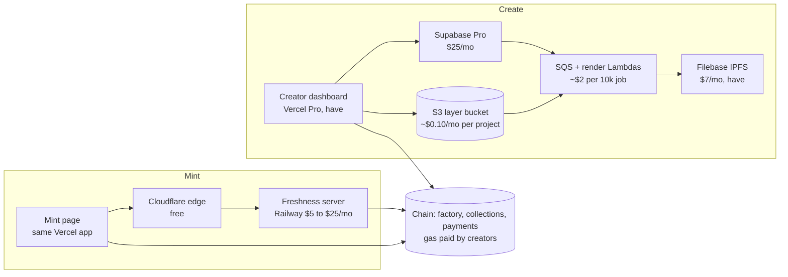
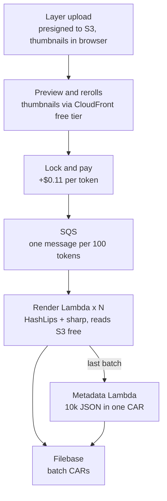
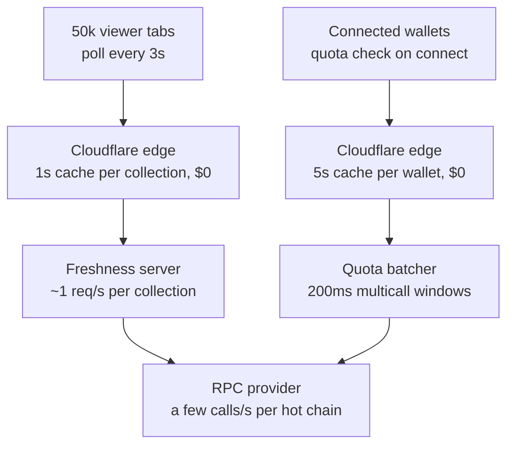
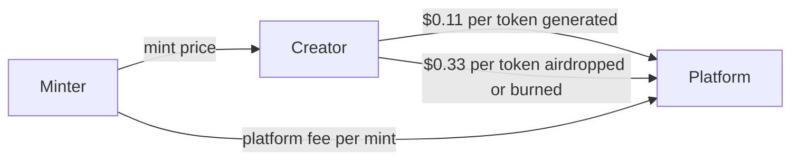

# Cobweb / KingdomlyLite

Sep 24, 2026 · Kobe Sergio

> This is the source plan, kept verbatim. The build sequence derived from it is in [MASTER_PLAN.md](MASTER_PLAN.md).

## Goal and scope

Cobweb / KingdomlyLite revives the Kingdomly no-code NFT launchpad as the lightest version we can run: roughly $60 to $80 a month fixed, five paid services instead of a dozen, and AWS cut down to Lambda, SQS and S3 for art rendering. Creator and minter UX stays at or above the old level, with the early-live failed-mint bug from The Suits fixed by design.

**In scope for v1:** create collection, generate art from layer assets, deploy, set up phases, upload whitelist, mint page, reveal, airdrops, phase edits.

**Out of scope for v1:** the LayerZero bridge launchpad, staking pools, the Seaport marketplace, Discord/X/email gates, and merkle whitelists.

## Before and after

Every AWS service except Lambda, SQS and S3 is replaced by one managed service or removed. The old monthly AWS bill is the one number still missing for the "before" column.

| Area | Old Kingdomly | KingdomlyLite | Trade-off |
| --- | --- | --- | --- |
| Frontend | Next.js, wagmi/viem, Dynamic wallet auth | Next.js on Vercel Pro, RainbowKit, Supabase Auth Sign in with Ethereum | Dynamic and Firebase gone; one auth provider |
| Backend | Node/Express on EC2, Lambda, API Gateway, Step Functions | One Node service on Railway plus render Lambdas fed by SQS | No always-on fleet; the worker costs nothing between jobs |
| Storage | S3, EFS, CloudFront, ElastiCache | S3 for source layers with CloudFront's free tier for thumbnails, Cloudflare free edge cache for mint state | No EFS; each render Lambda uploads its own batch |
| Database | Postgres + Supabase + Firebase | Supabase Pro only | One vendor for DB, auth, storage, job queue |
| IPFS | Pinata | Filebase (existing $7 plan), CAR uploads | Same CID guarantees, cheaper plan |
| RPC | Alchemy | Free tier to start, paid tier only when several chains are hot | Freshness server fans in all reads, so RPC use is small |
| Price oracle | CoinGecko / Pyth for a USD-pegged fee | None; per-chain flat native fee set by admin, snapshotted at deploy | No oracle dependency; fee drifts with ETH until admin adjusts |
| Contracts | Compiler service, then factory deployer; verifier service | Factory deploys full ERC721 (no proxies) via CREATE2 with an allowlisted codehash; verify once per chain | No verifier service; a new contract version is a new codehash entry |
| Art pipeline | Orchestrator Lambda + Step Functions, 3 Lambdas (HashLips render, image upload, metadata upload), S3/EFS | Kingdomly DNA engine picks traits for free rerolls (no rendering in the browser); render Lambdas run the HashLips pipeline with sharp for compositing, 100 tokens each, and upload each batch as a CAR; a metadata Lambda builds the single metadata CAR | Same output layout as before, no Step Functions or EFS, faster render |
| Gates | Discord, X, email verification | None in v1 | Bot resistance relies on per-wallet quotas |
| Mint data | CRON validator + Mint Feed aggregator, per-page JSON-RPC and WS | Freshness server: tiered polling, one topic-filtered logs subscription per chain, HTTP polling with ETag behind Cloudflare | No CRON jobs; viewer load never reaches the origin |
| Whitelist | CSV written on-chain as address to quota mapping, 1,000 addresses per tx | CSV written on-chain as address to quota mapping | Unchanged; ported as-is |

## Locked decisions

These are settled unless the cofounder review changes them.

1. **Contracts.** Factory deploys full ERC721 (ERC721AC where a transfer validator exists), no proxies or clones. Creation code passed in calldata, checked against an allowlisted codehash, deployed with CREATE2. Fee snapshot lives in storage, not immutables, so runtime bytecode stays identical and explorer verification is once per chain. Phases carry start, end, price, supply, per-wallet cap and allowlist flag; a phase is live only by `block.timestamp`, with no separate active flag. Reveal, airdrop and phase edits are retained from the old contracts.
2. **Data and auth.** Supabase Pro for Postgres, Auth (native Sign in with Ethereum), Storage and the job queue. RainbowKit for wallets. Dynamic and Firebase dropped.
3. **Whitelist.** CSV upload written on-chain as an address to quota mapping, chunked a few hundred addresses per tx. No merkle, no gates.
4. **Mint page liveness.** The mint button opens only when the server-reported block timestamp is past phase start, never on browser clock. The wallet opens only after a `simulateContract` preflight passes, and the write uses the simulated request so the wallet does not re-estimate. This is the fix for The Suits failures, where a status event set `live` before the chain did and users clicked through the wallet anyway.
5. **Freshness server.** One Railway service reads every chain: tiered polling (20s idle, 1s around phase boundaries, 2 to 3s while live), one topic-filtered logs subscription per chain, no newHeads. Liveness is never derived from an event; only the contract view populates it. HTTP polling with ETag behind Cloudflare first; SSE deferred.
6. **Platform mint fee.** No oracle. Per-chain flat native fee set on the factory by admin, snapshotted into each collection at deploy, plus a percentage. Admin may lower a snapshotted fee, never raise it. See Revenue streams for the proposed rate.
7. **Art generation.** Free rerolls run the existing Kingdomly DNA engine in the browser; the server re-runs the same code at lock and stores the assignment hash. Compositing runs once, after payment, on render Lambdas: the HashLips pipeline in Node with sharp for compositing, 100 tokens per invocation, one SQS message per batch with retries and a dead-letter queue. Whichever Lambda finishes the last batch triggers the metadata Lambda, which writes the JSON files and packs them into one CAR. No Step Functions; EFS only if a layer set ever exceeds Lambda's 10 GB /tmp.
8. **Payments gate.** A job row is created at lock with a quote and TTL. The worker only claims jobs that are `paid` (verified from the payments contract event) or `waived` (admin-only, with admin id and reason logged).
9. **Edits after payment.** Unlocking before payment is free. No unlocking after payment; a creator duplicates the project instead. Duplicates share layer files by content hash, so they cost no extra storage.
10. **Storage.** Layers upload straight to S3 by presigned URL, with thumbnails made in the browser at upload and served through CloudFront's free tier. Render Lambdas read layers from same-region S3 at no egress cost and hold one batch on disk at a time. Sources deleted 90 days after render or 90 days idle.
11. **No mint toggles.** The old two-step lock (overall mint toggle plus per-group toggle) is gone. A phase opens purely on its start timestamp.
12. **Start times.** The creator enters time in their own timezone (e.g. 5 PM Philippine time); the dashboard converts it to a Unix timestamp before it goes on-chain.
13. **Delegated minting** via delegate.xyz is retained.
14. **Locked NFTs** (temporary non-transferable) are retained, as part of the ERC721AC standard.
15. **Per-wallet caps.** Max mints per wallet is deprecated for whitelisted phases, since quotas replace it. It stays for public phases only.
16. **Single Asset** projects are capped at 4,000 tokens.
17. **Upload limit** is 10 MB per file.
18. **Rarity on re-upload.** `Name#weight.png` sets initial rarity, and adding layers or traits keeps existing weights instead of resetting to defaults.

## Art generator plan

The old Kingdomly art gallery is the baseline and is kept in full. It already matches or beats [Bueno](https://docs.bueno.art/generator/introduction/overview) on curation, and clients used its multi-collection setup (for example Male and Female species with their own rules and sizes), so that stays as-is.

The generation logic stays HashLips-based with Kingdomly's additions. Trait assignment is the existing `DNAGenerator` class (multi-collection, rules, constants, blank traits, curated regeneration), run in the browser for free rerolls and re-run on the server at lock. Rendering keeps the HashLips compositing pipeline in the Lambda, with sharp swapped in for node-canvas if the benchmark shows it matters.

**Kept from Kingdomly:** project types (Generative, 1/1s, Metadata, Single Asset), multi-collection with manual size per collection, drag-and-drop layer order that remaps token DNA, per-trait rarity with constants (fixed quantities), blank traits for optional layers, rules with duplicate check and conflict analyzer, in-place token editing, swap index, delete, curated regeneration, shuffle, auto-populate, 1/1 upload with quantity, metadata view with counts and graph, rarity tiers, strict JSON validation for Metadata projects.

**Competitor features to decide on** (from Bueno and [HashLips](https://github.com/HashLips/hashlips_art_engine)):

| Feature | From | Impact | Recommendation |
| --- | --- | --- | --- |
| Rarity slider that auto-rebalances the layer | Bueno | High | Add; removes the "must sum to 100" error |
| Sum-based rarity score | Bueno | High | Switch; matches marketplace rankings |
| "Only mixes with" replacing order-dependent "must pair with" | Bueno | High | Replace; same intent, no layer-order trap |
| "Appears with at least one" rule | Bueno | Medium | Add; prevents tokens with every optional layer blank |
| `Name#weight.png` import sets initial rarity | HashLips | Medium | Add; zero UI |
| `bypassDNA` per layer (exclude Background from uniqueness) | HashLips | Medium | Add as a checkbox |
| Per-trait metadata off, layer display name | Bueno, HashLips | Medium | Add; skip aliases |
| Save token as 1/1, create rule from token | Bueno | Medium | Add; two buttons on an existing modal |
| Per-layer opacity | HashLips | Low | Add opacity only |
| Extra metadata key/values | HashLips | Low | Add |
| Preview collage image | HashLips | Low | Add on the worker |
| Tags, animation/SVG, pixel mode, filters, palettes | Bueno, HashLips | Low | Skip for v1 |

**Pricing:** $0.11 per token, paid at lock in the chain's native token at an admin-set rate, quote valid for a set TTL. Old Kingdomly charged 4,000 tokens free then $0.11; Bueno charges 0.00009 ETH per token.

## Architecture and cost per component

Creators and minters share only the chain. Everything on the Create side costs money only while a job runs; everything on the Mint side is edge-cached so viewer count never reaches our servers.

The dashboard signs deploys, whitelist writes, phase edits and reveal directly; the freshness server only reads; the mint page sends the mint tx from the user's wallet.

**Art pipeline, 4 GB in and 20 GB out.** Only source layers touch S3; the rendered 20 GB goes from Lambda /tmp to Filebase one batch at a time.

This is the old pipeline with Step Functions and EFS removed. A 4 GB layer set costs about $0.10 a month on S3, and Lambda reads it from the same region at no egress cost, so 100 parallel workers cost the same as one. Peak disk per Lambda is one batch, well inside the 10 GB `/tmp`. Retries and dead-lettering come from SQS, and the last render Lambda to finish flips the job to `finalizing` with one conditional update, so the metadata step runs exactly once.

**Mint day traffic.** Each layer shrinks what reaches the next one.

50,000 tabs polling is about 17,000 requests per second at the edge and about one per second per collection at Railway. 10,000 wallets connecting in a minute becomes roughly 300 multicalls instead of 10,000 reads, which fixes the one path The Suits left pointed at the public RPC.

## Revenue streams

Three streams, all collected on-chain in the chain's native token at admin-set per-chain rates, no oracle. Creators pay for generation and airdrops; minters pay the mint fee on top of the creator's price.

| Stream | Rate | Who pays | Collected by | Example |
| --- | --- | --- | --- | --- |
| Art generation | $0.11 per token | Creator, at lock | Payments contract, job runs after the event | 10k collection: $1,100 |
| Airdrop | $0.33 per token airdropped or burned (a burn is an airdrop to the dead address) | Creator, at airdrop | The collection's airdrop function takes the fee as msg.value and forwards it | 500 tokens: $165 |
| Mint fee | $3 + 3% per mint for now, subject to change at the cofounder meeting; options below | Minter, per token minted | Snapshotted into the collection at deploy | See table |

**Mint fee proposal.** $3 + 3% is 9% of a $50 mint and the whole fee is visible to the minter, which pushes creators to competitors. Three lower options, fee per token minted:

| Mint price | Today: $3 + 3% | A: $1 + 2% | B: $0.50 + 2% | C: 2.5%, $0.50 minimum |
| --- | --- | --- | --- | --- |
| Free | $3.00 | $1.00 | $0.50 | $0.50 |
| $10 | $3.30 | $1.20 | $0.70 | $0.50 |
| $50 | $4.50 | $2.00 | $1.50 | $1.25 |
| $200 | $9.00 | $5.00 | $4.50 | $5.00 |

A keeps free mints meaningful for us; B and C win more price-sensitive creators. Whichever is chosen, the flat part still covers our per-mint infrastructure and the percentage scales with successful drops.

## Costs

Running the platform costs about $60 to $80 a month at rest, and one 5k-token render job ($550) pays for a heavy month. Building it adds one line, Claude Max, on top of tools already paid for.

**Build and tooling (during development)**

| Item | Monthly | Status |
| --- | --- | --- |
| Claude Max 20x (Claude Code) | $200 | have |
| Vercel Pro | $20 | have |
| Filebase IPFS plan | $7 | have |
| Supabase Pro | $25 | new, from first deploy |
| Railway (freshness server) | $5 plan, $15 to $25 once always-on | new, from first launch |
| Domain | about $1 to $2 (yearly renewal) | have or renew |
| Cloudflare, GitHub, testnet gas | $0 | free tiers |
| Factory deploy + explorer verification | one-time gas per chain, small on L2s | per chain |

Build-phase total: about $250 a month, of which $200 is Claude Max. After launch the tooling line drops to whatever you keep for maintenance.

**Fixed monthly at rest:** Supabase $25, Railway $15 to $25, Filebase $7, Vercel $20, Cloudflare $0, RPC $0, AWS about $1 (S3 storage; Lambda and SQS sit inside the free tier at rest). **Total $68 to $78, of which $40 to $50 is new spend.**

**Per 10k high-res render job:** revenue $1,100; Lambda about $2 (100 invocations of 5 minutes at 4 GB is 120,000 GB-seconds at the published on-demand rate, and the 400,000 GB-second monthly free tier covers the first three jobs outright); S3 about $0.10 a month for the layer set, no egress since Lambda reads same-region S3; Filebase about 4% of a 500 GB plan. Render time is an estimate until we benchmark real layers.

**Monthly scenarios**

| Line | Quiet | Normal | Heavy |
| --- | --- | --- | --- |
| Supabase | $25 | $25 | $30 |
| Railway | $15 | $20 | $45 (replica) |
| Filebase | $7 | $7 | $20 (tier bump) |
| Vercel | $20 | $20 | $20 |
| Cloudflare | $0 | $0 | $0 |
| RPC | $0 | $0 | $50 |
| Art compute (Lambda + S3) | $1 | $3 | $20 |
| **Total** | **$68** | **$75** | **$185** |
| Revenue (render only, at $0.11) | $0 | 2 jobs of 5k: $1,100 | 8 jobs of 5k: $4,400 |

Quiet = no launches, no renders. Normal = a few launches, two render jobs. Heavy = ten chains, a 50k-viewer drop, a Railway replica, paid RPC, a Filebase tier bump, eight render jobs. Art compute and the Heavy column are estimates, not quotes. Mint and airdrop fees are on top of the revenue row.

Costs that grow with success, in the order you will feel them: Filebase storage as collections accumulate, RPC once several chains are hot together, Supabase egress past about 60 big render jobs a month, Vercel bandwidth after a viral drop. Each is a plan upgrade, not a design change.

Sources: [Supabase Pro limits and overages](https://withorb.com/blog/supabase-pricing), [Railway plans](https://docs.railway.com/pricing/plans.md), [Filebase plans](https://filebase.com/blog/announcing-filebases-updated-pricing-more-storage-and-lower-costs/).

## Load and scale

Cost scales with the number of hot chains, not with collections, wallets or viewers.

| Scale axis | What grows | Where it lands | Cost effect |
| --- | --- | --- | --- |
| More chains | One logs subscription and one multicall tick per chain | Freshness server, RPC | RPC only; free tier for a launch or two at a time, about $50 when several chains are hot together |
| More concurrent launches | Rows in the hot set; same multicall per tick per chain | Freshness server | None; Filebase storage grows with stored collections |
| More viewers | Cached JSON at the edge | Cloudflare | None; origin sees about 1 req/s per collection |
| More connected wallets | Quota reads batched into 200ms multicalls | Railway, RPC | A few RPC calls per second at peak |
| The mint tx itself | Goes wallet to sequencer | Not us | None |
| Restart during a launch | Up to 10s stale at the edge, `degraded` flag shown | Railway | Optional second replica, about +$15 to $25 |

Before the first real launch: port the k6 load test from the Suits backend and run it against the Cloudflare-fronted endpoint at 20k concurrent pollers and 5k quota reads in one minute.

## Open questions

- [ ] Mint fee: pick A, B or C above
- [ ] Art fee: $0.11 from token one, or restore the old 4,000 free tokens
- [ ] Review the old smart contract repo against the phase, quota, fee snapshot and codehash factory design
